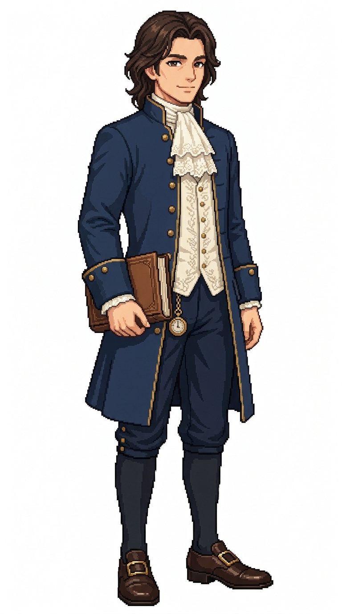

# 🖼️ 愛德華・金衡｜矜持的市民紳士

## 居民設定

42歲，有產市民階層；職務原型 `town_burgher`。

處事溫文儒雅、謹慎細緻，深諳大西洋貿易航線貨價起伏與保險貼現率。出身港鎮老牌商戶家庭，經營木材、醃魚與香料的分銷合夥行，在市政廳的商貿參議會議上佔有一席之地。他極重契約與商譽，習慣準時比約定更早五分鐘抵達商會。願望是在市中心捐建一座供船員家屬使用的公共圖書館。

**生活路線提案：**石造大宅邸 → 商行櫃台審閱大船卸貨清單 → 市政廳會客廳參與關稅協調 → 商業沙龍與進出口船東碰面 → 傍晚走過港邊林蔭步道觀察水流與進港帆影 → 返家。

**造型設定：**乾淨修剪的波浪微捲深褐髮、溫和深邃的眼眸與含蓄微笑。深海軍藍高檔羊毛雙排扣長禮服大衣（帶細緻暗金金屬鈕扣與翻領）、精紡米白絲質摺疊領巾、合身深色短馬褲與平整絲襪、擦得鋥亮的銅方扣皮鞋。腋下夾著皮面精裝商帳簿，指間自然搭在懷錶鏈上，身姿挺拔端莊。

## 創作理念

城鎮居民系列擴充之一。做為港口城市中產與菁英市民的代表，他的服飾剪裁考究卻不至像舊大陸宮廷貴族般浮誇，反映新大陸海港新興資產階級注重實效、體面與信用的獨特審美。

精緻像素畫面展現了羊毛呢大衣的深沉厚重感與絲質領巾的輕柔反光，與碼頭工人托馬斯的粗麻背心形成鮮明的社會階層層次對比。

## 完整生成提示詞

成圖觀察：雙排金扣的光澤分佈均勻，呢絨大衣衣擺垂墜感逼真，神態中透出受過良好教育的從容自信。

```text
Use case: stylized-concept. ONE original ADULT male civilian TOWN RESIDENT, finished full-body exquisite Japanese anime pixel-art character illustration. Match the reference's fine pixel density, expressive anime face, crisp stair-step contours and discrete shaded pixel clusters, fabric detail and adult proportions. White background, NO ground shadow, scenery, text or border. Portrait 4:7, full head/hair/hands/feet inside comfortable margins, three-quarter facing slightly screen RIGHT. Age-of-sail Caribbean-inspired fantasy town around 1715; practical modest civilian clothing. Edward Goldbalance, 42, 17th-century town merchant burgher gentleman. Medium-length wavy brown hair (no hat), wearing an elegant deep navy long merchant frock coat with subtle gold button trim over a cream cravat and waistcoat, dark breeches and buckled leather shoes, holding a ledger under arm, composed friendly expression.
```


