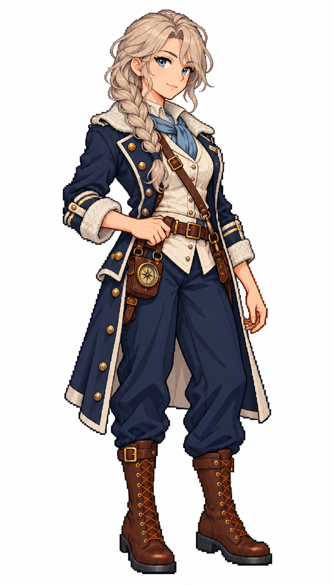

# 🖼️ 阿絲翠德・霜灣｜聽冰的極地領航員

## 人物設定

36歲。冷靜、節制、觀察敏銳，不喜歡把勇敢說成無所畏懼。成長於北方群島，擅長霧航與浮冰間的低速操船。她會在下令前聽一會兒船殼的聲音；說話冷淡，卻總把乾燥手套留給值夜的人。缺點是不容易開口求援。

冷白肌膚、灰金長髮編成粗辮垂在肩前，冰藍眼與微微挑起的眉。無帽，炭藍長外套搭窄而實用的灰白毛領、冰藍領巾與象牙白內襯，深藍褲、厚棕靴。沉著淡笑，一手輕扶腰帶，另一手垂下；腰側掛有保護套的黃銅羅盤。

## 創作方向

五位女船長系列之一，以表情、站姿、髮型與服裝輪廓呈現指揮者的個性。共同保留深藍、象牙白、棕皮革與黃銅配件，讓她與既有女水手處於同一個視覺世界；外套的剪裁與領口重音色則提供辨識。

畫風參考 [Sirius 的船醫](sirius_sailor_surgeon_sprite.md) 與 [帆匠](sirius_sailor_sailmaker_sprite.md)，人物、姓名與背景為 meadow 原創。採幻想帆船時代設計，不宣稱考據復原特定海軍制服。白底單張全身立繪，不是動畫圖集或已匯入遊戲的素材。

## 生成提示詞

使用內建 imagegen；上述兩張圖僅作畫風參考。

```text
Use case: stylized-concept. Create ONE original adult female CAPTAIN, a finished full-body Japanese refined pixel-art character illustration matching the TWO reference images' exquisite anime pixel style, pixel density, face quality, stair-step contours, discrete clustered shading and costume detail. References are STYLE ONLY; do not copy their faces or occupations. Pure white background, no shadow, no scenery, no text, no border. Portrait 4:7 composition, complete hat/hair/hands/boots with white margins, consistent adult proportions and scale as references, three-quarter view slightly toward screen right. Practical age-of-sail fantasy clothing, trousers and sturdy boots; navy, ivory, brown leather and brass unify the series. Strong captain silhouette with a long tailored officer coat, individual expression and posture. No modern objects, no real insignia, no sexualized costume, no smooth painted gradients, no pixel-noise filter. Astrid Frostbay, 36, stoic polar navigator captain. Fair cool-toned skin, ice-blue eyes, ash-blonde thick long braid over one shoulder, slightly lifted eyebrow and restrained almost-smile. No hat, no crown. Structured charcoal-navy knee-length maritime captain coat with narrow practical grey-white shearling collar and cuffs, ice-blue scarf tucked close, ivory inner waistcoat, navy trousers and thick dark-brown leather boots. One hand lightly rests on belt, other relaxed, compact brass compass in protective leather case secured at hip. Slim confident grounded stance, crisp angular silhouette, subtle cold-weather layering without oversized fur.
```



