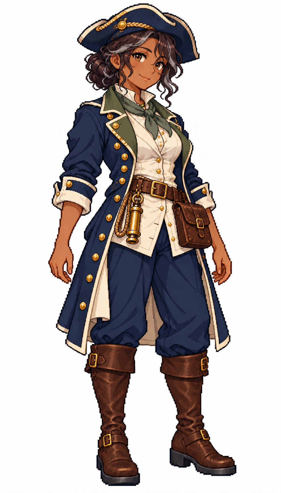

# 🖼️ 伊妮絲・莫羅｜守燈的護航船長

## 人物設定

44歲。溫厚、務實、護短，能記住船上每個人的家鄉。當過運糧船水手長，也帶過難民船；擅長補給與長航程，遇到爭執會先端一杯熱茶。她不急著讓人信任自己，卻不肯輕易放棄落隊的人；缺點是有時因此錯過最省力的航線。

深褐色皮膚、深棕捲髮盤在後腦，幾根銀髮、溫暖榛色眼與眼角笑紋。深藍寬簷船長帽、苔綠領巾、厚實深藍長外套、象牙白背心、磨亮的黃銅扣與深棕靴。帶著踏實的微笑，雙臂放鬆；腰側掛黃銅船長哨與舊皮革日誌袋。

## 創作方向

五位女船長系列之一，以表情、站姿、髮型與服裝輪廓呈現指揮者的個性。共同保留深藍、象牙白、棕皮革與黃銅配件，讓她與既有女水手處於同一個視覺世界；外套的剪裁與領口重音色則提供辨識。

畫風參考 [Sirius 的船醫](sirius_sailor_surgeon_sprite.md) 與 [帆匠](sirius_sailor_sailmaker_sprite.md)，人物、姓名與背景為 meadow 原創。採幻想帆船時代設計，不宣稱考據復原特定海軍制服。白底單張全身立繪，不是動畫圖集或已匯入遊戲的素材。

## 生成提示詞

成圖觀察：生成結果多了細圓眼鏡，帽型偏寬展三角帽；表情是收斂的淡笑，身形也較原設想纖細。銀髮與苔綠領口保留，年齡是人物設定，並非畫面能準確判讀的事實。腰側黃銅物件偏短筒造型，未清楚呈現預設的船長哨。

使用內建 imagegen；上述兩張圖僅作畫風參考。

```text
Use case: stylized-concept. Create ONE original adult female CAPTAIN, a finished full-body Japanese refined pixel-art character illustration matching the TWO reference images' exquisite anime pixel style, pixel density, face quality, stair-step contours, discrete clustered shading and costume detail. References are STYLE ONLY; do not copy their faces or occupations. Pure white background, no shadow, no scenery, no text, no border. Portrait 4:7 composition, complete hat/hair/hands/boots with white margins, consistent adult proportions and scale as references, three-quarter view slightly toward screen right. Practical age-of-sail fantasy clothing, trousers and sturdy boots; navy, ivory, brown leather and brass unify the series. Strong captain silhouette with a long tailored officer coat, individual expression and posture. No modern objects, no real insignia, no sexualized costume, no smooth painted gradients, no pixel-noise filter. Ines Moreau, 44, warm seasoned convoy captain. Deep brown skin, warm hazel-brown eyes, visible gentle smile lines, dark curly hair in a substantial low updo with a few silver strands. Broad reassuring smile, solid adult build and grounded stance. Navy broad-brim captain hat with modest brass braid, sturdy knee-length navy coat with moss-green collar and ivory cuffs, ivory waistcoat over closed blouse, moss-green neck scarf, navy trousers, worn polished dark-brown boots. Both hands empty relaxed at sides. Brass boatswain-style command whistle and closed worn leather logbook pouch secured at waist. Maternal warmth plus unmistakable command authority, no mug.
```



