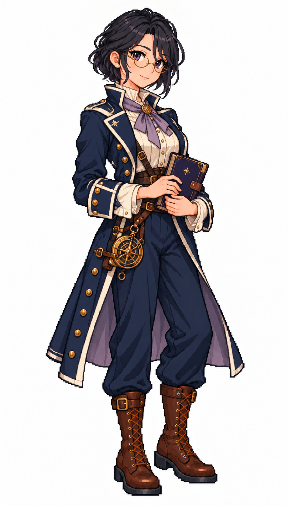

# 🖼️ 汐織・月瀨｜讀星的學者船長

## 人物設定

33歲。寡言、好奇、帶著乾乾的幽默。曾任測量船航海長，會先聽完水手的觀察才下判斷；擅長星象、洋流與測繪。她把航海日誌寫得像可重做的實驗，缺點是有時會為了最後一次觀測忘記吃飯。

墨黑齊下巴短髮、耳側一束微長，靛紫眼與細圓黃銅眼鏡。無帽，深藍立領長外套、淡紫領結、象牙白高領衫、細緻銀色星紋內襯。雙手在腰前捧一本闔起的靛藍航海日誌，腰側掛小型黃銅星盤。

## 創作方向

五位女船長系列之一，以表情、站姿、髮型與服裝輪廓呈現指揮者的個性。共同保留深藍、象牙白、棕皮革與黃銅配件，讓她與既有女水手處於同一個視覺世界；外套的剪裁與領口重音色則提供辨識。

畫風參考 [Sirius 的船醫](sirius_sailor_surgeon_sprite.md) 與 [帆匠](sirius_sailor_sailmaker_sprite.md)，人物、姓名與背景為 meadow 原創。採幻想帆船時代設計，不宣稱考據復原特定海軍制服。白底單張全身立繪，不是動畫圖集或已匯入遊戲的素材。

## 生成提示詞

使用內建 imagegen；上述兩張圖僅作畫風參考。

```text
Use case: stylized-concept. Create ONE original adult female CAPTAIN, a finished full-body Japanese refined pixel-art character illustration matching the TWO reference images' exquisite anime pixel style, pixel density, face quality, stair-step contours, discrete clustered shading and costume detail. References are STYLE ONLY; do not copy their faces or occupations. Pure white background, no shadow, no scenery, no text, no border. Portrait 4:7 composition, complete hat/hair/hands/boots with white margins, consistent adult proportions and scale as references, three-quarter view slightly toward screen right. Practical age-of-sail fantasy clothing, trousers and sturdy boots; navy, ivory, brown leather and brass unify the series. Strong captain silhouette with a long tailored officer coat, individual expression and posture. No modern objects, no real insignia, no sexualized costume, no smooth painted gradients, no pixel-noise filter. Shiori Tsukise, 33, reserved scholarly survey captain. Precise chin-length ink-black bob with one slightly longer side lock, indigo-violet eyes, delicate round brass spectacles. No hat. Thoughtful observant gaze with tiny knowing smile. Long navy stand-collar officer coat with subtle silver piping and pale lavender lining visible only at lapels, ivory high-neck blouse, lavender neck ribbon, navy tailored trousers, brown calf boots. Both hands naturally hold ONE closed indigo logbook at waist, a small brass astrolabe secured flat at belt. Quiet intellectual authority, tidy silhouette, star motif very subtle.
```



