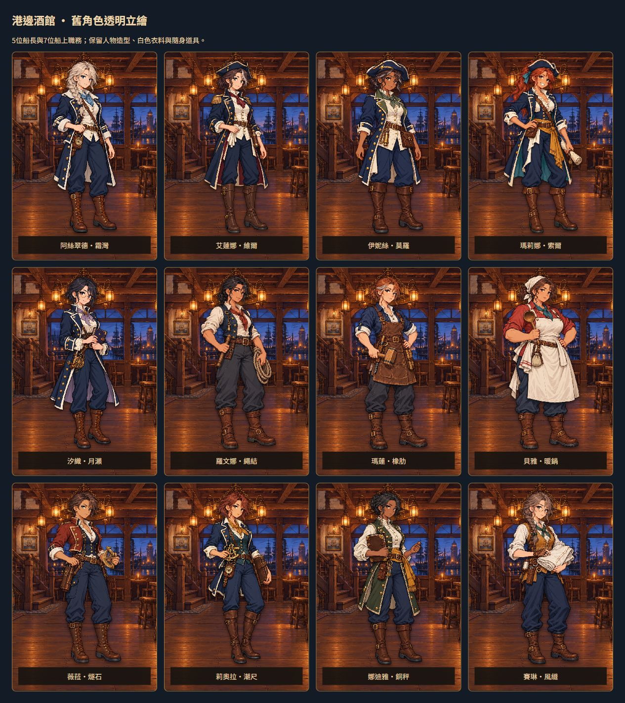

# 港邊酒館｜十二位舊角色透明立繪

這批整理讓已完成的角色離開白色畫紙，接上港邊酒館的暖色木地板與窗外暮色。五位船長，以及水手長、船匠、廚師、砲術長、航海士、軍需官與帆匠，皆延續原本的造型、站姿、服裝與隨身道具。

背景使用內建 image_gen 逐張移除，產出真正具有 alpha 的透明 PNG。白襯衫、毛領、圍裙、手套、書頁與帆布仍屬於人物；髮絲、手臂、雙腿與繩圈間的背景空隙則讓酒館透出。

原始白底稿與十二份人物設定卡均保留。透明版另存為 `RawImages/meadow_cutout1193_<id>.png`，不覆寫原始藝廊稿。遊戲仍沿用原本的角色 ID 與圖片檔名，來源紀錄另加 `source.cutout`。

[完整實際提示詞、編輯目標與前後雜湊](../RawImages/meadow_cutout1193_generation.json)。每張原圖皆先檢視，再作為該張去背的唯一編輯目標；本批沒有另加風格參考圖。

驗收使用正式酒館介面與隔離資料逐位切換，十二張均正常載入；另檢查阿絲翠德、貝雅與賽琳在酒館中的輪廓與淺色衣料，以及390px手機下的全身顯示。

