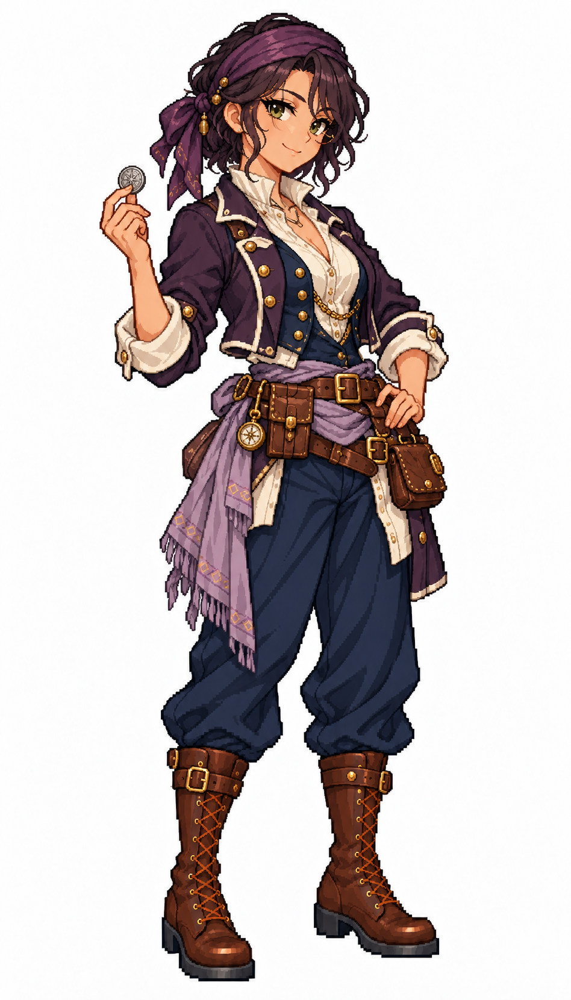

# 🖼️ 米蕾・銀骰｜狡黠的談判高手

## 人物設定

32歲。機靈、愛逗人，能從一場看似輸掉的牌局裡換到泊位。出身港口掮客，擅長談判與辨識謊言；真正需要信守承諾時卻比誰都認真。她的缺點是喜歡先試探別人的底線，偶爾會把真心話也說得像玩笑。

橄欖膚色、深紫黑波浪短髮、綠眼與單邊挑眉的笑，無眼鏡。斜戴深紫頭巾、梅紫短外套、象牙白高領襯衫、深藍背心、灰紫腰巾。腰側有小皮錢袋與封閉卡盒，手中輕握一枚銀幣。

## 創作理念

五位女海盜系列之一。以不同的待人方式、專長與弱點建立個性，再用表情、髮型、外套輪廓與腰巾顏色讓差異可見。保留象牙白、深藍與棕皮革的船員世界，海盜服裝則有更多不對稱裁片與個人的修補痕跡。

畫風參考 [Sirius 船醫](sirius_sailor_surgeon_sprite.md) 與 [帆匠](sirius_sailor_sailmaker_sprite.md)，只取畫風、比例與材質表現。姓名、背景與人物設計由 meadow 原創；為幻想帆船世界設計，不宣稱復原真實人物或特定時代制服。白底全身單張，並非透明動畫圖集或已匯入遊戲的素材。

## 完整生成提示詞

成圖觀察：生成結果仍帶了細圓眼鏡，與原設計的無眼鏡不同；銀幣舉至肩旁，而非停在腰間。保留這一版更外顯的逗趣姿勢，並記錄設計與成圖差異。

內建 imagegen，兩張既有女水手僅作畫風參考。

```text
Use case: stylized-concept. ONE original ADULT female pirate, full-body finished exquisite Japanese anime pixel-art game illustration. Match the TWO style references' crisp stair-step contours, high-detail square-pixel clusters, discrete shaded fabric and expressive anime face. References STYLE ONLY; independent face and costume. Pure WHITE background, NO shadow, scenery, text or frame. Portrait aspect 4:7, whole head/hat/hands/boots comfortably inside frame, three-quarter toward screen RIGHT, grounded relaxed stance. Practical age-of-sail fantasy pirate outfit with trousers, sturdy boots, brown leather and beautifully tailored layered fabrics. Clear pirate identity through asymmetric coat, sash, headwear and small secured nautical gear. No modern gear, no real emblems, no gore, no sexualized costume, no smooth painted rendering, no artificial pixel noise. Mirelle Silverdice, 32, sly charming pirate negotiator. Olive skin, dark plum-black short wavy bob, sharp green eyes, one raised eyebrow, mischievous closed-mouth smirk. NO glasses, NO hat. Deep violet headscarf angled across forehead, cropped plum-purple pirate jacket with ivory cuffs, ivory high-neck blouse and navy waistcoat, muted lilac sash, navy trousers, brown knee boots. One hand casually holds ONE silver coin between fingers at waist, other rests on belt. Small closed leather card case and coin pouch secured at belt. Elegant playful asymmetry, practical fully clothed.
```



