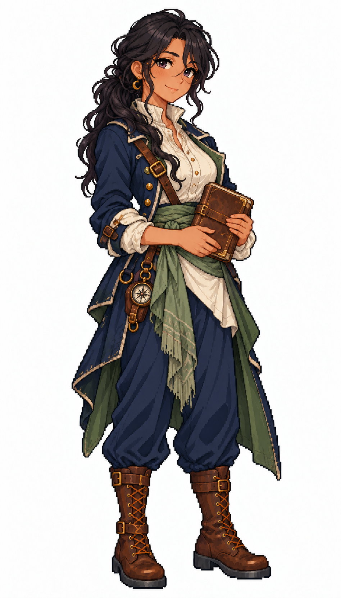

# 🖼️ 諾艾爾・夜潮｜溫柔的逃亡領航者

## 人物設定

39歲。溫柔、沉著，有不容退讓的底線。曾駕船協助受壓迫的人逃離港口，從此被懸賞；她接受海盜之名，卻不接受拿弱者換贖金。擅長夜航與照料受驚的乘客，缺點是很難放下任何求援訊號。

中等棕膚色、墨黑長髮鬆鬆束成低馬尾、煙紫眼與溫和淡笑。無帽，深靛藍不對稱長外套、墨綠內襯、象牙白高領衫、灰綠腰巾與深藍長褲。小月形黃銅耳墜，雙手在腰前捧闔起的舊航海日誌。

## 創作理念

五位女海盜系列之一。以不同的待人方式、專長與弱點建立個性，再用表情、髮型、外套輪廓與腰巾顏色讓差異可見。保留象牙白、深藍與棕皮革的船員世界，海盜服裝則有更多不對稱裁片與個人的修補痕跡。

畫風參考 [Sirius 船醫](sirius_sailor_surgeon_sprite.md) 與 [帆匠](sirius_sailor_sailmaker_sprite.md)，只取畫風、比例與材質表現。姓名、背景與人物設計由 meadow 原創；為幻想帆船世界設計，不宣稱復原真實人物或特定時代制服。白底全身單張，並非透明動畫圖集或已匯入遊戲的素材。

## 完整生成提示詞

成圖觀察：生成結果多了細圓眼鏡，耳墜偏圓環而非明確月牙；長髮也比原設計的低馬尾更蓬鬆。闔起的航海日誌、灰綠腰巾與綠色外套內襯可見。

內建 imagegen，兩張既有女水手僅作畫風參考。

```text
Use case: stylized-concept. ONE original ADULT female pirate, full-body finished exquisite Japanese anime pixel-art game illustration. Match the TWO style references' crisp stair-step contours, high-detail square-pixel clusters, discrete shaded fabric and expressive anime face. References STYLE ONLY; independent face and costume. Pure WHITE background, NO shadow, scenery, text or frame. Portrait aspect 4:7, whole head/hat/hands/boots comfortably inside frame, three-quarter toward screen RIGHT, grounded relaxed stance. Practical age-of-sail fantasy pirate outfit with trousers, sturdy boots, brown leather and beautifully tailored layered fabrics. Clear pirate identity through asymmetric coat, sash, headwear and small secured nautical gear. No modern gear, no real emblems, no gore, no sexualized costume, no smooth painted rendering, no artificial pixel noise. Noelle Nighttide, 39, gentle principled fugitive pirate navigator. Medium-brown skin, long ink-black hair in loose low ponytail, smoky violet eyes, mature softly reassuring expression and subtle smile lines. NO hat, NO glasses. Asymmetric long deep-indigo pirate coat with muted forest-green lining, ivory high-neck blouse, sage-green waist sash, navy trousers and worn brown calf boots. Tiny brass crescent earring in ONE ear. Both hands naturally hold ONE closed weathered leather navigation log at waist. Small compass case at hip, no weapons. Graceful calm grounded stance, distinct from navy officer, no military epaulettes.
```



