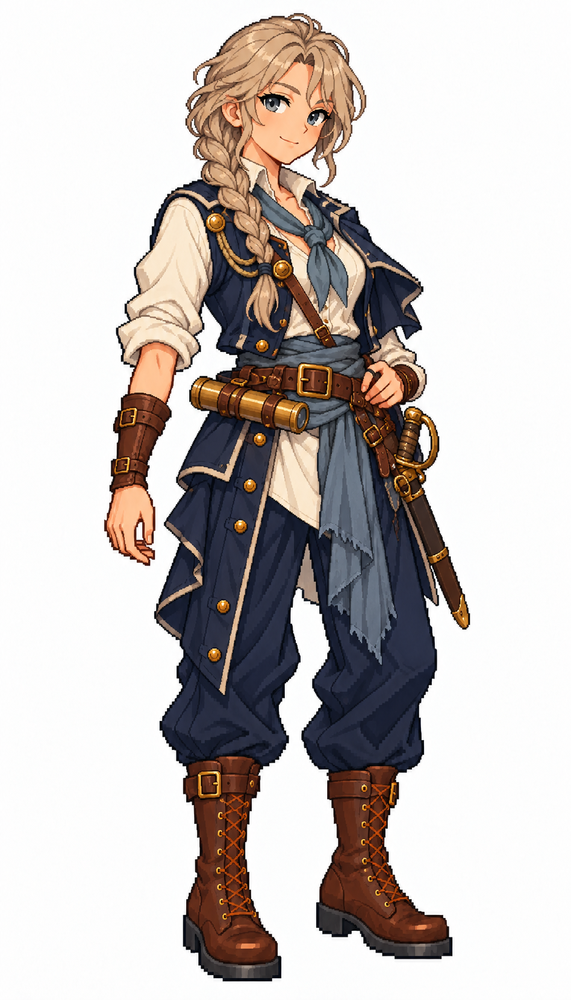

# 🖼️ 露娜・礁牙｜沉默的礁岸獵手

## 人物設定

35歲。冷靜、寡言，記得住每一條暗礁間的水道。曾在北方漁港帶船，失去家船後加入海盜隊，專長是霧航、伏擊與撤退。她看似不近人情，實際上從不把新手留在最後；缺點是遇到危險時總想獨自殿後。

冷白皮膚、灰金單辮、鋼藍眼，左眉外側一小道已癒合疤痕。無帽，炭藍短肩披搭深藍長背心、灰青領巾、象牙白衫、皮革護腕與深褐靴。站姿穩定，淡淡半笑，腰側收妥短望遠鏡。

## 創作理念

五位女海盜系列之一。以不同的待人方式、專長與弱點建立個性，再用表情、髮型、外套輪廓與腰巾顏色讓差異可見。保留象牙白、深藍與棕皮革的船員世界，海盜服裝則有更多不對稱裁片與個人的修補痕跡。

畫風參考 [Sirius 船醫](sirius_sailor_surgeon_sprite.md) 與 [帆匠](sirius_sailor_sailmaker_sprite.md)，只取畫風、比例與材質表現。姓名、背景與人物設計由 meadow 原創；為幻想帆船世界設計，不宣稱復原真實人物或特定時代制服。白底全身單張，並非透明動畫圖集或已匯入遊戲的素材。

## 完整生成提示詞

成圖觀察：左眉外側的疤痕不明顯，長背心呈現有衣尾的款式；單辮、短肩披、護腕與橫掛望遠鏡均可辨識。年齡與背景屬設定，不由畫面直接證明。

內建 imagegen，兩張既有女水手僅作畫風參考。

```text
Use case: stylized-concept. ONE original ADULT female pirate, full-body finished exquisite Japanese anime pixel-art game illustration. Match the TWO style references' crisp stair-step contours, high-detail square-pixel clusters, discrete shaded fabric and expressive anime face. References STYLE ONLY; independent face and costume. Pure WHITE background, NO shadow, scenery, text or frame. Portrait aspect 4:7, whole head/hat/hands/boots comfortably inside frame, three-quarter toward screen RIGHT, grounded relaxed stance. Practical age-of-sail fantasy pirate outfit with trousers, sturdy boots, brown leather and beautifully tailored layered fabrics. Clear pirate identity through asymmetric coat, sash, headwear and small secured nautical gear. No modern gear, no real emblems, no gore, no sexualized costume, no smooth painted rendering, no artificial pixel noise. Runa Reefang, 35, taciturn northern reef ambusher. Fair cool skin, ash-blonde SINGLE long braid, steel-blue eyes, small healed scar at OUTER LEFT eyebrow, steady restrained half-smile. NO hat, NO eyepatch, NO glasses. Short asymmetric charcoal-navy shoulder cape, long dark navy sleeveless waistcoat over ivory shirt, muted blue-grey neck scarf, brown leather bracers, navy trousers and thick dark-brown boots. Both hands relaxed, one lightly touches belt. Collapsed brass telescope secured horizontally at belt, closed sheathed short cutlass at opposite hip. Strong quiet angular silhouette, no fur.
```



