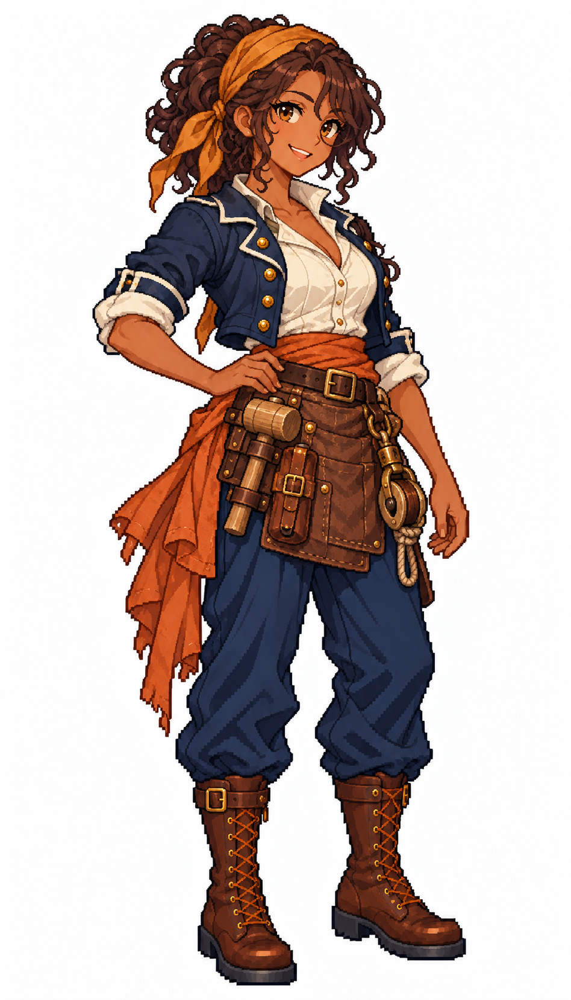

# 🖼️ 泰莎・銅火｜熱情的船上巧匠

## 人物設定

30歲。熱情、直率，喜歡把壞掉的東西修得比原來更順手。曾替船廠工作，現在負責海盜船上的滑輪、火炮保養與臨時修補。她會把每一次失敗留下當作教具；缺點是聽見新機關就忘了看時間，常被同伴拖去吃飯。

深褐皮膚、深棕蓬鬆捲髮以赭黃頭巾束起、琥珀眼與開朗微笑。深藍短工作外套、象牙白捲袖衫、銅橙腰巾、短皮革工具圍裙與深藍褲；結實手臂、棕色厚底靴。

## 創作理念

五位女海盜系列之一。以不同的待人方式、專長與弱點建立個性，再用表情、髮型、外套輪廓與腰巾顏色讓差異可見。保留象牙白、深藍與棕皮革的船員世界，海盜服裝則有更多不對稱裁片與個人的修補痕跡。

畫風參考 [Sirius 船醫](sirius_sailor_surgeon_sprite.md) 與 [帆匠](sirius_sailor_sailmaker_sprite.md)，只取畫風、比例與材質表現。姓名、背景與人物設計由 meadow 原創；為幻想帆船世界設計，不宣稱復原真實人物或特定時代制服。白底全身單張，並非透明動畫圖集或已匯入遊戲的素材。

## 完整生成提示詞

成圖觀察：生成結果多了細圓眼鏡。木槌、滑輪與工具皮套均收在腰側，短皮圍裙與銅橙腰巾保留。

內建 imagegen，兩張既有女水手僅作畫風參考。

```text
Use case: stylized-concept. ONE original ADULT female pirate, full-body finished exquisite Japanese anime pixel-art game illustration. Match the TWO style references' crisp stair-step contours, high-detail square-pixel clusters, discrete shaded fabric and expressive anime face. References STYLE ONLY; independent face and costume. Pure WHITE background, NO shadow, scenery, text or frame. Portrait aspect 4:7, whole head/hat/hands/boots comfortably inside frame, three-quarter toward screen RIGHT, grounded relaxed stance. Practical age-of-sail fantasy pirate outfit with trousers, sturdy boots, brown leather and beautifully tailored layered fabrics. Clear pirate identity through asymmetric coat, sash, headwear and small secured nautical gear. No modern gear, no real emblems, no gore, no sexualized costume, no smooth painted rendering, no artificial pixel noise. Tessa Copperfire, 30, enthusiastic pirate ship tinkerer. Deep brown skin, voluminous dark-brown curly hair tied back with ochre bandana, amber eyes, cheerful open smile, strong sturdy adult build. Cropped weathered navy pirate work jacket over ivory roll-sleeve shirt, copper-orange sash, short brown leather tool apron over navy trousers, sturdy brown boots. One hand rests on belt, other relaxed. Small wooden mallet, closed leather tool roll and brass pulley block securely attached at belt. No modern wrench, no goggles, no glasses, no weapons, no sparks. Practical asymmetrical pirate outfit, capable warm energy.
```



