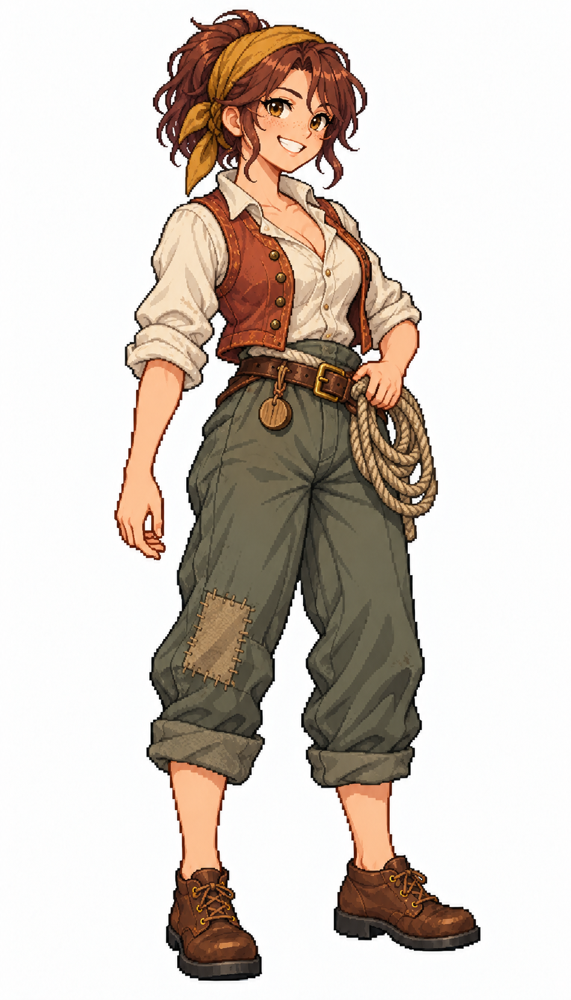

# 🖼️ 艾莉絲・繫繩｜爽朗的碼頭搬運工

## 居民設定

26歲，受薪勞動階層；職務原型 `dockhand`。

直率、爽朗，擅長協調同伴一起抬重貨。收入按班次結算，與朋友合租港邊住宅；她會先替新人挑不易滑手的繩，卻也因為不肯承認疲累而逞強。希望存下足夠的錢，把母親接到城裡住。

**生活路線提案：**住宅 → 井邊取水 → 碼頭領班點名處 → 倉庫交接貨物 → 市場買晚餐 → 回家。下雨時停露天裝卸，缺貨時候工；搬運量由崗位與貨物帳決定，動畫只是呈現。

**造型設定：**淺膚色與雀斑、栗紅短馬尾、金棕眼。赭黃頭巾、捲袖本白亞麻衫、褪色赤陶短背心、灰綠寬褲、補過膝的布片、棕色繫帶工作鞋。結實手臂，一手輕扶腰間短繩圈，另一手放鬆；不戴眼鏡。

## 創作理念

五位女居民系列之一。階層由衣料狀態、剪裁、配件與生活條件呈現；性格與個人的經歷則各自成立。五人都可以有勇氣、缺點與自己的願望，不把收入高低畫成人格等級，也不將膚色或出身當作階層標記。

畫風參考 [Sirius 的船醫女水手](sirius_sailor_surgeon_sprite.md)，只借像素層次、比例與材質表現，改為城鎮平民服裝。此為 1715 年前後加勒比海風格的幻想角色設計，不宣稱復原特定國家的歷史服制。白底全身單張，尚非遊戲動畫圖集或已實作的居民系統。

## 完整生成提示詞

成圖觀察：長褲褲腳捲至小腿，繩圈比預設的小繩圈更醒目；木製點工牌可見。人物年齡與性格是設定，不是由畫面測得。

內建 imagegen；船醫原圖僅作畫風參考。

```text
Use case: stylized-concept. ONE original ADULT female civilian TOWN RESIDENT, finished full-body exquisite Japanese anime pixel-art character illustration. Match the reference's fine pixel density, expressive anime face, crisp stair-step contours and discrete shaded pixel clusters, fabric detail and adult proportions. Reference is STYLE ONLY: do NOT copy her face, navy medical uniform, glasses or satchel. White background, NO ground shadow, scenery, text or border. Portrait 4:7, full head/hair/hands/feet inside comfortable margins, three-quarter facing slightly screen RIGHT. Age-of-sail Caribbean-inspired fantasy town around 1715; practical modest civilian clothing, period-inspired not exact historical reconstruction. Make social circumstances readable through cut, fabric condition, tools and posture, never through a uniform navy costume. No sailor collar, no captain hat, no modern items, no smooth painting, no pixel-noise overlay. Alice Moorline, 26, outgoing wage-earning dockworker. Fair freckled skin, short chestnut-red ponytail, golden-brown eyes, broad cheerful toothy smile, strong practical adult build. Ochre cloth bandana, undyed ivory rolled-sleeve linen shirt, faded terracotta cropped work vest, loose grey-green trousers with one neatly patched knee, sturdy low brown lace-up work shoes. One hand rests lightly on a SMALL coiled rope secured at belt, other empty relaxed. Plain wooden tally token on belt. Fabrics worn clean and repaired, no ragged misery. NO glasses, NO hat, NO weapons. Grounded confident posture.
```



