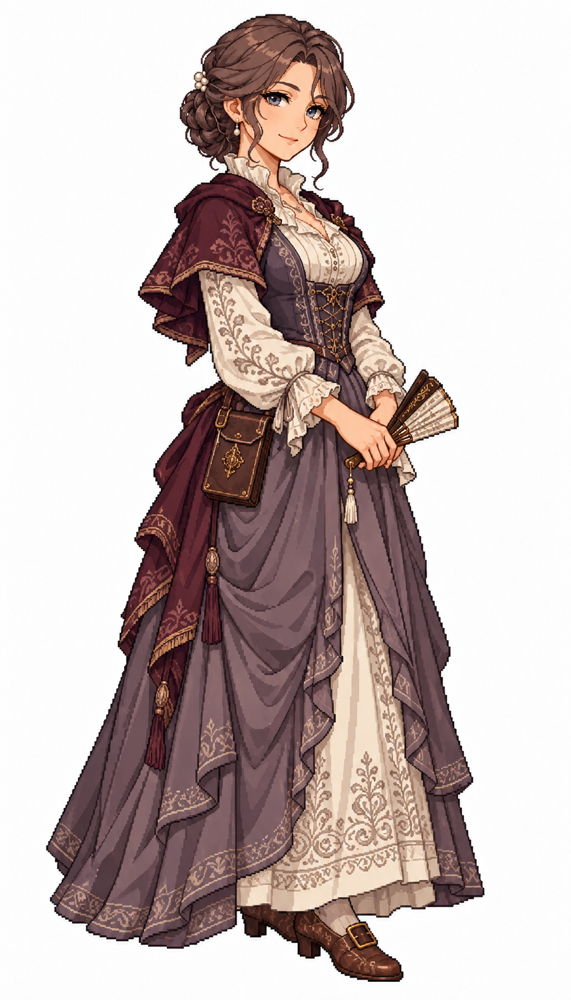

# 🖼️ 瑟蕾絲特・白榆｜克制的名門議事者

## 居民設定

42歲，地方名門與行政菁英；職務原型 `civic_patron`。

克制、謹慎、很會聽人說話。來自擁有土地與地方議席的家庭，資助識字課與公共水井；面對熟人時有乾淡的幽默。她希望自己的提案能留下可靠的公共設施，缺點是太習慣透過程序與代理人辦事，必須學會直接聽見居民的不滿。

**生活路線提案：**名門住宅 → 市政廳議事／收請願 → 公共水井或學堂視察 → 書店／廣場 → 住宅。職務不是每位上層居民都必有；她只是名門階層的一個人物範例，不能拿她的慈善代表整個階層。

**造型設定：**偏暖淺膚色、灰褐髮收成低盤髻、煙藍眼、成熟眉眼與克制微笑。低調珍珠髮針、灰梅紫正式長裙、象牙白繡邊長袖上身、深酒紅短肩披、棕色低跟扣鞋。雙手在腰前握一只闔起的摺扇，小皮革文書袋；無眼鏡、無王冠。

## 創作理念

五位女居民系列之一。階層由衣料狀態、剪裁、配件與生活條件呈現；性格與個人的經歷則各自成立。五人都可以有勇氣、缺點與自己的願望，不把收入高低畫成人格等級，也不將膚色或出身當作階層標記。

畫風參考 [Sirius 的船醫女水手](sirius_sailor_surgeon_sprite.md)，只借像素層次、比例與材質表現，改為城鎮平民服裝。此為 1715 年前後加勒比海風格的幻想角色設計，不宣稱復原特定國家的歷史服制。白底全身單張，尚非遊戲動畫圖集或已實作的居民系統。

## 完整生成提示詞

成圖觀察：摺扇呈半開，並非提示詞要求的闔起；長裙遮住後方鞋的大部分，前方扣鞋完整可見，沒有把腳裁出畫面。珍珠髮飾、短肩披、皮革文書袋與繡邊保留。

內建 imagegen；船醫原圖僅作畫風參考。

```text
Use case: stylized-concept. ONE original ADULT female civilian TOWN RESIDENT, finished full-body exquisite Japanese anime pixel-art character illustration. Match the reference's fine pixel density, expressive anime face, crisp stair-step contours and discrete shaded pixel clusters, fabric detail and adult proportions. Reference is STYLE ONLY: do NOT copy her face, navy medical uniform, glasses or satchel. White background, NO ground shadow, scenery, text or border. Portrait 4:7, full head/hair/hands/feet inside comfortable margins, three-quarter facing slightly screen RIGHT. Age-of-sail Caribbean-inspired fantasy town around 1715; practical modest civilian clothing, period-inspired not exact historical reconstruction. Make social circumstances readable through cut, fabric condition, tools and posture, never through a uniform navy costume. No sailor collar, no captain hat, no modern items, no smooth painting, no pixel-noise overlay. Celeste Whiteelm, 42, restrained local patrician and civic patron. Warm fair skin, ash-brown hair in elegant low braided chignon, smoky blue eyes, mature face with subtle smile lines, thoughtful reserved closed-mouth smile. NO glasses, NO crown, NO hat. Small discreet pearl hairpin. Modest sophisticated muted PLUM-GREY full-length civilian gown with ivory embroidered long-sleeve bodice, dark burgundy short shoulder mantle, refined brown low-heel buckle shoes visible under hem. Both hands hold ONE closed folding fan low at waist; small flat leather document pouch at hip. Excellent fabric and delicate embroidery, dignified upright posture, not royalty, no huge court panniers, no modern accessories.
```



