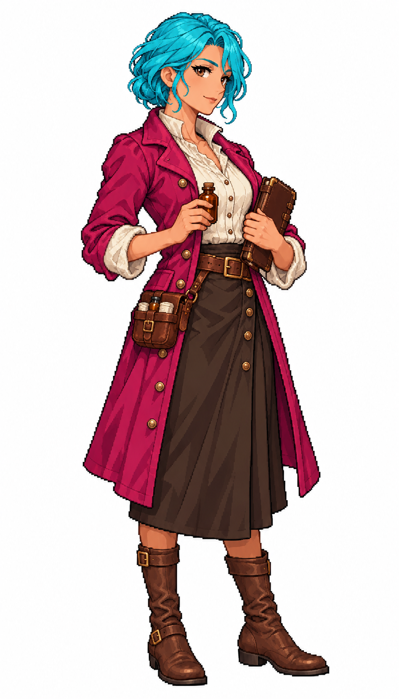

# 女醫師・薇若妮卡

薇若妮卡設定為47歲、身高1.70公尺的女性居民，id `doctor_f_01`、職業 `doctor`，工作用途 `hospital`。用診療筆記、藥瓶與腰間皮包辨識醫師，對應醫院。Tim要求學校、醫院需要自己的工作者美術，這批讓教學、診療與照護各有可辨認的道具。角色是遊戲創作，不據此宣稱歷史醫療或教育制度。

內建image_gen逐位獨立生成，實際附上 `meadow_captain_astrid_sprite_v1.png`，只借細緻日系像素與深輪廓，沒有套用船長身分。全身四分之三朝右、頭髮收在上方、道具靠腰身，完整保留腳尖。青髮與洋紅主衣料用來建立髮衣遮罩，皮膚、白麻布、書本、玻璃和皮革保留自然色；遊戲另換自然髮色與衣色。

館藏保留白底原始生成稿；遊戲原圖另經封閉白底檢查與圖集轉換。完整實際prompt、參考及原稿SHA見[生成記錄](../RawImages/meadow_resident_schoolmed1066_generation.json)，遊戲派生與驗證另在Blocksail `docs/evidence/schoolmed1066/`。學校、醫療服務及產能仍由TASK-1064整合，人物素材本身不增加人口。

## 完整實際提示詞

```text
Use case: stylized-concept. ONE full-body adult female civilian professional, age-of-sail Caribbean-inspired town. Attached Astrid reference ONLY for refined Japanese anime pixel-art rendering, clear dark stair-step outlines and discrete shaded clusters. Do not copy her face, captain uniform, braid or military accessories. Tall portrait on pure white. Compact three-quarter standing facing SCREEN RIGHT, nose points right. Complete head, fingers and feet, generous margins. Narrow silhouette fits96x192 cell with164px figure height; props close to waist/torso, none beside feet, no outstretched elbows. ALL hair and eyebrows CYAN #00BCD4 with cyan-only shading, compact hairstyle entirely inside top30% of figure. MAIN coloured clothing MAGENTA #C2185B with magenta-only shading. Natural skin, brown eyes, neutral lips, ivory linen, brown leather/wood, neutral props; no cyan/magenta spill on these materials. White background, no ground shadow, scene, lettering, labels or border. Historically inspired fictional character, not chibi or modern uniform. A confident experienced woman physician47, olive skin, subtle mature face lines, compact cyan bob above collar. Plain magenta knee-length professional coat over ivory linen shirt, dark brown narrow skirt and brown flat boots. One hand holds a small corked amber glass medicine bottle at waist; other arm cradles a compact closed leather-bound medical notebook. A small brown leather diagnostic pouch rests attached at her hip, above knees. No modern white laboratory coat, no stethoscope, syringe, red cross, plague mask or modern medical symbols.
```


