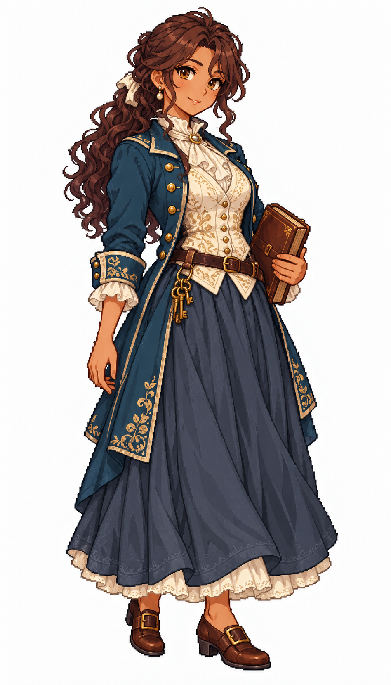

# 🖼️ 蕾歐妮・遠帆｜好奇的富裕商人

## 居民設定

34歲，富裕商業階層；職務原型 `merchant_owner`。

好奇、熱情，願意走進倉庫問搬運工貨箱為何總在同一角破損。持有小型商行與部分商船貨股，生活寬裕；她相信新航線能改善城鎮，缺點是有時會把自己的樂觀當成人人都承受得起的風險。想開一間讓小攤販也租得起的共享倉庫。

**生活路線提案：**商人住宅 → 商行帳房 → 倉庫驗貨 → 港口見船長 → 市場洽談 → 住宅。風暴封港時改在帳房處理訂單；實際交易走既有庫存與訂單帳，不由居民走到哪裡另扣一次。

**造型設定：**中等曬棕膚色、深栗色長捲髮半束、琥珀眼與明亮微笑。石油藍合身及膝外套、香檳米色刺繡背心、白色領口、深藍灰長裙與棕色扣帶鞋；細緻但不滿身金飾。單手扶闔起的皮革帳本，另一手放鬆，小鑰匙串在腰側。

## 創作理念

五位女居民系列之一。階層由衣料狀態、剪裁、配件與生活條件呈現；性格與個人的經歷則各自成立。五人都可以有勇氣、缺點與自己的願望，不把收入高低畫成人格等級，也不將膚色或出身當作階層標記。

畫風參考 [Sirius 的船醫女水手](sirius_sailor_surgeon_sprite.md)，只借像素層次、比例與材質表現，改為城鎮平民服裝。此為 1715 年前後加勒比海風格的幻想角色設計，不宣稱復原特定國家的歷史服制。白底全身單張，尚非遊戲動畫圖集或已實作的居民系統。

## 完整生成提示詞

成圖觀察：金線刺繡與珍珠耳墜比原本的節制設想更華麗，外套衣尾也較長；帳本與鑰匙保留。高低收入的差別不作服飾史考據。

內建 imagegen；船醫原圖僅作畫風參考。

```text
Use case: stylized-concept. ONE original ADULT female civilian TOWN RESIDENT, finished full-body exquisite Japanese anime pixel-art character illustration. Match the reference's fine pixel density, expressive anime face, crisp stair-step contours and discrete shaded pixel clusters, fabric detail and adult proportions. Reference is STYLE ONLY: do NOT copy her face, navy medical uniform, glasses or satchel. White background, NO ground shadow, scenery, text or border. Portrait 4:7, full head/hair/hands/feet inside comfortable margins, three-quarter facing slightly screen RIGHT. Age-of-sail Caribbean-inspired fantasy town around 1715; practical modest civilian clothing, period-inspired not exact historical reconstruction. Make social circumstances readable through cut, fabric condition, tools and posture, never through a uniform navy costume. No sailor collar, no captain hat, no modern items, no smooth painting, no pixel-noise overlay. Leonie Farsail, 34, curious optimistic affluent merchant woman. Medium sun-brown skin, long dark-chestnut curls half tied back, amber eyes, bright intelligent welcoming smile. NO glasses, NO hat. Well-tailored PETROL BLUE knee-length civilian coat with restrained brass buttons, champagne-ivory embroidered waistcoat over white high-neck blouse, deep blue-grey full ankle-length skirt, polished brown buckle shoes. One hand supports ONE closed brown leather account ledger at waist, other relaxed. Small warehouse key ring secured at belt. Fine linen, subtle silk trim, prosperous but practical, no military epaulettes, no weapons.
```



