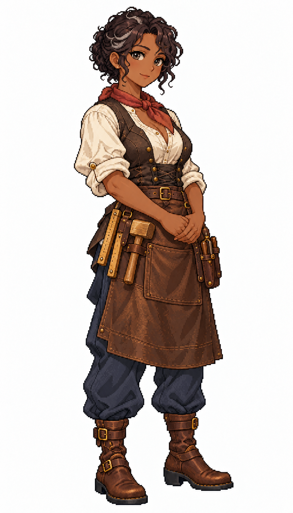

# 🖼️ 莎賓・銅尺｜寡言的工坊師傅

## 居民設定

38歲，熟練工匠階層；職務原型 `master_craftswoman`。

寡言、精確，會讓學徒先說出自己量到的尺寸，再一起找誤差。靠修理滑輪與木作取得穩定收入，經營有一位學徒的小工坊；她願意替鄰居修壞椅子，卻很不擅長替自己的工時開價。希望整理一本每個學徒都看得懂的工具手冊。

**生活路線提案：**工坊附屬住宅 → 材料庫核料 → 工作台加工／維修 → 市場補工具 → 工坊教學 → 住宅。缺材料時整理工具或教學；技能與疲勞影響工作效率，社會階層本身不提供效率倍率。

**造型設定：**深褐皮膚、黑色短捲髮夾銀絲、灰棕眼與沉著淡笑。鐵鏽紅領巾、米白捲袖襯衫、炭褐工作背心、深棕及膝皮圍裙、靛灰工作褲與結實棕靴。木製折尺、木槌與封閉工具套收在腰側，雙手自然交握；無眼鏡。

## 創作理念

五位女居民系列之一。階層由衣料狀態、剪裁、配件與生活條件呈現；性格與個人的經歷則各自成立。五人都可以有勇氣、缺點與自己的願望，不把收入高低畫成人格等級，也不將膚色或出身當作階層標記。

畫風參考 [Sirius 的船醫女水手](sirius_sailor_surgeon_sprite.md)，只借像素層次、比例與材質表現，改為城鎮平民服裝。此為 1715 年前後加勒比海風格的幻想角色設計，不宣稱復原特定國家的歷史服制。白底全身單張，尚非遊戲動畫圖集或已實作的居民系統。

## 完整生成提示詞

成圖觀察：木尺以兩條折合尺片的形式呈現，工具皮套上端露出木製握柄；皮圍裙與頭髮銀絲可辨識。不是已可操作的工具動畫。

內建 imagegen；船醫原圖僅作畫風參考。

```text
Use case: stylized-concept. ONE original ADULT female civilian TOWN RESIDENT, finished full-body exquisite Japanese anime pixel-art character illustration. Match the reference's fine pixel density, expressive anime face, crisp stair-step contours and discrete shaded pixel clusters, fabric detail and adult proportions. Reference is STYLE ONLY: do NOT copy her face, navy medical uniform, glasses or satchel. White background, NO ground shadow, scenery, text or border. Portrait 4:7, full head/hair/hands/feet inside comfortable margins, three-quarter facing slightly screen RIGHT. Age-of-sail Caribbean-inspired fantasy town around 1715; practical modest civilian clothing, period-inspired not exact historical reconstruction. Make social circumstances readable through cut, fabric condition, tools and posture, never through a uniform navy costume. No sailor collar, no captain hat, no modern items, no smooth painting, no pixel-noise overlay. Sabine Copperrule, 38, quiet independent master craftswoman. Deep brown skin, short black curly hair with a few silver strands, grey-brown eyes, composed tiny closed-mouth smile and mature features. NO glasses, NO hat. Rust-red neck scarf, ivory rolled-sleeve blouse, charcoal-brown work waistcoat, knee-length dark-brown leather workshop apron over indigo-grey trousers, sturdy brown ankle boots. Hands naturally clasped low in front. Wooden folding rule, compact wooden mallet and closed leather tool sheath secured at apron belt. Well-maintained tools, strong precise posture, no modern machinery.
```



