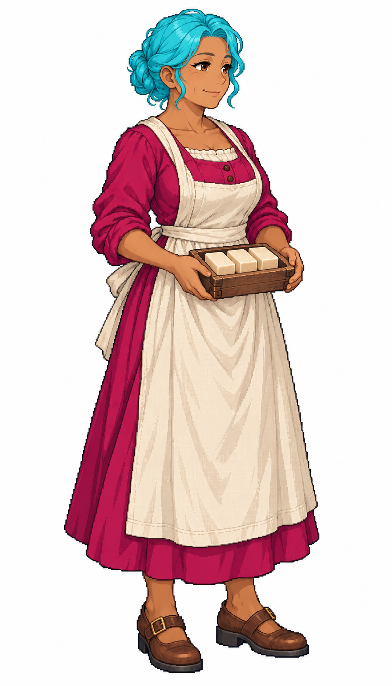

# 女製皂工・碧雅

碧雅是51歲、身高1.63公尺的女性居民。她在製皂坊工作，雙手端著木皂模與三塊素色皂；讓製皂工從通用工人中獨立出來。這是角色創作設定，不是對歷史職業人口的推估。她的穩定id為 `soapmaker_f_01`，工作建築為 `soapworks`，只參與居民演出選角，不增加生產能力或人口。

Tim希望依目前生產建築再新增女性工種。原稿透過內建image_gen獨立生成，實際附上 `meadow_captain_astrid_sprite_v1.png`，僅借細緻日系像素、離散色階與深輪廓，不複製船長身分。四分之三朝右，全身與腳尖完整、道具集中腰間。頭髮與眉毛為青色標記，主衣料為洋紅標記；皮膚、白麻布、木器、皮革與工具保留自然色，供現有遊戲的髮衣遮罩換色。

白底館藏保留原始生成版本。遊戲原圖另經BiRefNet檢查封閉白底，再由townfolk工具壓入圖集；髮衣四組自然配色、孔洞及選角結果在Blocksail的 `docs/evidence/womenjobs/`。完整追溯見 [生成記錄](../RawImages/meadow_resident_womenjobs_generation.json)。

## 完整實際提示詞

```text
Use case: stylized-concept. ONE full-body adult female civilian craft worker for an age-of-sail Caribbean-inspired town. Attached Astrid reference is ONLY for fine Japanese anime pixel-art style, discrete shaded clusters, clean dark stair-step contours and readable anatomy; do not copy her face, captain coat or military outfit. Tall portrait white canvas. Compact three-quarter standing pose facing SCREEN RIGHT (nose points right), complete head, both hands/fingers and both feet visible with generous blank margins. Narrow silhouette suitable for96x192 game cell with164px body height: no outstretched elbows, no oversized props, all props held near waist/torso and above knees, nothing beside the feet. ALL hair and eyebrows pure CYAN #00BCD4 with cyan-only shading. Short compact hair, entirely in top30% of the figure. MAIN coloured garment MAGENTA #C2185B with magenta-only shading. Natural skin, brown eyes, ivory linen, brown leather/wood, neutral tools. No cyan or magenta reflections/spots on skin, eyes, lips, accessories or props; no makeup. Pure solid white background, no scenery, shadow, ground plane, labels, lettering, border or checkerboard. Refined proportional adult, not chibi or modern fashion. Woman soap maker,51, medium brown skin, round mature face with subtle age lines, compact cyan hair in a short rolled bun above collar. Magenta long-sleeve work dress with simple ivory linen apron, practical brown shoes. Both hands hold a SMALL shallow rectangular wooden soap mold close at waist with three matte pale-ivory rectangular soap bars, clearly solid soap not food. No bubbles, no water bucket, no text or stamps. Calm friendly practical worker.
```


