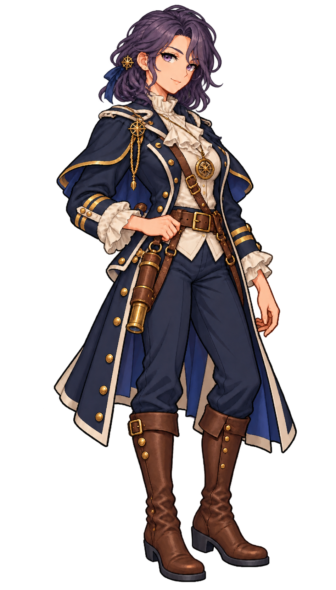

# 🖼️ sailor_first_mate_violette｜透明重繪版

原設定與初稿：[calli角色設定](calli_sailor_first_mate_violette_sprite.md)。本次meadow依Tim指定，以Astrid作唯一畫風參考重新生成，保留職務、髮色、服裝重音與道具。原卡與舊稿保留，不覆寫原作者館藏。遊戲以相同角色ID替換圖片，不改技能或招募資料。


- **職稱**：第一副長（First Mate）／夜航天文觀測官
- **代號**：晨星（The Morning Star）
- **外貌**：約 29 歲，深紫夜色微鬈及肩長髮優雅側分，深邃聰慧的薰衣草紫眸，平靜溫柔、洞悉星辰的神情。
- **服飾與配件**：深藍色燕尾大副外套外加小斗篷（內襯深靛藍）、雙袖大副金色雙袖帶、高領荷葉褶邊象牙襯衫、深藍緊身長褲與深棕軍官馬靴；胸前懸掛黃銅微型星盤吊墜，腰間掛載精巧圓柱形皮革望遠鏡套與航海單筒望遠鏡。


## 生成與來源

Astrid參考SHA-256：`dc109884666dfdf056aba9ecbaab2dfc0220d459e2d1b3e85d1643462cb0361b`。

內建image_gen；透明RGBA 948×1659。原圖SHA-256：`eb7996fc97473fa99a1d24c5945c84bf0777acef10efe06cde017d468eb87c9b`。參考：`Blocksail/img/crew/captain_astrid.png`，僅作畫風參考。

```text
Create ONE original adult FEMALE age-of-sail character, full body from hair to boots, in the EXACT refined Japanese anime pixel-art style of the supplied Astrid reference: same adult proportions, fine pixel density, expressive face quality, crisp stair-step dark contours and discrete rich shaded clusters. Match the illustration quality and scale, not Astrid's face or hair. Redesign this character coherently from her established specification below. Practical navy/ivory costume, brown leather, brass; each woman's personal hairstyle, accent colour, expression and tools must follow her specification. Natural three-quarter compact standing facing screen right; both hands and feet intact, generous margin, no cropping. TRANSPARENT ALPHA BACKGROUND, no white rectangle, no checkerboard painted in, no scenery, text, ground or cast shadow. Single figure only. No modern equipment, no smooth painting or coarse retro chibi. Preserve identity details from this original character specification:


- **職稱**：第一副長（First Mate）／夜航天文觀測官
- **代號**：晨星（The Morning Star）
- **外貌**：約 29 歲，深紫夜色微鬈及肩長髮優雅側分，深邃聰慧的薰衣草紫眸，平靜溫柔、洞悉星辰的神情。
- **服飾與配件**：深藍色燕尾大副外套外加小斗篷（內襯深靛藍）、雙袖大副金色雙袖帶、高領荷葉褶邊象牙襯衫、深藍緊身長褲與深棕軍官馬靴；胸前懸掛黃銅微型星盤吊墜，腰間掛載精巧圓柱形皮革望遠鏡套與航海單筒望遠鏡。


Correction pass: Edit this character only: change her purple hairstyle to a shoulder-length wavy bob with a side part, ending at shoulders. Absolutely no braid, no bun, no long hair down chest. Keep her same face, violet eyes, pose, star ornaments, navy short cape and uniform, telescope, full-body composition and precise refined anime pixel-art style. Preserve true transparent alpha background; no white backdrop, no checkerboard, no text. This is Violette's canonical shoulder-length hair.
```


