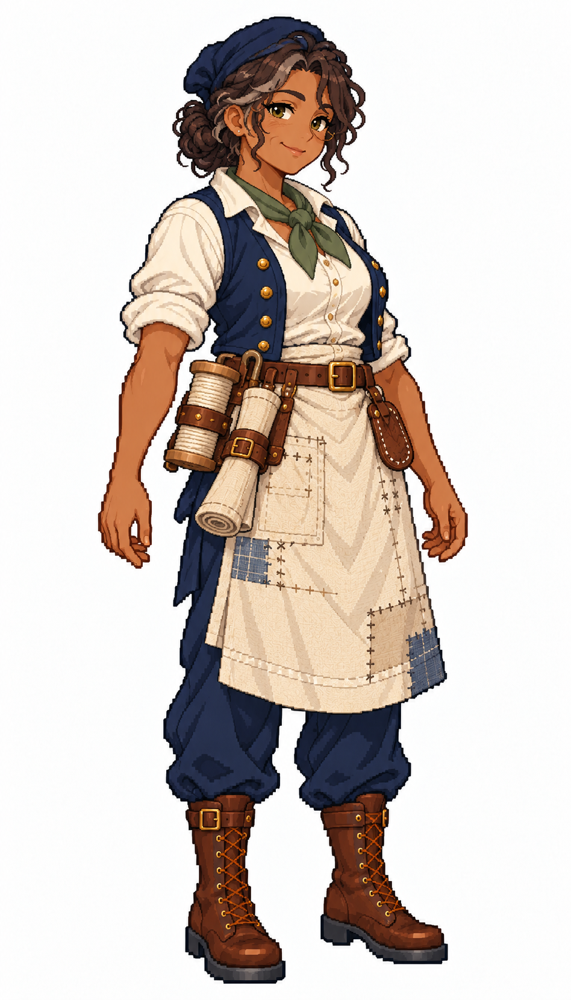

# 🖼️ 碧雅・舊帆｜溫厚的資深帆匠

## 人物設定

46歲。耐心、務實、護短，願意讓學徒先試再替她收拾線頭。年輕時曾遇過斷桅，從此修帆時總會順手檢查索具與固定點。她相信舊帆值得再補一次，卻也會明確指出何時必須換新；缺點是對自己不舒服的手腕總說沒事。

深褐皮膚、深棕捲髮盤髻與幾縷銀絲、榛色眼與笑紋，結實身形。深藍軟工作帽、苔綠領巾、象牙白襯衫與深藍背心、磨舊但乾淨的補片圍裙。

## 創作理念

五位帆匠各以不同的工作習慣與待人方式呈現個性。她們共用深藍、象牙白、亞麻與棕皮革構成的船員服裝，以髮型、表情、站姿和領巾重音色區分；工具收妥在身上，讓修帆的專業成為人物的一部分。

畫風參考 [Sirius 船醫](sirius_sailor_surgeon_sprite.md) 與 [Sirius 帆匠](sirius_sailor_sailmaker_sprite.md)，角色背景、姓名與設計為 meadow 原創。這是幻想帆船時代的服裝設計，不宣稱復原特定年代制服。白底全身單圖，不是透明圖集、動畫幀或已匯入遊戲的素材。

## 完整生成提示詞

成圖觀察：另加了細圓眼鏡；銀髮、笑紋、較結實的輪廓與補片圍裙可見。人物年齡屬設定，不作畫面可準確判讀的數字。

內建 imagegen；兩張既有圖只提供畫風、比例與配色參考。

```text
Use case: stylized-concept. Create ONE original adult female SAILMAKER, a finished full-body exquisite Japanese anime pixel-art game character matching the TWO reference images' pixel density, expressive face quality, crisp stair-step outlines, discrete clustered color shading and detailed tailoring. References are STYLE ONLY; new independent character. Pure WHITE background, no ground shadow, no scenery, no lettering, no border. Portrait 4:7 framing, complete head/hair/hands/boots and comfortable margins, adult proportions at same scale as references. Three-quarter view slightly toward screen RIGHT. Practical age-of-sail fantasy crew clothing, navy and ivory palette, brown leather, one muted personal accent. Work vest, canvas apron, trousers, sturdy boots; recognizable sailmaker tools close to body. NO captain coat, NO epaulettes, NO weapons, NO modern tools, NO exposed needle pointed at viewer, NO smooth painterly rendering, NO pixel noise filter. Bea Oldsail, 46, warm seasoned sailmaker and mentor. Deep brown skin, mature face with visible smile lines, hazel eyes, curly dark-brown hair in a low bun with silver strands. Sturdy broad adult build, relaxed reassuring smile. Soft navy cloth work cap, moss-green neckerchief, ivory rolled-sleeve shirt, practical navy vest, worn clean flax apron with several neat canvas patches, navy trousers and sturdy brown boots. Both hands empty relaxed at sides. Thick pale wooden thread spool, rolled canvas and leather palm guard secured at broad belt. Hands look experienced, no injury. Warm authority, not an officer.
```



