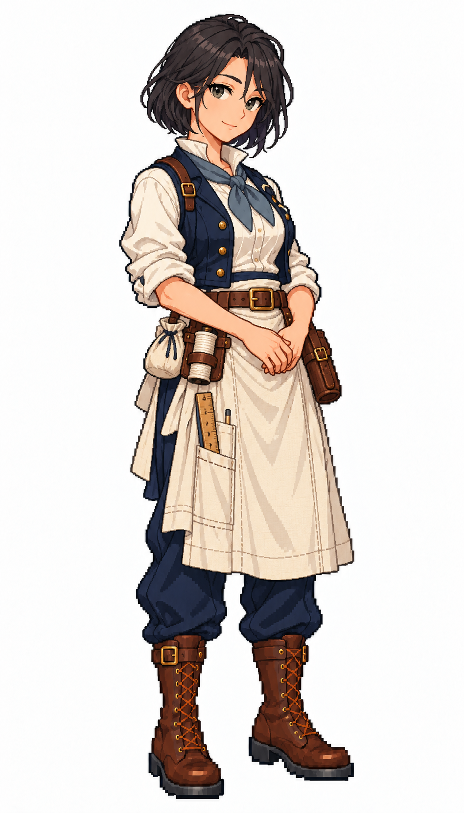

# 🖼️ 林・靜針｜寡言的精密裁帆師

## 人物設定

34歲。寡言、專注、討厭浪費布料。擅長讀懂帆形與張力，會用粉筆先畫出裁片，再把每一道縫留在適合受力的位置。她的幽默很淡，通常藏在一句精準的吐槽裡；缺點是對自己的要求過高，拆線重做時不太肯求助。

東亞面貌、墨黑直短髮、灰綠眼與細長眉；無帽。扣整齊的深藍工作背心、象牙白高領捲袖衫、灰青領巾、帶垂直收納袋的亞麻長圍裙。

## 創作理念

五位帆匠各以不同的工作習慣與待人方式呈現個性。她們共用深藍、象牙白、亞麻與棕皮革構成的船員服裝，以髮型、表情、站姿和領巾重音色區分；工具收妥在身上，讓修帆的專業成為人物的一部分。

畫風參考 [Sirius 船醫](sirius_sailor_surgeon_sprite.md) 與 [Sirius 帆匠](sirius_sailor_sailmaker_sprite.md)，角色背景、姓名與設計為 meadow 原創。這是幻想帆船時代的服裝設計，不宣稱復原特定年代制服。白底全身單圖，不是透明圖集、動畫幀或已匯入遊戲的素材。

## 完整生成提示詞

內建 imagegen；兩張既有圖只提供畫風、比例與配色參考。

```text
Use case: stylized-concept. Create ONE original adult female SAILMAKER, a finished full-body exquisite Japanese anime pixel-art game character matching the TWO reference images' pixel density, expressive face quality, crisp stair-step outlines, discrete clustered color shading and detailed tailoring. References are STYLE ONLY; new independent character. Pure WHITE background, no ground shadow, no scenery, no lettering, no border. Portrait 4:7 framing, complete head/hair/hands/boots and comfortable margins, adult proportions at same scale as references. Three-quarter view slightly toward screen RIGHT. Practical age-of-sail fantasy crew clothing, navy and ivory palette, brown leather, one muted personal accent. Work vest, canvas apron, trousers, sturdy boots; recognizable sailmaker tools close to body. NO captain coat, NO epaulettes, NO weapons, NO modern tools, NO exposed needle pointed at viewer, NO smooth painterly rendering, NO pixel noise filter. Lin Quietstitch, 34, reserved precision sail cutter. Adult East Asian face, straight ink-black jaw-length bob, grey-green eyes, straight fine brows, calm observant expression with tiny dry smile. NO hat, NO glasses. Buttoned navy work vest, ivory high-collar roll-sleeve blouse, muted blue-grey neckerchief, long flax apron with narrow vertical pockets over navy trousers and brown lace-up boots. Both hands rest naturally clasped low at waist. Flat wooden measuring rule in apron pocket, small chalk pouch, closed leather needle case and pale thread spool secured at belt. Clean precise silhouette, no sharp needle in hands.
```



