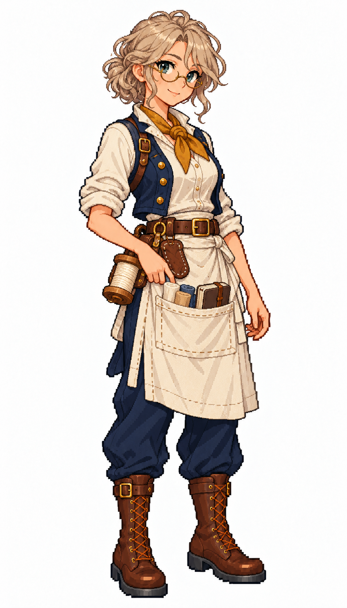

# 🖼️ 諾菈・風結｜好奇的試帆發明家

## 人物設定

25歲。好奇、樂觀，喜歡追問為什麼這一片帆會抖。她會用小布樣試不同的縫法，把測過的結果記進隨身小冊；風向一變，她比誰都想先上甲板看。缺點是新點子太多，需要同伴提醒先把手上那一面縫完。

淺膚色、灰金蓬鬆短捲髮、青藍眼、細圓眼鏡與好奇笑容；無帽。芥黃領巾、深藍開襟短背心、象牙白捲袖襯衫，圍裙口袋露出三種小布樣與闔上的筆記本。

## 創作理念

五位帆匠各以不同的工作習慣與待人方式呈現個性。她們共用深藍、象牙白、亞麻與棕皮革構成的船員服裝，以髮型、表情、站姿和領巾重音色區分；工具收妥在身上，讓修帆的專業成為人物的一部分。

畫風參考 [Sirius 船醫](sirius_sailor_surgeon_sprite.md) 與 [Sirius 帆匠](sirius_sailor_sailmaker_sprite.md)，角色背景、姓名與設計為 meadow 原創。這是幻想帆船時代的服裝設計，不宣稱復原特定年代制服。白底全身單圖，不是透明圖集、動畫幀或已匯入遊戲的素材。

## 完整生成提示詞

成圖觀察：三種布樣呈小捲布狀，而非原設定的平折布片；筆記本闔起並以皮帶束住，仍保留試驗者的收納特徵。

內建 imagegen；兩張既有圖只提供畫風、比例與配色參考。

```text
Use case: stylized-concept. Create ONE original adult female SAILMAKER, a finished full-body exquisite Japanese anime pixel-art game character matching the TWO reference images' pixel density, expressive face quality, crisp stair-step outlines, discrete clustered color shading and detailed tailoring. References are STYLE ONLY; new independent character. Pure WHITE background, no ground shadow, no scenery, no lettering, no border. Portrait 4:7 framing, complete head/hair/hands/boots and comfortable margins, adult proportions at same scale as references. Three-quarter view slightly toward screen RIGHT. Practical age-of-sail fantasy crew clothing, navy and ivory palette, brown leather, one muted personal accent. Work vest, canvas apron, trousers, sturdy boots; recognizable sailmaker tools close to body. NO captain coat, NO epaulettes, NO weapons, NO modern tools, NO exposed needle pointed at viewer, NO smooth painterly rendering, NO pixel noise filter. Nora Windknot, 25, curious inventive sailmaker. Fair skin, fluffy short ash-blonde curly hair, teal-blue eyes, small round brass spectacles, lively curious closed-mouth smile. NO hat. Mustard neckerchief, open cropped navy work vest over ivory rolled-sleeve blouse, short flax apron over navy trousers and brown boots. One hand rests lightly on apron pocket, other relaxed at side. Three small neatly folded canvas swatches of ivory, tan and blue-grey peek from apron pocket alongside a CLOSED small notebook; wooden thread spool and leather sailmaker palm guard secured at belt. Youthful ADULT proportions, no goggles or modern machinery.
```



