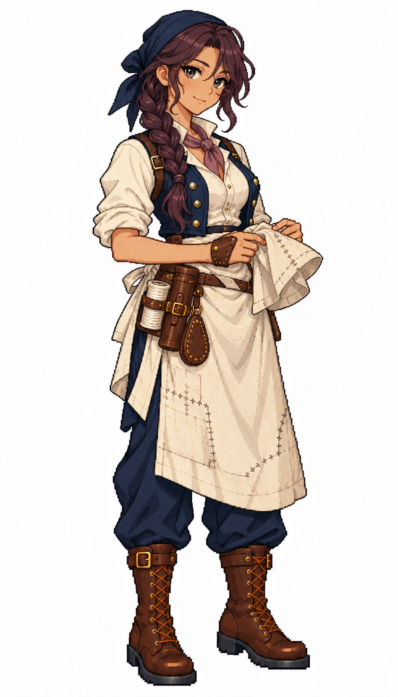

# 🖼️ 瑟菈・夜縫｜沉著的夜班修帆手

## 人物設定

31歲。沉著、獨立，習慣在別人睡下後整理第二天要用的針線。擅長在空間狹小、船身晃動時穩穩完成補縫；看似冷淡，其實會默默替同伴把磨破的袖口也補好。她不愛邀功，缺點是常讓別人不知道自己已經做了多少。

橄欖膚色、深梅紫長髮編成單辮垂肩，煙灰眼與安靜淡笑。深藍頭巾、灰紫領巾、象牙白襯衫、深藍貼身工作背心；稍長的亞麻圍裙以交叉綁帶固定。

## 創作理念

五位帆匠各以不同的工作習慣與待人方式呈現個性。她們共用深藍、象牙白、亞麻與棕皮革構成的船員服裝，以髮型、表情、站姿和領巾重音色區分；工具收妥在身上，讓修帆的專業成為人物的一部分。

畫風參考 [Sirius 船醫](sirius_sailor_surgeon_sprite.md) 與 [Sirius 帆匠](sirius_sailor_sailmaker_sprite.md)，角色背景、姓名與設計為 meadow 原創。這是幻想帆船時代的服裝設計，不宣稱復原特定年代制服。白底全身單圖，不是透明圖集、動畫幀或已匯入遊戲的素材。

## 完整生成提示詞

成圖觀察：另加了細圓眼鏡，掌帆皮護具也出現在手上；手持帆布有清楚補縫，圍裙的交叉綁帶在這個視角未清楚露出。

內建 imagegen；兩張既有圖只提供畫風、比例與配色參考。

```text
Use case: stylized-concept. Create ONE original adult female SAILMAKER, a finished full-body exquisite Japanese anime pixel-art game character matching the TWO reference images' pixel density, expressive face quality, crisp stair-step outlines, discrete clustered color shading and detailed tailoring. References are STYLE ONLY; new independent character. Pure WHITE background, no ground shadow, no scenery, no lettering, no border. Portrait 4:7 framing, complete head/hair/hands/boots and comfortable margins, adult proportions at same scale as references. Three-quarter view slightly toward screen RIGHT. Practical age-of-sail fantasy crew clothing, navy and ivory palette, brown leather, one muted personal accent. Work vest, canvas apron, trousers, sturdy boots; recognizable sailmaker tools close to body. NO captain coat, NO epaulettes, NO weapons, NO modern tools, NO exposed needle pointed at viewer, NO smooth painterly rendering, NO pixel noise filter. Sela Nightseam, 31, composed independent night-shift sail repairer. Olive skin, smoky grey eyes, long dark-plum hair in ONE thick braid over shoulder, quiet restrained almost-smile. Navy cloth headscarf tied neatly at back, muted mauve neckerchief, ivory rolled-sleeve shirt, fitted practical navy work vest, longer flax apron with cross-tied straps over navy trousers, dark brown sturdy boots. One hand lightly holding a SMALL folded repaired canvas patch at waist, other supports it naturally. Closed leather needle case, cream wooden thread spool and leather sailmaker palm guard secured at belt. Understated poised stance, no scenery or lantern.
```



