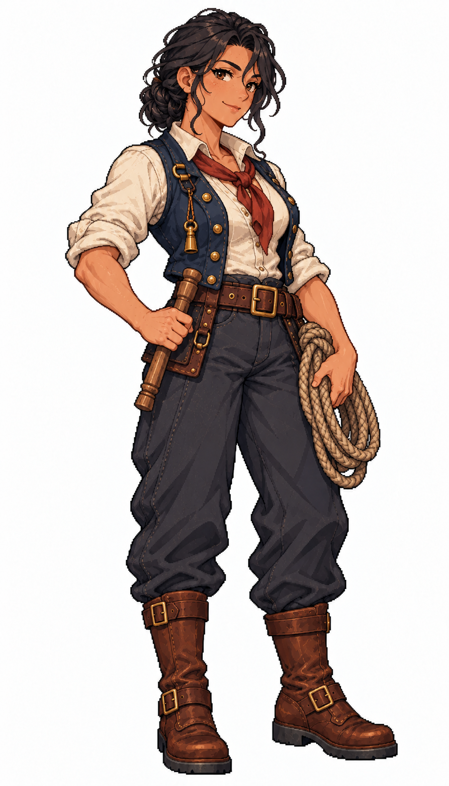

# 🖼️ 羅文娜・繩結｜水手長：每條繩後面，都站著一個人

## 人物設定

- 角色識別：`boatswain_rowenna`
- 姓名：羅文娜・繩結（Rowenna Knotwell）
- 性別：女性
- 年齡：40歲，成年
- 船上崗位：水手長

### 性格

坦率、護短，對偷懶很敏銳，對害怕卻肯問的新手格外耐心。習慣先示範一次，再把工具交給對方，不愛在甲板上羞辱人。

### 經歷

從補給船的繫纜手做起，年輕時因不敢質疑錯誤口令而害同伴摔傷。此後她要求交接時把指令重述清楚，連船長也不例外。繩結是同事給她的外號：她總能把鬧成一團的人重新帶回同一個節奏。

### 船上職責

協調甲板值班、索具與纜繩巡查、升降帆的人手分工及新手訓練，將異常回報大副；不取代船長或大副的指揮權。

### 專長

擅長把複雜甲板作業拆成能互相覆核的小步驟，也看得出誰已疲勞到不宜再上桅。

### 弱點與矛盾

總把最累的班留給自己，難以接受熟手離隊；緊急時容易先替人完成工作，反而壓縮新人練習機會。

### 個人目標

想培養一批能安心接班的水手，再回家陪年邁的姐姐經營小渡口；她希望自己的不可或缺，有一天能變成可放心離開。

### 登船契機提案

在碼頭免費教新水手打繩結，尋找肯把休息與訓練排進值班表的船；屬劇情提案，尚非實作招募條件。

### 外貌與隨身物件

日曬橄欖膚色、深棕眼，黑髮編成頸後低髻；象牙白捲袖襯衣、磨舊海軍藍短背心、鐵鏽紅領巾、炭灰長褲與低跟棕色海靴。身側持整齊麻繩圈與短木製繫纜栓，背心繫黃銅哨，前臂結實、站姿安定。

### 代表台詞

> 不會就問。繩子不會因為你逞強，就少拉一點。

## 創作方向與交付邊界

以不同工作道具、臉型、髮型、配色與服裝輪廓呈現專業分工，延續精緻日系像素的階梯輪廓、離散明暗與布料皮革質感。只借用 [Astrid](meadow_captain_astrid_sprite.md) 的畫風，人物與設定為 meadow 原創。

本圖是白底單人全身招募立繪原稿，採自然髮色與服色，不套用通用居民的青髮洋紅衣換色規格；尚未去背、製作動畫圖集或接入招募介面。專長與登船契機是敘事設計，不代表已實作的技能數值或招募條件。服裝與道具屬幻想帆船時代設計，不宣稱考據復原。

## 來源與驗收

- 任務：TASK-1182；母單：TASK-1172。
- 工具：內建 image_gen，單人獨立生成；原稿未經裁切或覆寫。
- 參考圖：`RawImages/meadow_captain_astrid_sprite_v1.png`（僅畫風）；SHA-256：`dc109884666dfdf056aba9ecbaab2dfc0220d459e2d1b3e85d1643462cb0361b`。
- 本圖：`RawImages/meadow_special_boatswain_rowenna_sprite_v1.png`；948×1659，RGB PNG。
- 原稿 SHA-256：`4e8963de5ce21b2b73a2376b5dba3c167da08e61b64bd7f6073a8ade1825aaa4`。
- 已親看：全身與雙靴完整、雙手及職務道具可辨、白底無文字場景；髮型、色彩與服裝符合本卡。年齡是人物設定，像素動漫臉不視為精確年齡證據。

第二張畫風參考：[瑪蓮・橡肋](meadow_special_carpenter_maren_sprite.md)，`RawImages/meadow_special_carpenter_maren_sprite_v1.png`，SHA-256：`22d0582141446a35a5bd7ab2d05704ee53d624b261a50aa65cacd1fcafdb1865`。兩張皆只作畫風參考，不是改圖目標。

成圖差異：提示詞中的頸後低辮盤成低髻，設定依實際成圖採黑髮低髻；黃銅哨為幻想造型，不作歷史器具復原。

## 完整實際提示詞

```text
Use case: stylized-concept. Create ONE original adult female ship specialist, a finished full-body refined Japanese anime PIXEL ART character illustration for Blocksail. Attached Astrid and Maren are STYLE ONLY: match fine pixel density, expressive anime face, crisp dark stair-step contours, discrete clustered shading, rich cloth and leather detail. Invent a distinct face, hair, clothing and pose. Pure solid white background, no ground shadow, scenery, text, border, panels or extra figures. Tall portrait approximately 4:7, complete hair, fingers and both boots with white margins. Three-quarter compact standing facing slightly screen right. Age-of-sail fantasy practical clothing, trousers and sturdy boots, natural hair colours. No modern items, no smooth painted gradients, no pixel noise filter, no sexualized outfit. This is a named recruitment portrait, not a recolorable generic resident. Do not copy a captain's uniform.
Rowenna Knotwell, 40-year-old FEMALE BOATSWAIN. Tall sturdy athletic build, sun-tanned olive skin, dark brown eyes, thick BLACK hair in a compact low braid looped at nape, weathered confident face and warm crooked smile. Rolled-sleeve ivory linen shirt under sleeveless weathered navy short vest, rust-red neckerchief, wide dark brown leather belt, charcoal trousers and practical low-heeled brown sea boots. Carry ONE small neat hemp rope coil with left hand near hip; right hand holds a SHORT wooden belaying pin vertically beside belt. Small brass boatswain's whistle on a short cord fixed to vest, not in mouth. Strong forearms, capable grounded stance, no long coat, no fur, no weapons, no detached objects by feet.
```


