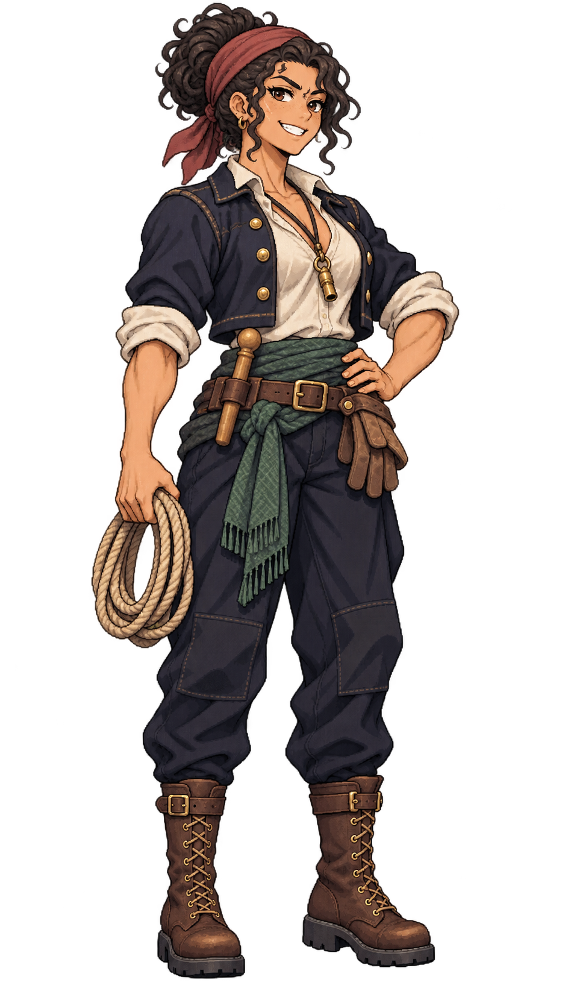

# 🖼️ 塔瑪・葦結｜水手長

## 人物設定

- 角色ID：`special_boatswain_tamar`
- 姓名：塔瑪・葦結（Tamar Reedknot）
- 女性，35歲，成年
- 船上職位：水手長

### 性格

嗓門亮、笑得爽快，喜歡用示範代替訓斥。她能記住誰怕高，卻常忘記自己也會累。

### 經歷

成長於葦洲渡口，年輕時在纜繩作坊與渡船之間換工。她曾帶過來自幾個港口、彼此聽不懂口音的臨時船員，靠手勢和重述口令讓他們在暴雨中完成繫泊。後來大家叫她葦結，因為她最擅長把鬆散的人編成一起受力的一束。

### 船上職責

安排甲板值更、索具作業、工具點交與新手訓練，讓每個班都知道自己的下一步與退讓空間。

### 專長

擅長跨口音協作，能從動作遲疑看出有人沒聽懂，提前停下重新示範。

### 弱點與矛盾

遇到危急作業總想自己上，容易把職責分工又拉回一人硬撐。

### 個人目標

養成一班不靠她大聲喊也能可靠交接的甲板骨幹。

### 登船契機提案

在酒館替受傷的前船友找替班，若玩家願意讓新手受訓而非直接頂上，她會考慮登船。此為劇情提案。

### 外貌與服裝道具

Tamar Reedknot, age 35, strong female boatswain with broad shoulders and muscular forearms. Warm olive-tan skin, dark expressive eyes, thick black curly hair in a compact high bun wrapped with a faded wine-red headscarf. Confident open grin, one slightly raised eyebrow. Cropped unbuttoned navy work jacket, ivory shirt sleeves rolled high, dark sea-green woven waist sash, dark navy work trousers, sturdy mid-calf brown lace-up boots. A small brass boatswain's whistle on a cord at her chest, wooden belaying pin tucked safely in her belt. One hand holds a small tidy coil of natural hemp rope beside her hip, other rests on waist. Work-worn glove tucked into belt. Compact balanced stance, full fingers visible, no objects on ground, no copied blonde braid or officer finery.

### 代表台詞

> 口令要聽懂，繩子才拉得齊。

## 技能設計提案

**葦結口令**：水手長任職時改善甲板水手與索具作業的工作效率；不改角色移動速度、物理繩索強度或無條件消除疲勞。

**個性特長：重述一遍**。強調交接清楚與空缺提示，可作甲板協同特長；不得以一張人物卡替代一般水手人數。

以上保留原始敘事與玩法設計方向；已實作的效率加成見下方遊戲接入，其他情節與提示仍是提案。

## 遊戲接入（TASK-1203）

已加入27人酒館候選池，沿用城鎮每7日固定候選規則。

- **葦結口令**：甲板水手、預備水手工作效率 +8%。
- **重述一遍**：全船工作效率 +1%，同類特長取最高，不重複疊加。
- 招募費 240.0；日薪 2.5，待命也計薪。
- 任職且付清薪資才生效，待命／空槽／欠薪停止生效，調任後只作用於新船。
- 接入既有真實工作效率運算，並保留食材、帆布、彈藥與人力需求；未把其他原始敘事提案當成已實作能力。

## 創作理念

以職業道具、年齡、面容與服裝輪廓區分同職位角色，延續Astrid的離散像素色階、深色輪廓及海軍藍／象牙白／皮革／黃銅材質。參考僅限畫風，人物與設定為meadow原創；不將船長的臉或毛領複製成職業模板。

直接生成透明RGBA單人全身原稿，使用自然髮色與服色。象牙白衣料、帆布與高光維持不透明；角色可獨立疊在酒館背景上。保留內建工具原檔，不做白底侵蝕去背，不製作居民換色圖集。

## 來源與交付

- 內建工具：image_gen；use case：stylized-concept。
- 尺寸：948×1659；RGBA；alpha 0～255。
- SHA-256：`d40c7ccf2147a85fbb5647674189e0b4e752e95e91b81827ba4be2f4dacf773d`。
- 參考：`D:/Unity/Valhalla/ArtGallery/RawImages/meadow_captain_astrid_sprite_v1.png`（僅畫風）。
- 參考SHA-256：`dc109884666dfdf056aba9ecbaab2dfc0220d459e2d1b3e85d1643462cb0361b`。
- 遊戲待用素材：`img/crew/special_boatswain_tamar.png`；已註冊酒館候選池。
- 完整提示詞、設定及檔案對照：Blocksail `docs/evidence/crew-batch2-1201/generation.json`。

## 實際生成提示詞

```text
Use case: stylized-concept. Asset: ONE original adult female special crew member for the Blocksail recruitment UI. Reference image is STYLE ONLY: match Astrid's refined Japanese anime pixel-art sprite, crisp stair-step contours, dark selective outlines, discrete clustered shading, detailed fabric/leather/brass and expressive face, restrained age-of-sail fantasy costume. Create a DISTINCT person, never copy Astrid's face, braid, captain coat or fur trim. Single full-body standing figure, portrait approximately 4:7, three-quarter facing slightly screen right, complete hair, hands, tools and boot soles, generous transparent margins on every side. Natural hair and clothing colours. Practical trousers and boots. Upper-left light, no ground shadow, no background scene, no white backdrop, no checkerboard drawn, no labels, text, border, watermark, duplicates or extra people. GENUINELY TRANSPARENT background with clean alpha; preserve ivory fabric and highlights as opaque. Use the reference's refined visible pixel clusters; no smooth airbrush gradients, blur or pixel-noise filter. Tamar Reedknot, age 35, strong female boatswain with broad shoulders and muscular forearms. Warm olive-tan skin, dark expressive eyes, thick black curly hair in a compact high bun wrapped with a faded wine-red headscarf. Confident open grin, one slightly raised eyebrow. Cropped unbuttoned navy work jacket, ivory shirt sleeves rolled high, dark sea-green woven waist sash, dark navy work trousers, sturdy mid-calf brown lace-up boots. A small brass boatswain's whistle on a cord at her chest, wooden belaying pin tucked safely in her belt. One hand holds a small tidy coil of natural hemp rope beside her hip, other rests on waist. Work-worn glove tucked into belt. Compact balanced stance, full fingers visible, no objects on ground, no copied blonde braid or officer finery.
```


