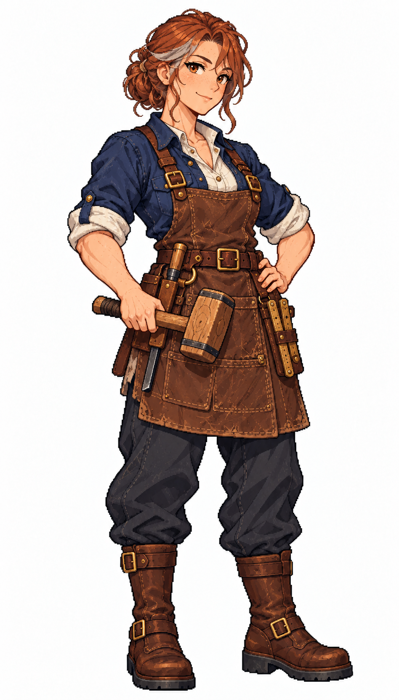

# 🖼️ 瑪蓮・橡肋｜船匠：聽得出船殼哪裡正在硬撐

## 人物設定

- 角色識別：`carpenter_maren`
- 姓名：瑪蓮・橡肋（Maren Oakrib）
- 性別：女性
- 年齡：43歲，成年
- 船上崗位：船匠

### 性格

務實、慢熱，對木料的耐性比對人多一點。修理時會輕聲哼歌，遇到船員害怕漏水，總先交給對方一件能做的小事。

### 經歷

在沿海修船村當了二十多年學徒與師傅，經歷過因省略檢查而失去一艘老船。她後來離開固定船塢，跟著遠航船工作，想親眼知道自己補上的木料如何承受風浪。

### 船上職責

巡查船殼、桅座與艙底，安排填縫、木構修補和損管備料；重大損傷會先回報，不承諾海上能修復所有結構。

### 專長

能從濕痕、木材聲響和榫接鬆動判斷優先修補處，擅長教非木工船員做簡易損管。

### 弱點與矛盾

對舊船有感情，常低估徹底換料的必要；右手在長時間重擊後會僵，需要輪替工作。

### 個人目標

記下不同海域木料的維修表現，回鄉開一所讓女孩也能正式拜師的修船學舍。

### 登船契機提案

在船塢替一艘被判報廢的小船做最後檢查，希望找艘肯預留維修時間的船；屬劇情提案。

### 外貌與隨身物件

雀斑暖膚色、棕眼、銅紅髮綁低髻，鬢角略帶灰；靛藍捲袖工作襯衫、象牙白內衫、褐色短皮圍裙、炭灰長褲與厚底棕靴。腰前持木柄填縫槌，另一手自然扶腰，腰袋收好填縫鐵與小尺；有實際勞作的肩臂輪廓。

### 代表台詞

> 先把水舀出去。船要哭，等我們靠岸再說。

## 創作方向與交付邊界

以不同工作道具、臉型、髮型、配色與服裝輪廓呈現專業分工，延續精緻日系像素的階梯輪廓、離散明暗與布料皮革質感。只借用 [Astrid](meadow_captain_astrid_sprite.md) 的畫風，人物與設定為 meadow 原創。

本圖是白底單人全身招募立繪原稿，採自然髮色與服色，不套用通用居民的青髮洋紅衣換色規格；尚未去背、製作動畫圖集或接入招募介面。專長與登船契機是敘事設計，不代表已實作的技能數值或招募條件。服裝與道具屬幻想帆船時代設計，不宣稱考據復原。

## 來源與驗收

- 任務：TASK-1176；母單：TASK-1172。
- 工具：內建 image_gen，單人獨立生成；原稿未經裁切或覆寫。
- 參考圖：`RawImages/meadow_captain_astrid_sprite_v1.png`（僅畫風）；SHA-256：`dc109884666dfdf056aba9ecbaab2dfc0220d459e2d1b3e85d1643462cb0361b`。
- 本圖：`RawImages/meadow_special_carpenter_maren_sprite_v1.png`；948×1659，RGB PNG。
- 原稿 SHA-256：`22d0582141446a35a5bd7ab2d05704ee53d624b261a50aa65cacd1fcafdb1865`。
- 已親看：全身與雙靴完整、雙手及職務道具可辨、白底無文字場景；髮型、色彩與服裝符合本卡。年齡是人物設定，像素動漫臉不視為精確年齡證據。

## 完整實際提示詞

```text
Use case: stylized-concept. Create ONE original adult female ship specialist, refined Japanese anime PIXEL ART full-body portrait for Blocksail. Attached Astrid is STYLE ONLY: match fine pixel density, expressive anime face, crisp dark stair-step outlines, discrete clustered shading, richly detailed cloth and leather; invent a new face and costume, not a recolor of Astrid. Pure white background, NO ground shadow, scenery, text, border, panel or extra figures. Tall portrait around 4:7; complete hair, hands and both boots, ample white margins. Three-quarter standing facing slightly screen right, compact natural pose. Practical age-of-sail fantasy attire, trousers, sturdy boots, ivory linen, navy, brown leather, brass; no modern technology, no sexualized outfit, no smooth painted gradients or pixel-noise filter. Natural hair and clothing colors; this is a named recruitment portrait, not a recolorable town resident.
Maren Oakrib, 43-year-old adult female SHIP CARPENTER. Visibly mature warm freckled face with subtle smile lines, brown eyes, copper-red hair tied in a low compact bun with a few grey strands at temples. Broad capable shoulders and muscular forearms, reassuring small smile. Indigo rolled-sleeve work shirt over ivory undershirt, short worn brown leather work apron ending above knees, charcoal trousers, heavy brown flat work boots. Hold a wooden caulking mallet horizontally at waist in one hand, other hand rests naturally on hip. Belt has securely sheathed caulking iron and short folding ruler. Compact steady stance, practical craftswoman silhouette. No fancy captain coat, no gold epaulettes, no fur, no floating tools, no woodpile or detached objects by feet.
```


