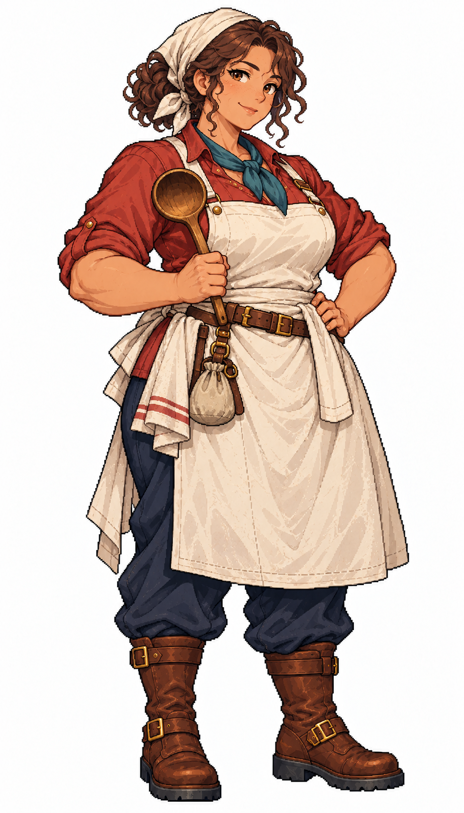

# 🖼️ 貝雅・暖鍋｜廚師：讓遠航的人，記得自己正在回家

## 人物設定

- 角色識別：`cook_bea`
- 姓名：貝雅・暖鍋（Bea Warmkettle）
- 性別：女性
- 年齡：47歲，成年
- 船上崗位：廚師

### 性格

開朗、記性好，會記住誰不吃某種香料。關心別人時常直接多盛半勺，但討厭有人把她當成不會生氣的母親。

### 經歷

曾和伴侶經營碼頭食堂，航線改道後店裡只剩欠條。她選擇登船當廚師，不為重開同一間店，而想知道那些吃完就匆匆離開的人，下一頓究竟在哪裡吃。多年來她把各港學來的調味記在不用文字也能看懂的食材小圖旁。

### 船上職責

安排船餐、食材輪替與船廚清潔，依軍需官的實際存量調整菜單；食材補給與分配先協調，不自行創造物資。

### 專長

擅長把耐存食材做出變化，觀察船員胃口與疲勞，用可行的小調整維持日常用餐節奏。

### 弱點與矛盾

面對有人吃不下時容易把原因攬到自己身上，忙起來忘記自己吃飯；不喜歡被催促而會嘴硬。

### 個人目標

想走遍幾條主要商路，寫一份能讓不同故鄉船員都吃得慣的船上菜譜，最後開一間不趕夜班水手走的深夜小食堂。

### 登船契機提案

在碼頭替延誤的船員煮一鍋晚餐，願意加入重視乾淨飲水與規律用餐的船；屬劇情提案。

### 外貌與隨身物件

暖褐膚色、深褐眼、豐潤結實的身形，深栗捲髮收進低髻，米白頭巾束住髮際；磚紅捲袖上衣、青綠領巾、象牙白長圍裙、深藍長褲與棕色工作靴。持木製湯勺，另一手扶腰，腰側掛折好的餐巾與小布袋。

### 代表台詞

> 先坐下。風浪欠你的那一口，今天補上。

## 創作方向與交付邊界

以不同工作道具、臉型、髮型、配色與服裝輪廓呈現專業分工，延續精緻日系像素的階梯輪廓、離散明暗與布料皮革質感。只借用 [Astrid](meadow_captain_astrid_sprite.md) 的畫風，人物與設定為 meadow 原創。

本圖是白底單人全身招募立繪原稿，採自然髮色與服色，不套用通用居民的青髮洋紅衣換色規格；尚未去背、製作動畫圖集或接入招募介面。專長與登船契機是敘事設計，不代表已實作的技能數值或招募條件。服裝與道具屬幻想帆船時代設計，不宣稱考據復原。

## 來源與驗收

- 任務：TASK-1184；母單：TASK-1172。
- 工具：內建 image_gen，單人獨立生成；原稿未經裁切或覆寫。
- 參考圖：`RawImages/meadow_captain_astrid_sprite_v1.png`（僅畫風）；SHA-256：`dc109884666dfdf056aba9ecbaab2dfc0220d459e2d1b3e85d1643462cb0361b`。
- 本圖：`RawImages/meadow_special_cook_bea_sprite_v1.png`；948×1659，RGB PNG。
- 原稿 SHA-256：`bf334b355026ad096510029c6641aeb24d6eee6edbf1107c81c2c0b38ad5d042`。
- 已親看：全身與雙靴完整、雙手及職務道具可辨、白底無文字場景；髮型、色彩與服裝符合本卡。年齡是人物設定，像素動漫臉不視為精確年齡證據。

第二張畫風參考：[瑪蓮・橡肋](meadow_special_carpenter_maren_sprite.md)，`RawImages/meadow_special_carpenter_maren_sprite_v1.png`，SHA-256：`22d0582141446a35a5bd7ab2d05704ee53d624b261a50aa65cacd1fcafdb1865`。兩張皆只作畫風參考，不是改圖目標。

## 完整實際提示詞

```text
Use case: stylized-concept. Create ONE original adult female ship specialist, a finished full-body refined Japanese anime PIXEL ART character illustration for Blocksail. Attached Astrid and Maren are STYLE ONLY: match fine pixel density, expressive anime face, crisp dark stair-step contours, discrete clustered shading, rich cloth and leather detail. Invent a distinct face, hair, clothing and pose. Pure solid white background, no ground shadow, scenery, text, border, panels or extra figures. Tall portrait approximately 4:7, complete hair, fingers and both boots with white margins. Three-quarter compact standing facing slightly screen right. Age-of-sail fantasy practical clothing, trousers and sturdy boots, natural hair colours. No modern items, no smooth painted gradients, no pixel noise filter, no sexualized outfit. This is a named recruitment portrait, not a recolorable generic resident. Do not copy a captain's uniform.
Bea Warmkettle, 47-year-old FEMALE SHIP COOK. Distinct mature round face with gentle laugh lines, warm brown skin, dark brown eyes, sturdy generously plump build and full arms. Dark chestnut curly hair tied in a low bun, ivory fabric headscarf keeping hair back, NO modern chef hat. Warm welcoming but self-possessed smile. Brick-red rolled-sleeve practical blouse, small teal neckerchief, simple unadorned ivory full apron from chest to just below knees over navy trousers, sensible brown work boots. ONE large wooden soup ladle held upright at waist in right hand, left hand rests naturally at hip. Neatly folded kitchen cloth and small linen pouch at belt. All objects attached or held; no pot or food on floor, no steam, no stove, no background scene, no text. Rounded warm silhouette clearly different from the lean officers. No captain coat or military trim.
```


