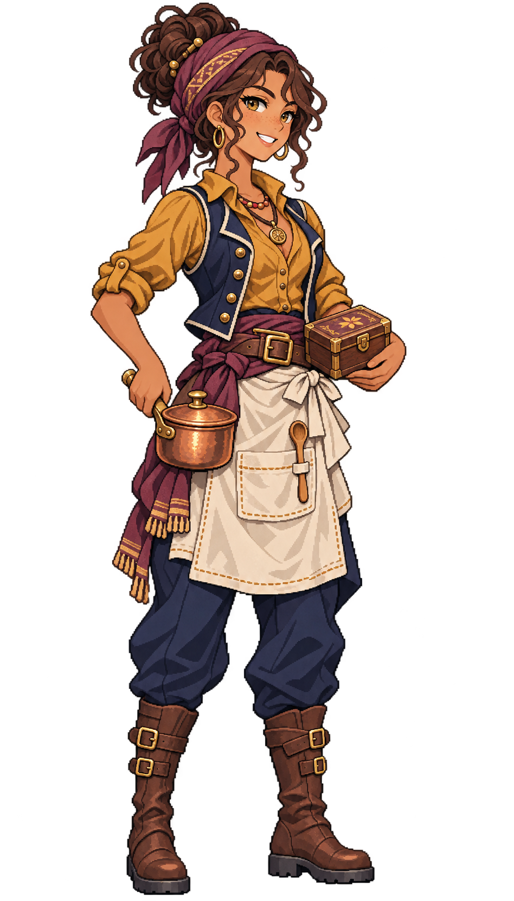

# 🖼️ 莎芙菈・香潮｜廚師

## 人物設定

- 角色ID：`special_cook_saffra`
- 姓名：莎芙菈・香潮（Saffra Spicetide）
- 女性，28歲，成年
- 船上職位：廚師

### 性格

好奇、反應快，會記住每個人的口味與過敏提醒，但偶爾太急著證明自己的新點子。

### 經歷

香料行的女兒，熟悉哪些氣味代表乾燥、哪些代表貨受了潮。家中一次遠航貨損後，她開始在船上做飯，發現帳面上的食材份量與人在搖晃廚房裡真正吃下的份量是兩回事。她逐漸學會先把穩定的一餐做好，再把創意留給還有餘裕的晚上。

### 船上職責

安排船餐、檢查食材保存、點交香料與淡水，與軍需官核對真正可用的庫存。

### 專長

擅長用既有食材做出輪替菜色，也能從氣味提早發現一批貨需要優先處理。

### 弱點與矛盾

遇到沒見過的食材容易手癢，得有人提醒她先保留熟悉且足量的船餐。

### 個人目標

寫一本把保存方式、替代食材和實際份量都說明白的遠航食譜，而不是只給富人看的宴席書。

### 登船契機提案

正為一支短途船隊試做長航菜單，想找願意公開船員意見、肯讓她修訂食譜的船。此為劇情提案。

### 外貌與服裝道具

Saffra Spicetide, age 28, spirited female ship cook and spice trader's daughter. Warm medium brown skin, golden-hazel eyes, dark chestnut curly hair gathered in a compact high bun under a muted plum headwrap. Bright attentive smile, slim energetic adult build. Mustard-ochre rolled-sleeve blouse, open short navy waistcoat, clean opaque ivory half-apron tied over navy trousers, sturdy brown calf boots. One hand supports a small polished copper saucepan close to her hip with lid CLOSED; other holds a compact closed wooden spice box at waist, no food floating, no steam. Small wooden tasting spoon tucked into apron loop. Costume practical maritime rather than modern chef uniform, no white chef hat. Clear distinctive warm ochre/copper/plum accents, composed ready-to-work stance.

### 代表台詞

> 香料不是拿來遮壞味道的，是讓人願意好好吃完。

## 技能設計提案

**香潮輪餐**：廚師任職時改善既有烹飪工作效率；餐點仍消耗真實食材，buff依既有船餐系統生效，不把香料當成免費士氣。

**個性特長：先聞再入鍋**。偏向補給保存與菜單提示的特長，將優先使用的食材說清楚；具體耗損數值待定。

以上為敘事與玩法設計方向，沒有新增遊戲數值、主動技、候選名單或已生效buff。

## 創作理念

以職業道具、年齡、面容與服裝輪廓區分同職位角色，延續Astrid的離散像素色階、深色輪廓及海軍藍／象牙白／皮革／黃銅材質。參考僅限畫風，人物與設定為meadow原創；不將船長的臉或毛領複製成職業模板。

直接生成透明RGBA單人全身原稿，使用自然髮色與服色。象牙白衣料、帆布與高光維持不透明；角色可獨立疊在酒館背景上。保留內建工具原檔，不做白底侵蝕去背，不製作居民換色圖集。

## 來源與交付

- 內建工具：image_gen；use case：stylized-concept。
- 尺寸：948×1659；RGBA；alpha 0～255。
- SHA-256：`150bca30af2d4be1b4ab86c6c3e8db7a509dee22d5cc61dcad3dbd4599022bc3`。
- 參考：`D:/Unity/Valhalla/ArtGallery/RawImages/meadow_captain_astrid_sprite_v1.png`（僅畫風）。
- 參考SHA-256：`dc109884666dfdf056aba9ecbaab2dfc0220d459e2d1b3e85d1643462cb0361b`。
- 遊戲待用素材：`img/crew/special_cook_saffra.png`；尚未註冊候選。
- 完整提示詞、設定及檔案對照：Blocksail `docs/evidence/crew-batch2-1201/generation.json`。

## 實際生成提示詞

```text
Use case: stylized-concept. Asset: ONE original adult female special crew member for the Blocksail recruitment UI. Reference image is STYLE ONLY: match Astrid's refined Japanese anime pixel-art sprite, crisp stair-step contours, dark selective outlines, discrete clustered shading, detailed fabric/leather/brass and expressive face, restrained age-of-sail fantasy costume. Create a DISTINCT person, never copy Astrid's face, braid, captain coat or fur trim. Single full-body standing figure, portrait approximately 4:7, three-quarter facing slightly screen right, complete hair, hands, tools and boot soles, generous transparent margins on every side. Natural hair and clothing colours. Practical trousers and boots. Upper-left light, no ground shadow, no background scene, no white backdrop, no checkerboard drawn, no labels, text, border, watermark, duplicates or extra people. GENUINELY TRANSPARENT background with clean alpha; preserve ivory fabric and highlights as opaque. Use the reference's refined visible pixel clusters; no smooth airbrush gradients, blur or pixel-noise filter. Saffra Spicetide, age 28, spirited female ship cook and spice trader's daughter. Warm medium brown skin, golden-hazel eyes, dark chestnut curly hair gathered in a compact high bun under a muted plum headwrap. Bright attentive smile, slim energetic adult build. Mustard-ochre rolled-sleeve blouse, open short navy waistcoat, clean opaque ivory half-apron tied over navy trousers, sturdy brown calf boots. One hand supports a small polished copper saucepan close to her hip with lid CLOSED; other holds a compact closed wooden spice box at waist, no food floating, no steam. Small wooden tasting spoon tucked into apron loop. Costume practical maritime rather than modern chef uniform, no white chef hat. Clear distinctive warm ochre/copper/plum accents, composed ready-to-work stance.
```


