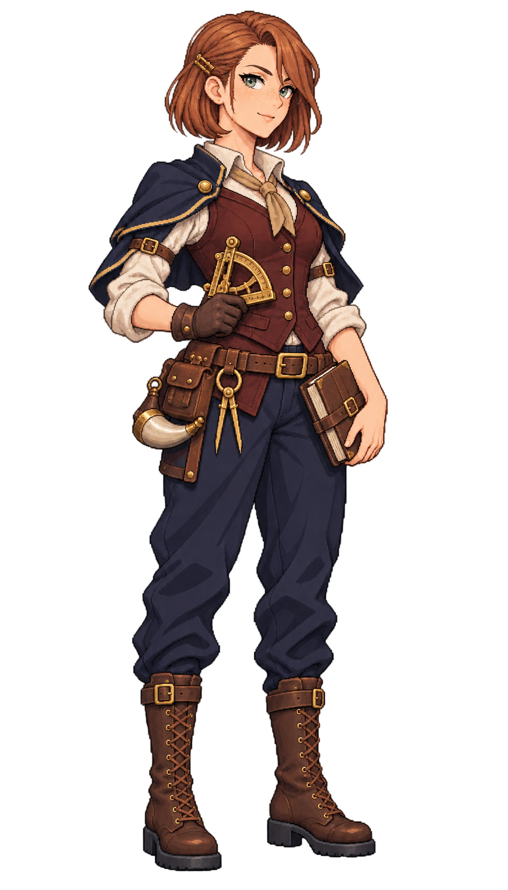

# 🖼️ 奧黛特・銅燧｜砲術長

## 人物設定

- 角色ID：`special_gunner_odette`
- 姓名：奧黛特・銅燧（Odette Brasswick）
- 女性，32歲，成年
- 船上職位：砲術長

### 性格

說話乾淨俐落，喜歡拿一個可重做的小實驗結束爭論。私下會在帳本夾乾花，對外卻不愛解釋。

### 經歷

在港口鑄造坊當過試砲記錄員，見過同一批砲因火藥受潮而打出截然不同的結果。一次試射事故後，她拒絕照管事要求刪去異常紀錄，離開工坊改上商船，想讓砲班知道自己的器材能做到什麼、不能做到什麼。

### 船上職責

統整砲班訓練、砲具量測、彈藥保存與交火後的器材紀錄；開火與停火遵照船長命令。

### 專長

善於辨認器材狀態與操作流程造成的散差，讓送藥手與砲班使用同一套簡短口令。

### 弱點與矛盾

太相信可記錄的數字，面對經驗水手的模糊警訊時有時反應慢半拍。

### 個人目標

寫一本讓新砲手也能辨認異常的薄手冊，保留失敗案例而不只列標準答案。

### 登船契機提案

正在酒館找願意保留試射紀錄的船，不要求最重的砲，先問誰負責教新手。此為劇情提案。

### 外貌與服裝道具

Odette Brasswick, age 32, meticulous female master gunner. Fair freckled skin, clear grey-green eyes, copper-auburn chin-length straight bob with a single tucked-back side, alert measuring gaze and slight wry smile. Medium athletic build. Deep oxblood-red fitted waistcoat over ivory rolled-sleeve linen shirt, short navy shoulder cape secured behind upper arms, dark leather utility belt with brass measuring dividers and a CLOSED powder horn, navy trousers tucked into practical brown boots. One gloved hand holds a compact brass gunner's quadrant at waist, other rests on a leather-covered notebook, all props close to the silhouette. No giant cannon, no firearm in hands, no flames, no modern safety equipment, no oversized hat. Precise disciplined stance, not a captain.

### 代表台詞

> 先量清楚，再讓別人聽見我們。

## 技能設計提案

**銅燧校準**：砲術長任職時改善砲班協同及裝填工作效率；仍受現有火砲、彈藥、到崗人力與射界限制，不產生額外砲彈。

**個性特長：異常不刪**。讓砲班相關效果與限制有清楚來源，偏重持續穩定操作；不直接套用未實作的命中率數值。

以上保留原始敘事與玩法設計方向；已實作的效率加成見下方遊戲接入，其他情節與提示仍是提案。

## 遊戲接入（TASK-1203）

已加入27人酒館候選池，沿用城鎮每7日固定候選規則。

- **銅燧校準**：砲班、送藥手工作效率 +9%。
- **異常不刪**：全船工作效率 +1%，同類特長取最高，不重複疊加。
- 招募費 300.0；日薪 3.0，待命也計薪。
- 任職且付清薪資才生效，待命／空槽／欠薪停止生效，調任後只作用於新船。
- 接入既有真實工作效率運算，並保留食材、帆布、彈藥與人力需求；未把其他原始敘事提案當成已實作能力。

## 創作理念

以職業道具、年齡、面容與服裝輪廓區分同職位角色，延續Astrid的離散像素色階、深色輪廓及海軍藍／象牙白／皮革／黃銅材質。參考僅限畫風，人物與設定為meadow原創；不將船長的臉或毛領複製成職業模板。

直接生成透明RGBA單人全身原稿，使用自然髮色與服色。象牙白衣料、帆布與高光維持不透明；角色可獨立疊在酒館背景上。保留內建工具原檔，不做白底侵蝕去背，不製作居民換色圖集。

## 來源與交付

- 內建工具：image_gen；use case：stylized-concept。
- 尺寸：948×1659；RGBA；alpha 0～255。
- SHA-256：`8040bad19c3fd86b979cfb47ecdcd0fecb3f2f994f8d1225e1dac1e2853271e8`。
- 參考：`D:/Unity/Valhalla/ArtGallery/RawImages/meadow_captain_astrid_sprite_v1.png`（僅畫風）。
- 參考SHA-256：`dc109884666dfdf056aba9ecbaab2dfc0220d459e2d1b3e85d1643462cb0361b`。
- 遊戲待用素材：`img/crew/special_gunner_odette.png`；已註冊酒館候選池。
- 完整提示詞、設定及檔案對照：Blocksail `docs/evidence/crew-batch2-1201/generation.json`。

## 實際生成提示詞

```text
Use case: stylized-concept. Asset: ONE original adult female special crew member for the Blocksail recruitment UI. Reference image is STYLE ONLY: match Astrid's refined Japanese anime pixel-art sprite, crisp stair-step contours, dark selective outlines, discrete clustered shading, detailed fabric/leather/brass and expressive face, restrained age-of-sail fantasy costume. Create a DISTINCT person, never copy Astrid's face, braid, captain coat or fur trim. Single full-body standing figure, portrait approximately 4:7, three-quarter facing slightly screen right, complete hair, hands, tools and boot soles, generous transparent margins on every side. Natural hair and clothing colours. Practical trousers and boots. Upper-left light, no ground shadow, no background scene, no white backdrop, no checkerboard drawn, no labels, text, border, watermark, duplicates or extra people. GENUINELY TRANSPARENT background with clean alpha; preserve ivory fabric and highlights as opaque. Use the reference's refined visible pixel clusters; no smooth airbrush gradients, blur or pixel-noise filter. Odette Brasswick, age 32, meticulous female master gunner. Fair freckled skin, clear grey-green eyes, copper-auburn chin-length straight bob with a single tucked-back side, alert measuring gaze and slight wry smile. Medium athletic build. Deep oxblood-red fitted waistcoat over ivory rolled-sleeve linen shirt, short navy shoulder cape secured behind upper arms, dark leather utility belt with brass measuring dividers and a CLOSED powder horn, navy trousers tucked into practical brown boots. One gloved hand holds a compact brass gunner's quadrant at waist, other rests on a leather-covered notebook, all props close to the silhouette. No giant cannon, no firearm in hands, no flames, no modern safety equipment, no oversized hat. Precise disciplined stance, not a captain.
```


