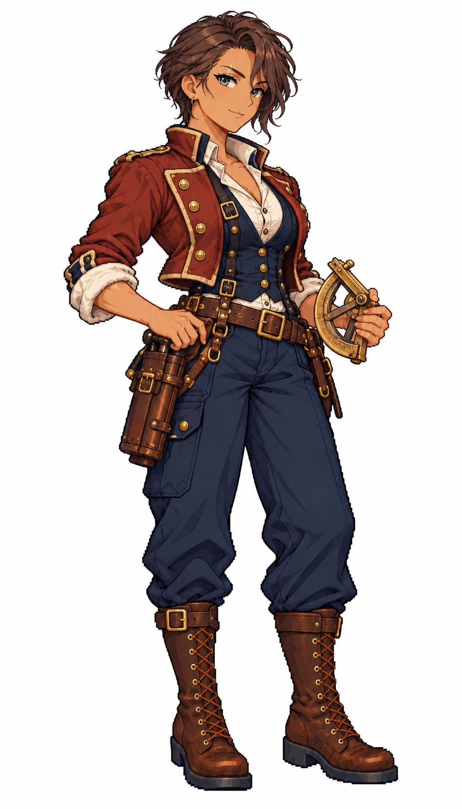

# 🖼️ 薇菈・燧石｜砲術長：比起開火，更在意何時停火

## 人物設定

- 角色識別：`gunner_vera`
- 姓名：薇菈・燧石（Vera Flint）
- 性別：女性
- 年齡：38歲，成年
- 船上崗位：砲術長

### 性格

沉著直接，教新人時耐心，遇到逞強則毫不留情；平常說話低聲，從不靠吼叫證明威嚴。

### 經歷

曾在護航船上當裝填手，因一次倉促齊射傷及己方小艇，轉而鑽研測距與甲板協同。她拒絕把那次事故說成命運，至今每次交班都親自清點火種與砲位。

### 船上職責

安排砲班、砲位保養、射界與裝填演練，向船長報告可射擊狀態及友軍風險。

### 專長

擅長穩定砲班節奏與辨識危險射界，比命中傳說更重視可重複的操作。

### 弱點與矛盾

對臨時調整砲班非常戒慎，可能錯過短暫機會；聽到近距離爆響後需要片刻重新集中。

### 個人目標

建立讓新手也能看懂的砲班交接手冊，希望自己的經驗最後能使更多人活著退役。

### 登船契機提案

在船塢督導砲班演練，尋找願意接受她安全規程的船長；屬劇情提案。

### 外貌與隨身物件

古銅膚色、灰綠眼、深棕短髮梳向一側；磚紅短砲手夾克、深藍實用背心、象牙白襯衣、深色長褲與耐磨棕靴。黃銅砲手象限儀握在腰前，皮帶掛合攏的火繩盒與隔離火種的小工具袋。

### 代表台詞

> 先看清旁邊是誰，再問我能不能打。

## 創作方向與交付邊界

以不同工作道具、臉型、髮型、配色與服裝輪廓呈現專業分工，延續精緻日系像素的階梯輪廓、離散明暗與布料皮革質感。只借用 [Astrid](meadow_captain_astrid_sprite.md) 的畫風，人物與設定為 meadow 原創。

本圖是白底單人全身招募立繪原稿，採自然髮色與服色，不套用通用居民的青髮洋紅衣換色規格；尚未去背、製作動畫圖集或接入招募介面。專長與登船契機是敘事設計，不代表已實作的技能數值或招募條件。服裝與道具屬幻想帆船時代設計，不宣稱考據復原。

## 來源與驗收

- 任務：TASK-1174；母單：TASK-1172。
- 工具：內建 image_gen，單人獨立生成；原稿未經裁切或覆寫。
- 參考圖：`RawImages/meadow_captain_astrid_sprite_v1.png`（僅畫風）；SHA-256：`dc109884666dfdf056aba9ecbaab2dfc0220d459e2d1b3e85d1643462cb0361b`。
- 本圖：`RawImages/meadow_special_gunner_vera_sprite_v1.png`；948×1660，RGB PNG。
- 原稿 SHA-256：`9bcc3dc131fe089d885db9e8f462f50bcfeedcc47b8d159a38b579ef6a8d76db`。
- 已親看：全身與雙靴完整、雙手及職務道具可辨、白底無文字場景；髮型、色彩與服裝符合本卡。年齡是人物設定，像素動漫臉不視為精確年齡證據。

成圖差異：提示詞要求的眉疤未清楚呈現，未將它列入本版固定外貌。

## 完整實際提示詞

```text
Use case: stylized-concept. Create ONE original adult female ship specialist, refined Japanese anime PIXEL ART full-body portrait for Blocksail. Attached Astrid is STYLE ONLY: match fine pixel density, expressive anime face, crisp dark stair-step outlines, discrete clustered shading, richly detailed cloth and leather; invent a new face and costume, not a recolor of Astrid. Pure white background, NO ground shadow, scenery, text, border, panel or extra figures. Tall portrait around 4:7; complete hair, hands and both boots, ample white margins. Three-quarter standing facing slightly screen right, compact natural pose. Practical age-of-sail fantasy attire, trousers, sturdy boots, ivory linen, navy, brown leather, brass; no modern technology, no sexualized outfit, no smooth painted gradients or pixel-noise filter. Natural hair and clothing colors; this is a named recruitment portrait, not a recolorable town resident.
Vera Flint, 38-year-old adult female MASTER GUNNER. Strong broad shoulders, bronze skin, grey-green eyes, short dark brown side-swept hair, a fine healed left eyebrow scar. Calm firm expression, visibly mature face distinct from the reference. Brick-red cropped gunner's jacket over practical navy waistcoat and ivory shirt, dark trousers, rugged brown boots. Hold a compact brass gunner's quadrant at waist, other hand relaxed on a secure belt with a CLOSED leather linstock tool case. No cannon, no ammunition on ground, no sparks. Grounded upright compact stance, functional working silhouette rather than a captain's long coat.
```


