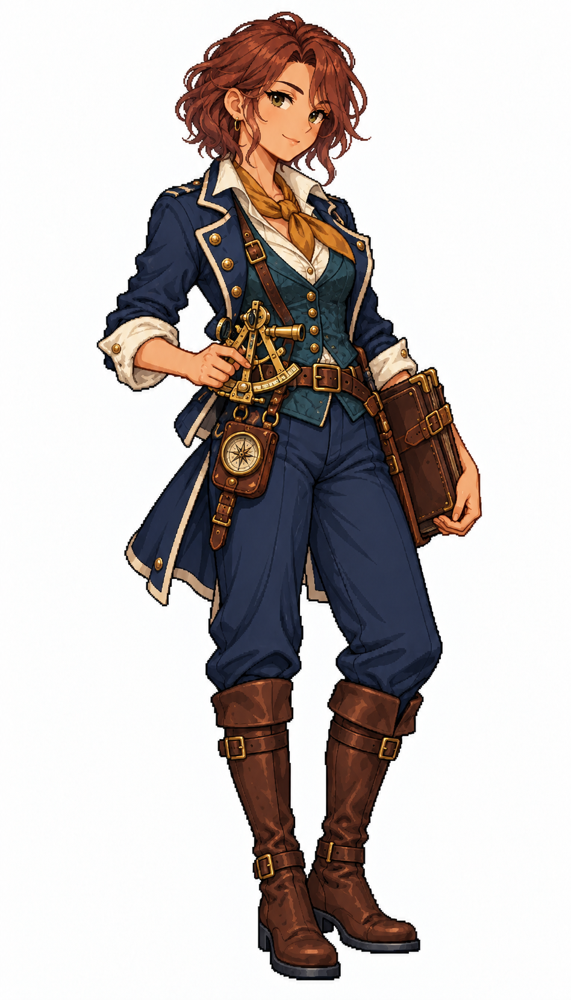

# 🖼️ 莉奧拉・潮尺｜航海士：把未知留在海圖邊緣的人

## 人物設定

- 角色識別：`navigator_liora`
- 姓名：莉奧拉・潮尺（Liora Tidegauge）
- 性別：女性
- 年齡：29歲，成年
- 船上崗位：航海士

### 性格

好奇、細心，說話前常先確認風向；願意承認不知道，卻會為一筆舊測量爭論到深夜。

### 經歷

出身河口測潮站，少年時替母親抄寫水位簿。一次照舊版海圖領航而擱淺，讓她離開抄圖所，登船逐段重測商路。她留下潮尺這個外號，提醒自己海面從來不照紙上的線停住。

### 船上職責

規劃航線、天文定位、記錄潮汐與測深，將觀測結果交給船長決策；不代替船長發出航行命令。

### 專長

擅長近岸航道比對與辨認海圖上的過時標記，會把觀測可信度一起寫入紀錄。

### 弱點與矛盾

急於補齊資料時容易忽略休息；雲層遮蔽星空又缺測深資料時會猶豫，需要同伴提醒決策時限。

### 個人目標

想繪製一本標出測量日期與不確定區的民用海圖集，讓沒錢雇領航員的小船也能回港。

### 登船契機提案

在港口海圖室尋找願意載她重測一處暗礁的船；這是劇情提案，尚未實作招募條件。

### 外貌與隨身物件

暖橄欖膚色、榛色眼、深赤褐短捲髮；深青綠背心、象牙白捲袖襯衣、海軍藍短燕尾外套、赭黃領巾、深藍長褲與棕靴。腰前持黃銅六分儀，身側夾皮革海圖冊，腰掛羅盤套。

### 代表台詞

> 這條線是去年畫的。海可沒答應今年還在原地。

## 創作方向與交付邊界

以不同工作道具、臉型、髮型、配色與服裝輪廓呈現專業分工，延續精緻日系像素的階梯輪廓、離散明暗與布料皮革質感。只借用 [Astrid](meadow_captain_astrid_sprite.md) 的畫風，人物與設定為 meadow 原創。

本圖是白底單人全身招募立繪原稿，採自然髮色與服色，不套用通用居民的青髮洋紅衣換色規格；尚未去背、製作動畫圖集或接入招募介面。專長與登船契機是敘事設計，不代表已實作的技能數值或招募條件。服裝與道具屬幻想帆船時代設計，不宣稱考據復原。

## 來源與驗收

- 任務：TASK-1173；母單：TASK-1172。
- 工具：內建 image_gen，單人獨立生成；原稿未經裁切或覆寫。
- 參考圖：`RawImages/meadow_captain_astrid_sprite_v1.png`（僅畫風）；SHA-256：`dc109884666dfdf056aba9ecbaab2dfc0220d459e2d1b3e85d1643462cb0361b`。
- 本圖：`RawImages/meadow_special_navigator_liora_sprite_v1.png`；948×1660，RGB PNG。
- 原稿 SHA-256：`b5f6d3202219c8dff4760a96089b0d6afc1e88630dbf2098ca0935ea66620fdb`。
- 已親看：全身與雙靴完整、雙手及職務道具可辨、白底無文字場景；髮型、色彩與服裝符合本卡。年齡是人物設定，像素動漫臉不視為精確年齡證據。

## 完整實際提示詞

```text
Use case: stylized-concept. Create ONE original adult female ship specialist, refined Japanese anime PIXEL ART full-body portrait for Blocksail. Attached Astrid is STYLE ONLY: match fine pixel density, expressive anime face, crisp dark stair-step outlines, discrete clustered shading, richly detailed cloth and leather; invent a new face and costume, not a recolor of Astrid. Pure white background, NO ground shadow, scenery, text, border, panel or extra figures. Tall portrait around 4:7; complete hair, hands and both boots, ample white margins. Three-quarter standing facing slightly screen right, compact natural pose. Practical age-of-sail fantasy attire, trousers, sturdy boots, ivory linen, navy, brown leather, brass; no modern technology, no sexualized outfit, no smooth painted gradients or pixel-noise filter. Natural hair and clothing colors; this is a named recruitment portrait, not a recolorable town resident.
Li ora Tidegauge (Liora), 29-year-old female NAVIGATOR. Warm olive skin, curious hazel eyes, short wavy dark auburn bob tucked behind one ear; attentive slightly lopsided smile. Fitted deep-teal waistcoat over rolled ivory shirt, short navy split-tail jacket with restrained brass piping, ochre neck scarf, high-waisted navy trousers and knee-high brown boots. A small brass sextant held carefully at waist in one hand, other hand supporting a closed slim leather chart folio against her hip. Leather compass case at belt. Light agile silhouette, thoughtful professional posture. No officer hat, no fur.
```


