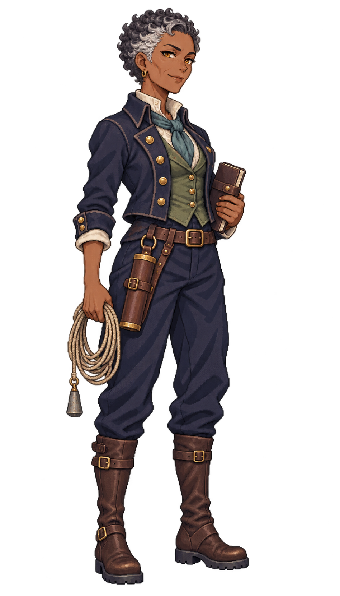

# 🖼️ 奈莉莎・灰汐｜航海士

## 人物設定

- 角色ID：`special_navigator_nerissa`
- 姓名：奈莉莎・灰汐（Nerissa Greywake）
- 女性，46歲，成年
- 船上職位：航海士

### 性格

寡言、務實，習慣先聽完值更水手的觀察再下結論。對新手不苛刻，對沒有日期的數據卻毫不客氣。

### 經歷

曾替河口小商船帶路二十多年。一次船東為趕潮忽略她的複測請求，船雖勉強通過，載貨卻受了損；事後她發現自己為了保住工作，把不確定性說得太輕。此後她把每筆測深的日期、風向與可信程度寫在同一頁。

### 船上職責

負責近岸測深、潮時比對、進出港備案與值更交接；航向由船長拍板，她提供可核對的選項。

### 專長

擅長在舊海圖與當日觀測不符時找出差異，為吃水不同的船準備多條進港方案。

### 弱點與矛盾

碰到時間不足又資料稀少的決策容易過度保守；她得學會分清合理冒險與敷衍風險。

### 個人目標

建立一本便宜小船也用得起的河口潮簿，註明每條記錄是何時、由誰量的。

### 登船契機提案

在酒館要求船長說清這趟船的吃水和預定抵達時辰，才願意談受雇。此為劇情提案。

### 外貌與服裝道具

Nerissa Greywake, age 46, seasoned coastal pilot. Mature angular face with subtle smile lines, deep brown skin, amber eyes, very short salt-and-pepper tightly curled hair with silver at temples. Quiet skeptical half-smile, sturdy slender build. Short fitted navy pilot's jacket with weathered brass buttons over muted sea-green waistcoat and ivory linen high-neck shirt, faded teal neckcloth, navy trousers, dark-brown knee boots. No captain insignia or fur. One hand holds a neatly coiled thin sounding line close to her hip, the small lead sounding weight hangs visibly beside the coil without touching the ground; other hand holds a compact closed tide notebook against her side. Slim leather chart case at belt. Grounded relaxed stance, practical veteran not a young girl's face.

### 代表台詞

> 海圖說得再肯定，也得先問問水深。

## 技能設計提案

**灰汐複測**：航海士任職時改善近岸領航與值更交接；優先接既有工作效率或航線風險資訊，不憑空改海床或賦予安全通航。

**個性特長：留一條退路**。資料不足時指出保守備案，讓玩家看見哪些判斷仍待觀測；不把角色直覺變成全知海圖。

以上為敘事與玩法設計方向，沒有新增遊戲數值、主動技、候選名單或已生效buff。

## 創作理念

以職業道具、年齡、面容與服裝輪廓區分同職位角色，延續Astrid的離散像素色階、深色輪廓及海軍藍／象牙白／皮革／黃銅材質。參考僅限畫風，人物與設定為meadow原創；不將船長的臉或毛領複製成職業模板。

直接生成透明RGBA單人全身原稿，使用自然髮色與服色。象牙白衣料、帆布與高光維持不透明；角色可獨立疊在酒館背景上。保留內建工具原檔，不做白底侵蝕去背，不製作居民換色圖集。

## 來源與交付

- 內建工具：image_gen；use case：stylized-concept。
- 尺寸：948×1659；RGBA；alpha 0～255。
- SHA-256：`a03cd0655af82046eb01bd091e51fc42430d001f4b09464af7b5ceceef69197c`。
- 參考：`D:/Unity/Valhalla/ArtGallery/RawImages/meadow_captain_astrid_sprite_v1.png`（僅畫風）。
- 參考SHA-256：`dc109884666dfdf056aba9ecbaab2dfc0220d459e2d1b3e85d1643462cb0361b`。
- 遊戲待用素材：`img/crew/special_navigator_nerissa.png`；尚未註冊候選。
- 完整提示詞、設定及檔案對照：Blocksail `docs/evidence/crew-batch2-1201/generation.json`。

## 實際生成提示詞

```text
Use case: stylized-concept. Asset: ONE original adult female special crew member for the Blocksail recruitment UI. Reference image is STYLE ONLY: match Astrid's refined Japanese anime pixel-art sprite, crisp stair-step contours, dark selective outlines, discrete clustered shading, detailed fabric/leather/brass and expressive face, restrained age-of-sail fantasy costume. Create a DISTINCT person, never copy Astrid's face, braid, captain coat or fur trim. Single full-body standing figure, portrait approximately 4:7, three-quarter facing slightly screen right, complete hair, hands, tools and boot soles, generous transparent margins on every side. Natural hair and clothing colours. Practical trousers and boots. Upper-left light, no ground shadow, no background scene, no white backdrop, no checkerboard drawn, no labels, text, border, watermark, duplicates or extra people. GENUINELY TRANSPARENT background with clean alpha; preserve ivory fabric and highlights as opaque. Use the reference's refined visible pixel clusters; no smooth airbrush gradients, blur or pixel-noise filter. Nerissa Greywake, age 46, seasoned coastal pilot. Mature angular face with subtle smile lines, deep brown skin, amber eyes, very short salt-and-pepper tightly curled hair with silver at temples. Quiet skeptical half-smile, sturdy slender build. Short fitted navy pilot's jacket with weathered brass buttons over muted sea-green waistcoat and ivory linen high-neck shirt, faded teal neckcloth, navy trousers, dark-brown knee boots. No captain insignia or fur. One hand holds a neatly coiled thin sounding line close to her hip, the small lead sounding weight hangs visibly beside the coil without touching the ground; other hand holds a compact closed tide notebook against her side. Slim leather chart case at belt. Grounded relaxed stance, practical veteran not a young girl's face.
```


