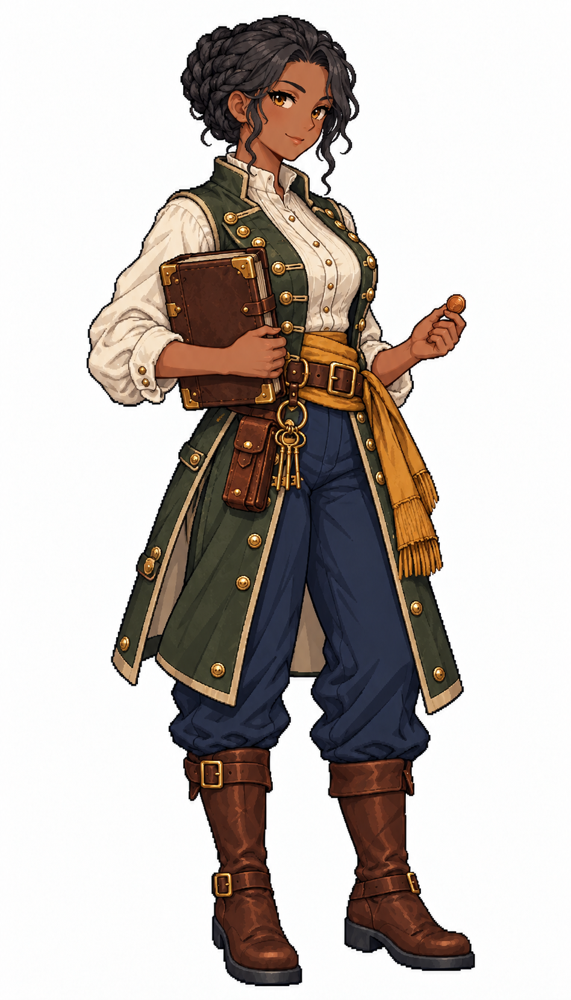

# 🖼️ 娜迪雅・銅秤｜軍需官：帳本上的每一筆，都是某人的明天

## 人物設定

- 角色識別：`quartermaster_nadia`
- 姓名：娜迪雅・銅秤（Nadia Copperbalance）
- 性別：女性
- 年齡：34歲，成年
- 船上崗位：軍需官

### 性格

溫和但界線清楚，記得每個人的飲食禁忌，討厭拿大方當作不記帳的藉口。幽默乾燥，會把挖苦藏在一本正經的報數裡。

### 經歷

幼年在轉運港的補給行長大，熟悉商人將損耗算到水手頭上的花樣。曾為一艘欠餉商船重整糧帳，之後選擇隨船管理物資，讓帳本的主人也能親眼看見分配。

### 船上職責

統整糧水、備品與補給清冊，協調採買和分配，讓船長與船員都能查閱存量及耗用。

### 專長

擅長估算航程補給和揭露重複報帳，能在有限物資下提出公平而可說明的分配方案。

### 弱點與矛盾

過度依賴紀錄，面對無憑據但真有急需的人容易先起疑；對親近的人也難以放下核對習慣。

### 個人目標

存錢開一間由退休水手共同持有的補給行，讓臨時失業的人不必先欠下高利貸。

### 登船契機提案

在碼頭清點一批被錯送的糧袋，願意加入接受公開糧帳的船；屬劇情提案。

### 外貌與隨身物件

深褐膚色、琥珀眼、黑髮盤成緊密編髮髻；苔綠長背心、象牙白高領襯衣、海軍藍長褲、赭金窄腰帶與棕靴。懷抱銅扣皮革帳冊，另一手握一枚素面銅籌，腰掛小型折疊秤套與鑰匙。

### 代表台詞

> 多給一份可以。先告訴我，明天少的那份由誰補上。

## 創作方向與交付邊界

以不同工作道具、臉型、髮型、配色與服裝輪廓呈現專業分工，延續精緻日系像素的階梯輪廓、離散明暗與布料皮革質感。只借用 [Astrid](meadow_captain_astrid_sprite.md) 的畫風，人物與設定為 meadow 原創。

本圖是白底單人全身招募立繪原稿，採自然髮色與服色，不套用通用居民的青髮洋紅衣換色規格；尚未去背、製作動畫圖集或接入招募介面。專長與登船契機是敘事設計，不代表已實作的技能數值或招募條件。服裝與道具屬幻想帆船時代設計，不宣稱考據復原。

## 來源與驗收

- 任務：TASK-1175；母單：TASK-1172。
- 工具：內建 image_gen，單人獨立生成；原稿未經裁切或覆寫。
- 參考圖：`RawImages/meadow_captain_astrid_sprite_v1.png`（僅畫風）；SHA-256：`dc109884666dfdf056aba9ecbaab2dfc0220d459e2d1b3e85d1643462cb0361b`。
- 本圖：`RawImages/meadow_special_quartermaster_nadia_sprite_v1.png`；948×1659，RGB PNG。
- 原稿 SHA-256：`bdef15a4414e26e87798335a4fef8e50b7363464e2217c4b5aaf5b37f9ad0aaa`。
- 已親看：全身與雙靴完整、雙手及職務道具可辨、白底無文字場景；髮型、色彩與服裝符合本卡。年齡是人物設定，像素動漫臉不視為精確年齡證據。

## 完整實際提示詞

```text
Use case: stylized-concept. Create ONE original adult female ship specialist, refined Japanese anime PIXEL ART full-body portrait for Blocksail. Attached Astrid is STYLE ONLY: match fine pixel density, expressive anime face, crisp dark stair-step outlines, discrete clustered shading, richly detailed cloth and leather; invent a new face and costume, not a recolor of Astrid. Pure white background, NO ground shadow, scenery, text, border, panel or extra figures. Tall portrait around 4:7; complete hair, hands and both boots, ample white margins. Three-quarter standing facing slightly screen right, compact natural pose. Practical age-of-sail fantasy attire, trousers, sturdy boots, ivory linen, navy, brown leather, brass; no modern technology, no sexualized outfit, no smooth painted gradients or pixel-noise filter. Natural hair and clothing colors; this is a named recruitment portrait, not a recolorable town resident.
Nadia Copperbalance, 34-year-old adult female QUARTERMASTER. Deep brown skin, amber eyes, tightly braided black hair in a compact bun, friendly but shrewd composed expression. Distinct softer round facial structure. Moss-green long sleeveless practical waistcoat with brass fasteners over high-collared ivory linen blouse, ochre narrow sash, navy trousers and brown boots. Cradle a CLOSED leather ledger with brass corners against one side of torso; other hand holds ONE small plain copper tally token at waist. Belt carries neat keys and a closed slim folded balance case. No readable writing, no open book, no scales standing on ground. Relaxed upright professional stance. Not a captain coat, no fur, no weapons.
```


