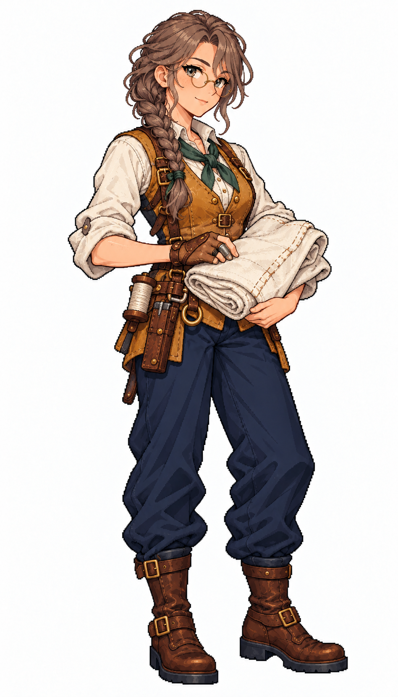

# 🖼️ 賽琳・風縫｜帆匠：把風留在該承受它的地方

## 人物設定

- 角色識別：`sailmaker_celine`
- 姓名：賽琳・風縫（Celine Windstitch）
- 性別：女性
- 年齡：31歲，成年
- 船上崗位：帆匠

### 性格

安靜、細膩，談到縫法時會突然變得健談。善於聽完別人的要求，但對不合理的交期會先沉默太久，最後才說不行。

### 經歷

原本在港口替劇團縫舞台布景，封港後轉入帆坊。第一次隨船才明白岸上平整的接縫到了海上會怎樣受力，於是把每次破帆的位置畫進自己的修補簿，不再只追求針腳好看。

### 船上職責

檢查與修補帆面、帆邊及補強部位，整理針線與備用帆布，與水手長協調收帆後的作業時段。

### 專長

擅長辨認布料磨耗與縫線受力，能把仍可用的舊帆布分級利用，清楚標記哪些補丁只能暫時撐住。

### 弱點與矛盾

容易為了把修補做得漂亮而超時；近距離專注久了會忽略甲板上的呼叫，需要同伴提醒轉換注意力。

### 個人目標

想把修帆手記編成附圖教材，讓不識字的學徒也能靠破損圖樣找到對應處理方法。

### 登船契機提案

在帆坊替一塊被認為只能丟棄的舊帆試做補強，希望跟船驗證它的實際表現；屬劇情提案。

### 外貌與隨身物件

淺雀斑膚色、灰綠眼，灰褐色側辮與小圓黃銅框眼鏡；赭金工作背心、象牙白捲袖襯衣、苔綠領巾、海軍藍長褲與棕靴。腰前抱折好的象牙白帆布，手戴皮革縫帆護掌與頂針，腰側收線軸與針具皮套。

### 代表台詞

> 補丁不是把洞遮住，是讓下一陣風有地方走。

## 創作方向與交付邊界

以不同工作道具、臉型、髮型、配色與服裝輪廓呈現專業分工，延續精緻日系像素的階梯輪廓、離散明暗與布料皮革質感。只借用 [Astrid](meadow_captain_astrid_sprite.md) 的畫風，人物與設定為 meadow 原創。

本圖是白底單人全身招募立繪原稿，採自然髮色與服色，不套用通用居民的青髮洋紅衣換色規格；尚未去背、製作動畫圖集或接入招募介面。專長與登船契機是敘事設計，不代表已實作的技能數值或招募條件。服裝與道具屬幻想帆船時代設計，不宣稱考據復原。

## 來源與驗收

- 任務：TASK-1183；母單：TASK-1172。
- 工具：內建 image_gen，單人獨立生成；原稿未經裁切或覆寫。
- 參考圖：`RawImages/meadow_captain_astrid_sprite_v1.png`（僅畫風）；SHA-256：`dc109884666dfdf056aba9ecbaab2dfc0220d459e2d1b3e85d1643462cb0361b`。
- 本圖：`RawImages/meadow_special_sailmaker_celine_sprite_v1.png`；948×1659，RGB PNG。
- 原稿 SHA-256：`83fdecb6249d80b7a578a43d74fe254806aad7f32cdba30011ebdfd91ffc0ec9`。
- 已親看：全身與雙靴完整、雙手及職務道具可辨、白底無文字場景；髮型、色彩與服裝符合本卡。年齡是人物設定，像素動漫臉不視為精確年齡證據。

第二張畫風參考：[瑪蓮・橡肋](meadow_special_carpenter_maren_sprite.md)，`RawImages/meadow_special_carpenter_maren_sprite_v1.png`，SHA-256：`22d0582141446a35a5bd7ab2d05704ee53d624b261a50aa65cacd1fcafdb1865`。兩張皆只作畫風參考，不是改圖目標。

成圖差異：原先提示詞希望較短的側辮和踝靴，成圖為肩前較長側辮與較高筒靴；本版設定依成圖採側辮與棕靴。

## 完整實際提示詞

```text
Use case: stylized-concept. Create ONE original adult female ship specialist, a finished full-body refined Japanese anime PIXEL ART character illustration for Blocksail. Attached Astrid and Maren are STYLE ONLY: match fine pixel density, expressive anime face, crisp dark stair-step contours, discrete clustered shading, rich cloth and leather detail. Invent a distinct face, hair, clothing and pose. Pure solid white background, no ground shadow, scenery, text, border, panels or extra figures. Tall portrait approximately 4:7, complete hair, fingers and both boots with white margins. Three-quarter compact standing facing slightly screen right. Age-of-sail fantasy practical clothing, trousers and sturdy boots, natural hair colours. No modern items, no smooth painted gradients, no pixel noise filter, no sexualized outfit. This is a named recruitment portrait, not a recolorable generic resident. Do not copy a captain's uniform.
Celine Windstitch, 31-year-old FEMALE SAILMAKER. Slender practical build, fair lightly freckled skin, thoughtful grey-green eyes behind small round brass-rim spectacles. Ash-brown hair in a neat short braid over one shoulder, not blonde. Soft reserved smile, intent observant expression. Ochre-gold sleeveless work jerkin over ivory long-sleeve blouse with rolled cuffs, moss-green narrow neck ribbon, navy trousers and brown ankle-high work boots. Worn tan leather sailmaker's palm strapped around right hand, small metal thimble visible, right hand gently resting on a neatly FOLDED piece of unmarked ivory sailcloth cradled at waist by left arm. Belt has a compact waxed-thread spool pouch and CLOSED needle case. A clearly defined folded cloth edge with tiny repair stitches, not a flag, no letters or emblems. Compact gentle stance, no long captain coat, no fur, no loose cloth on floor.
```


