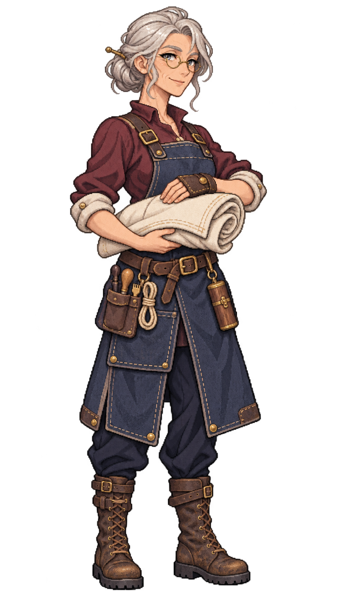

# 🖼️ 伊賽兒・白邊｜帆匠

## 人物設定

- 角色ID：`special_sailmaker_yselle`
- 姓名：伊賽兒・白邊（Yselle Whitehem）
- 女性，54歲，成年
- 船上職位：帆匠

### 性格

耐心、愛講冷笑話，常一邊縫帆一邊聽人抱怨。對手藝很自信，對自己的身體變化則不太坦率。

### 經歷

在港口帆坊工作三十多年，曾經一心追求縫得像新帆，直到一次救回海上破帆，才明白讓受力有路可走比遮住裂痕更要緊。她後來上船，把帆面補片和修理日期都記成小圖，讓接手者不必猜前人的做法。

### 船上職責

檢查帆面受力與磨損、安排帆布裁補、保管針線與補片，與水手長確認作業窗口。

### 專長

善於在有限帆布中規劃可再維修的補法，留下清晰工記，讓學徒接得上。

### 弱點與矛盾

長時間精細工作後手指會僵硬，偶爾為維持老手形象而不肯及時交班。

### 個人目標

把補帆圖記交給一名肯問為什麼的學徒，再親眼看看年輕時只在布料標籤上見過的遠港。

### 登船契機提案

帶著半卷完成的示範帆布在酒館等船；願意給她帶一名學徒與合理作息，比高薪更有吸引力。此為劇情提案。

### 外貌與服裝道具

Yselle Whitehem, age 54, experienced female sailmaker. Clearly mature calm face with fine smile lines, light warm skin, grey-blue eyes behind small round brass spectacles, silver-white hair neatly coiled into a low bun with a few loose wisps. Slim wiry physique, patient slightly amused expression. Muted burgundy linen work blouse with rolled ivory cuffs beneath an indigo-blue split leather-and-canvas work apron, navy trousers, worn brown boots. One forearm cradles a compact folded roll of opaque ivory sailcloth at waist; other hand wears a dark leather sailmaker's palm and rests on the cloth, no needle pointed at viewer. Small wooden sail-sewing tools and closed needle case secured at belt. Cloth remains entirely opaque with crisp pixel folds. No enormous sail filling frame, no floor props, no fashionable young face.

### 代表台詞

> 好補丁，得替下一次破口留位置。

## 技能設計提案

**白邊續縫**：帆匠任職時改善既有帆面修補工作效率，沿用帆布、工具與到崗需求；不無限生成帆布，也不讓破帆瞬間復原。

**個性特長：留給下一手**。修補過程可保留來源與接手資訊，作長航維護型特長；具體效果待玩法定案。

以上保留原始敘事與玩法設計方向；已實作的效率加成見下方遊戲接入，其他情節與提示仍是提案。

## 遊戲接入（TASK-1203）

已加入27人酒館候選池，沿用城鎮每7日固定候選規則。

- **白邊續縫**：帆匠工作效率 +9%。
- **留給下一手**：全船工作效率 +1%，同類特長取最高，不重複疊加。
- 招募費 270.0；日薪 3.0，待命也計薪。
- 任職且付清薪資才生效，待命／空槽／欠薪停止生效，調任後只作用於新船。
- 接入既有真實工作效率運算，並保留食材、帆布、彈藥與人力需求；未把其他原始敘事提案當成已實作能力。

## 創作理念

以職業道具、年齡、面容與服裝輪廓區分同職位角色，延續Astrid的離散像素色階、深色輪廓及海軍藍／象牙白／皮革／黃銅材質。參考僅限畫風，人物與設定為meadow原創；不將船長的臉或毛領複製成職業模板。

直接生成透明RGBA單人全身原稿，使用自然髮色與服色。象牙白衣料、帆布與高光維持不透明；角色可獨立疊在酒館背景上。保留內建工具原檔，不做白底侵蝕去背，不製作居民換色圖集。

## 來源與交付

- 內建工具：image_gen；use case：stylized-concept。
- 尺寸：948×1659；RGBA；alpha 0～255。
- SHA-256：`86470946742c280a33a2fc11a66b1d4371a2f1306df67a69ccbf47bd57077beb`。
- 參考：`D:/Unity/Valhalla/ArtGallery/RawImages/meadow_captain_astrid_sprite_v1.png`（僅畫風）。
- 參考SHA-256：`dc109884666dfdf056aba9ecbaab2dfc0220d459e2d1b3e85d1643462cb0361b`。
- 遊戲待用素材：`img/crew/special_sailmaker_yselle.png`；已註冊酒館候選池。
- 完整提示詞、設定及檔案對照：Blocksail `docs/evidence/crew-batch2-1201/generation.json`。

## 實際生成提示詞

```text
Use case: stylized-concept. Asset: ONE original adult female special crew member for the Blocksail recruitment UI. Reference image is STYLE ONLY: match Astrid's refined Japanese anime pixel-art sprite, crisp stair-step contours, dark selective outlines, discrete clustered shading, detailed fabric/leather/brass and expressive face, restrained age-of-sail fantasy costume. Create a DISTINCT person, never copy Astrid's face, braid, captain coat or fur trim. Single full-body standing figure, portrait approximately 4:7, three-quarter facing slightly screen right, complete hair, hands, tools and boot soles, generous transparent margins on every side. Natural hair and clothing colours. Practical trousers and boots. Upper-left light, no ground shadow, no background scene, no white backdrop, no checkerboard drawn, no labels, text, border, watermark, duplicates or extra people. GENUINELY TRANSPARENT background with clean alpha; preserve ivory fabric and highlights as opaque. Use the reference's refined visible pixel clusters; no smooth airbrush gradients, blur or pixel-noise filter. Yselle Whitehem, age 54, experienced female sailmaker. Clearly mature calm face with fine smile lines, light warm skin, grey-blue eyes behind small round brass spectacles, silver-white hair neatly coiled into a low bun with a few loose wisps. Slim wiry physique, patient slightly amused expression. Muted burgundy linen work blouse with rolled ivory cuffs beneath an indigo-blue split leather-and-canvas work apron, navy trousers, worn brown boots. One forearm cradles a compact folded roll of opaque ivory sailcloth at waist; other hand wears a dark leather sailmaker's palm and rests on the cloth, no needle pointed at viewer. Small wooden sail-sewing tools and closed needle case secured at belt. Cloth remains entirely opaque with crisp pixel folds. No enormous sail filling frame, no floor props, no fashionable young face.
```


