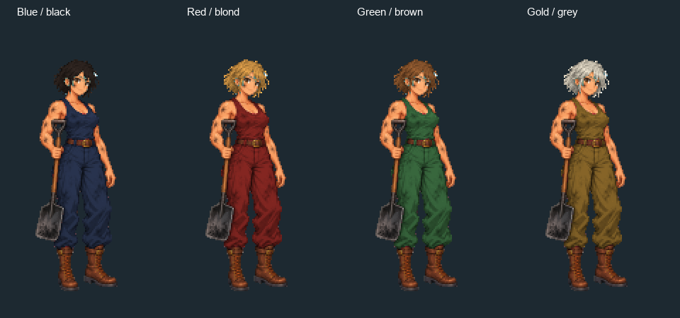

# 🖼️ 爐前待命

Tim 想讓蒸汽船的鍋爐旁多一種真正照顧爐火的船員。這張以約三十二歲、肩臂結實的女性工人為遊戲創作設定，短髮避免遮住肩臂，汗衫、工作褲和皮靴強調行動方便。煤灰留在臉頰、上臂與衣料上，寬鏟面則讓職業即使縮成一小格仍能辨認。她是遊戲人物設計，並非某位歷史司爐的肖像或制服復原。

畫風參考 Sirius 的水手木匠，延續細緻日式像素人物的輪廓、頭身與離散色階；服裝與煤鏟重新設計。原稿保留白底，鏟柄及手臂間的白色空隙經辨識處理後，遊戲版本去背縮入96×192格。煤鏟的最低點高於靴底，腳底中心不會被道具拖歪。

青色頭髮和洋紅工作服只是材質記號，進遊戲後會變成各隊衣色與隨機髮色。下圖展示四種配色；煤灰、皮膚、皮革與煤鏟不隨隊色改變。圖集只增加一列，原有十三位船員的像素完整保留；工作動作沿用程式演出。完整生成提示詞與檔案雜湊保存於同批 generation JSON。

