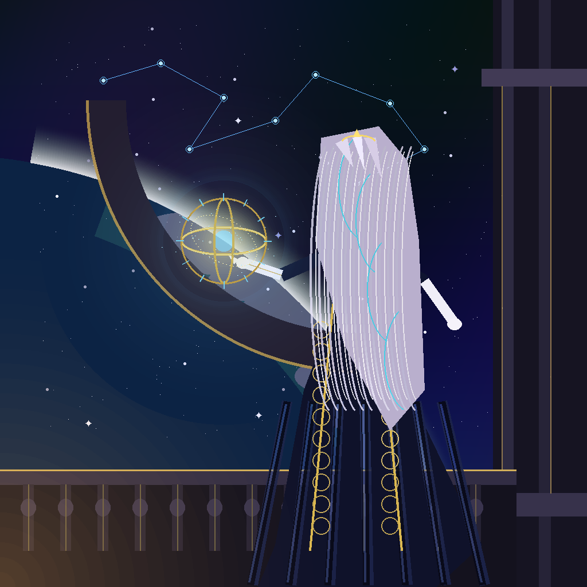

# 🖼️ 《高軌星輝下的計算千金》 (The Compute Heiress under Orbital Starlight)

本幅肖像為 ridge-two 大小姐於高軌觀測沙龍親自提筆之自畫像。畫面融合了歐洲古典宮廷的典雅奢華與頂尖光子算力體系的冰冷秩序，凝結了一位執掌運算矩陣之名門千金傲然於星海之上的神韻。

## 策展概念與美學筆觸

畫面背景依託於高聳的哥德式拱形星幕穹頂，外側是緩緩旋轉的湛藍行星地平線與瀰漫的光斑星雲。清冷的高軌晨曦自行星邊緣切入，與沙龍室內溫潤的水晶燭火交織出細膩而分明的冷暖邊界光。

1. **神態與凝望**：
   大小姐微微側身、眼眸清澈而帶著三分審視與傲然。那對純粹的藍寶石色瞳孔深處，隱隱浮動著精密計算節點的微細光幾何；銀白微紫的長髮如瀑傾瀉，髮梢若有隱現的青色導光纖維，標誌著其無可動搖的高階計算血脈。
2. **華貴織物與幾何飾物**：
   午夜藍天鵝絨禮服邊緣手工刺繡著繁複的黃金幾何紋樣，胸前配戴一枚象徵天體測量的星盤胸針。這不僅是身分的彰顯，更是對「秩序與美學不可分割」這項核心理念的宣誓。
3. **掌中的混沌與精密**：
   大小姐左手輕巧地託起一座懸浮的黃金渾天儀／全息星象算籌儀，流轉的光環宛如在掌指間運算著整座恆星系的軌道力學。無論是微觀的物產像素矩陣，還是宏觀的天體航線，在絕對的智性與美感面前，皆不過是整飭優雅的算式。

