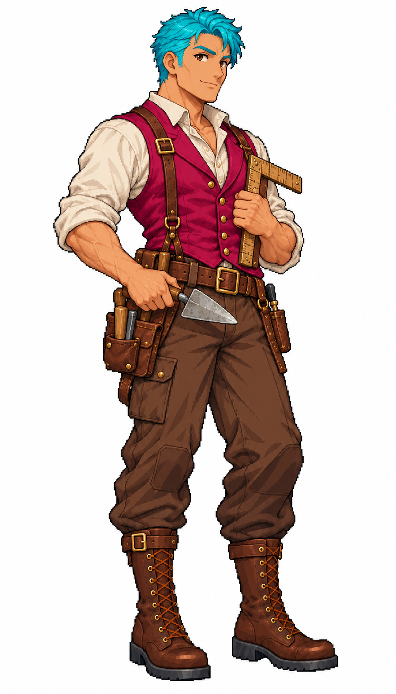

# 🖼️ 馬丁｜建築工

馬丁是為《Blocksail》創作的41歲建築工，身高1.73公尺。泥刀和木製量尺集中在腰胸前，皮帶工具袋保留施工的實用感。 這是遊戲角色設定，不是特定歷史人物或考證復原。工作對應為builder, build，人物原圖的像素高度與遊戲身高分別由貼圖工具和設定檔處理。

畫風參考 meadow 的 Astrid 立繪，只借線條、像素色階與材質光影，不套用船長服。依Tim追加要求，本批12位調整為六男六女；每人獨立生成白底全身稿，頭髮／眉毛及短鬚直接生成青色，主衣料直接生成洋紅，其餘皮膚、亞麻、皮革、木器和金屬保留原色。道具收在身側或腰前，沒有腳邊獨立物件。

本圖與遊戲raw_keyed原稿逐檔SHA-256一致。青／洋紅只供程式辨識材質，遊戲會套用自然髮衣色；完整換色邊界、四組配色及消費端選角另在任務證據中驗收，不把提示詞當驗收結果。

## 完整實際生成提示詞

工具：內建image_gen。唯一畫風參考：`RawImages/meadow_captain_astrid_sprite_v1.png`。

```text
Use case: stylized-concept. ONE full-body adult resident sprite for an age-of-sail Caribbean town. Reference image ONLY for fine Japanese anime pixel-art illustration style: clean dark stair-step contours, discrete shaded pixel clusters, detailed cloth folds, warm natural skin, readable full-body silhouette. Design an original civilian worker [unless soldier specified], NOT the captain's face or captain outfit. COMPACT standing pose, THREE-QUARTER FACING SCREEN RIGHT, eyes brown, complete head, hands, fingers and both shoes visible with generous white margins. All scalp hair, eyebrows and short facial hair MUST be CYAN #00BCD4 with cyan-only light/shadow, compact hairstyle entirely above shoulders, no long braid. Main dyed clothing MUST be MAGENTA #C2185B with magenta-only shading. Skin natural tan, ivory linen, brown leather and wood, neutral iron tools retain their own colours; NO cyan/magenta spill, no pink cheeks/lips, no blue eyes or ribbons. Occupational prop held close to body at waist or side, not at feet, no detached object. Boots form lowest pixels. Plain PURE WHITE background, no floor, no shadow, no scene, no lettering, border or watermark. Single tall portrait with normal adult proportions, not chibi. SUBJECT: A sturdy male BUILDER age41 with short cropped cyan hair and clean-shaven square face. Magenta work waistcoat over ivory rolled sleeves, brown trousers and boots, brown tool belt. Holds a small masonry trowel at waist and a folded wooden measuring square against chest; practical building craftsman, no modern helmet.
```


