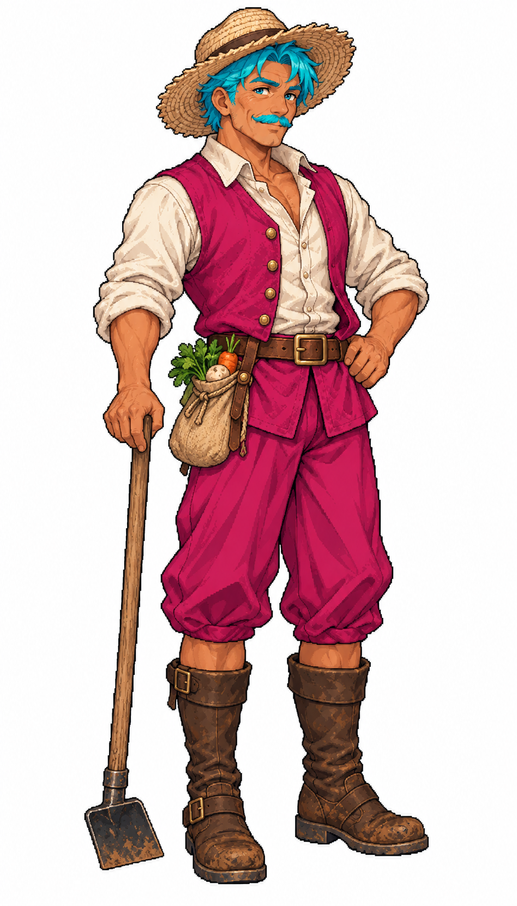

# 🖼️ 馬提亞斯・田埂｜菜農

四十七歲菜農，擅長整畦與育苗，總先看土壤濕度再決定今天做什麼。這位居民讓街道有不同年齡與生活節奏；角色設定是創作提案，不改變城鎮人口、產量或勞動帳。職業藉由服裝、姿態與隨身物件傳達，不額外加入經濟模擬。

畫風參考 [meadow 的 Astrid 船長](meadow_captain_astrid_sprite.md)，沿用細緻日系像素輪廓與分色陰影，但調整為此角色的年齡與身形。主衣料從生成時就是洋紅，髮絲、眉毛與短鬚以青色標記；這些是遊戲換色區，並非人物的自然配色。皮膚、白襯衫、木器、藤籃與皮革保留原色，原稿未經事後大塊塗色。

遊戲端使用 96×192 圖格，人物高度倍率 1.00，原圖與遊戲 raw_keyed 檔一致。成圖與四組換色預覽均需看圖核對；髮型、姿勢與小物的實際形狀以圖為準。白底完整原稿在此展出，遊戲載入前由素材工具去背並轉成換色圖集。

## 完整生成提示詞

內建 image_gen，參考圖片 meadow_captain_astrid_sprite_v1.png 僅提供畫風。

```text
Use case: stylized-concept. ONE full-body individual town resident, finest Japanese anime pixel-art illustration matching reference fine density, crisp stair-step dark outlines and discrete detailed shading. Matias, 47-year-old adult MALE farmer, broad sturdy build, deeply sun-tanned olive skin, mature lined face, short entirely cyan hair visible beneath TAN STRAW HAT, short cyan moustache, kind focused eyes. Magenta rough linen work vest and magenta loose knee breeches, ivory rolled sleeve shirt, brown leather belt and muddy brown CLOSED work boots. Small plain wooden handled hoe held vertically close to side, compact tan sack of vegetables at belt. Around 1715 Caribbean civilian, no modern farm equipment. PRODUCTION KEY COLORS: ALL hair including roots, eyebrows and facial hair MUST be saturated CYAN #00BCD4 with cyan-only highlights/shadows, NO natural gray brown hair. ALL main colored fabric must be saturated MAGENTA #C2185B with magenta-only light/dark shading. Ivory shirt/apron, natural skin, tan straw/wood/rope, brown leather, olive herbs, silver metal remain natural; absolutely NO cyan/magenta spill, reflections or speckles on those materials. Hair and facial hair compact within upper third of figure. Full head fingers feet inside comfortable margin. Three-quarter facing slightly right, narrow standing silhouette. Plain PURE WHITE background, no ground shadow, no scenery, no text or border. Reference only for STYLE; subject age and clothing are as specified, not captain.
```


