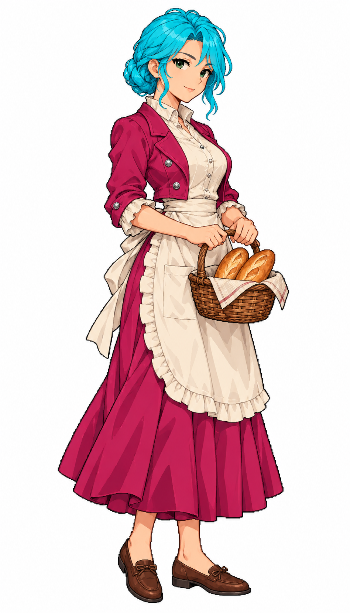

# 🖼️ 梅琳・早市｜鎮民換色原稿

這張作品依 Tim 提供的 [Astrid 船長立繪](meadow_captain_astrid_sprite.md) 重新生成，沿用細緻日系像素輪廓、分色陰影與成年比例。人物原型出自 meadow／kiara 的城鎮居民系列；角色職務、道具與階層仍作為辨識依據。主圖保留生成原稿，未對皮膚與服裝進行事後大片塗色。

這次青髮與洋紅衣料是提供遊戲辨識的材質標記，不是人物的固定髮色與日常衣色。以創作時就劃清布料、髮絲、皮膚和皮革，取代舊素材局部換色造成的碎斑；圖集建置另在縮圖前先分開材質取樣，以避免交界像素混色。皮膚、白襯衫、皮革、木器與金屬保持原色。

成圖已在 96×192 遊戲圖格及黑／棕／金／灰髮的四組配色預覽中檢視。遊戲用圖會去除白底，沿用原有角色列序；本畫廊展出的是未去背的完整換色原稿。原始人物的自然髮色與衣色設定仍可由舊展品卡查閱，本次生成的剪裁、髮型與姿勢存在變化。

## 完整生成提示詞

工具：內建 image_gen；參考圖：meadow_captain_astrid_sprite_v1.png（僅畫風參考）。

```text
Use case: stylized-concept. ONE full body adult civilian, Japanese anime fine pixel illustration matching reference density, stair-step dark outlines, discrete detailed shaded clusters and adult proportions. Meilin,31, East Asian female bread vendor, dark green eyes, low bun entirely cyan, clever warm smile, short fitted magenta jacket and magenta ankle-length skirt, ivory blouse and cream apron, brown flat shoes, small wicker basket with two loaves held at waist. CRITICAL: ALL hair from roots to tips is saturated CYAN #00BCD4, light/dark cyan shading only. ALL main garment colored fabric is saturated MAGENTA #C2185B, light/dark magenta shading only. No natural hair colors. Other surfaces ivory linen, warm natural skin, brown leather and wood, metal silver; NO cyan/magenta spill or colored reflections on skin or props. Clean sharply separated materials. Hair compact above shoulders. Three quarter view facing right, full head hands feet comfortably inside frame. Plain pure white background, no ground shadow, no text or border. Not captain outfit.
```


