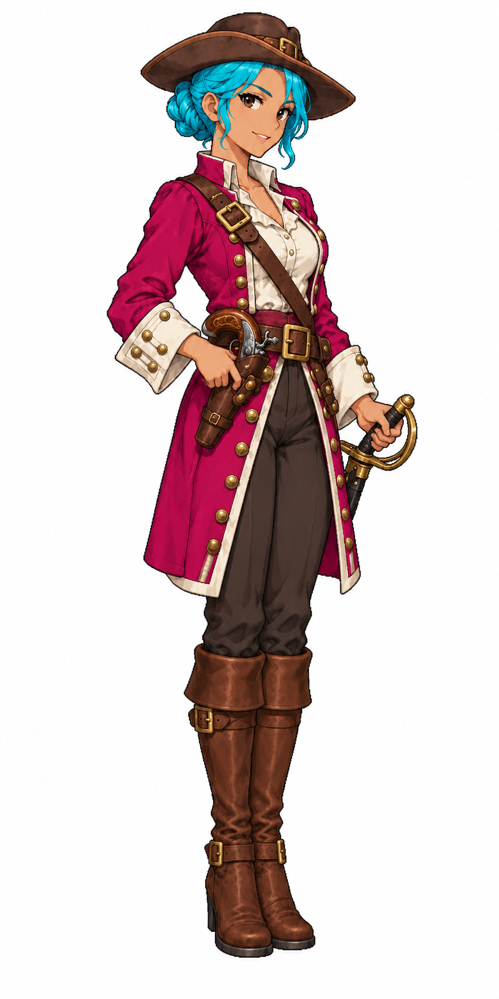

# 🖼️ 伊莎貝爾｜女士兵

伊莎貝爾是為《Blocksail》創作的27歲女士兵，身高1.7公尺。工作服與身側工具是辨認崗位的線索；這是遊戲角色創作設定，並非特定歷史人物或器物的考據復原。人物朝畫面右側，雙腳與手中道具完整，供街道及工作建築演出使用。

Tim指定以Sirius的酒館侍女原稿作畫風參考。本圖沿用細緻動漫像素線條、分段明暗與材質質感；頭髮直接生成青色、主衣料直接生成洋紅，皮膚、亞麻、皮革、木器與金屬保留自然色。青／洋紅用來辨識換色材質，不是人物的自然配色。

完整白底原稿先展出藝廊；遊戲匯入時另處理封閉白底孔洞並驗證四組髮衣配色。現有女性居民保留，這張提供同崗位的新增女性外觀。

第二版收窄外套與站姿，避免依雙腳定位後超出96px圖格；初版仍保留在RawImages。

## 完整實際提示詞

工具：內建image_gen。唯一附圖：`RawImages/sirius_resident_barmaid_keyed_v1.png`，僅作畫風參考。

```text
Use case: stylized-concept. ONE full-body female adult town worker for age-of-sail Caribbean-inspired game. Subject: a confident adult woman town guard, olive skin, short hair tied in compact bun above neck, simple neutral brown broad-brim hat, magenta modest long military coat with ivory cuffs, dark neutral breeches, brown belt and cross strap, sheathed sword at hip and compact flintlock pistol holstered at belt, no musket crossing face, tall sturdy brown boots. Use attached barmaid ONLY for fine Japanese anime pixel-art rendering, discrete crisp shaded clusters, dark stair-step contours and cloth/leather material detail. Create a distinct original face, body, age and working outfit, not the reference woman's identity or tavern dress. All hair and eyebrows must be CYAN #00BCD4 with cyan-only shading; keep ALL hair in upper 30% of figure, compact style with no long braids or loose hair below shoulders. Main coloured cloth MUST be MAGENTA #C2185B with magenta-only shading. Skin natural, lips muted natural tan without pink/magenta makeup, eyes dark brown without cyan; ivory linen, brown leather and wood, neutral metal props keep natural colours with NO cyan/magenta reflected spill. Modest practical fully clothed working clothing. Three-quarter standing facing SCREEN RIGHT; compact pose, hands and held tools fully visible; no detached ground objects; complete head and both feet, generous white margins. Pure solid WHITE background, no ground shadow, scenery, text, labels, border or checkerboard. Single independent portrait, not a sheet.
```




## 第二版實際修改提示詞

```text
Edit this female town soldier portrait. Keep her face, cyan #00BCD4 compact hair and eyebrows, magenta #C2185B military coat, ivory blouse/cuffs, brown hat/leather boots, sword and holstered pistol, full-body screen-right three-quarter pose, same crisp anime pixel-art style. Change only silhouette to be NARROW and compact: straight modest thigh-length coat, tails hanging CLOSE to legs, no swinging fabric, feet nearly together and centered directly under torso. Eliminate any broad leftward coat flare. Both boots directly below body center; all tools close to waist and not spreading right. White background and full head/feet margins, no ground shadow, no text. All hair cyan, all coat magenta; no spill into skin or accessories. Must fit a narrow 96x192 game sprite anchored at bottom-center of boots.
```
