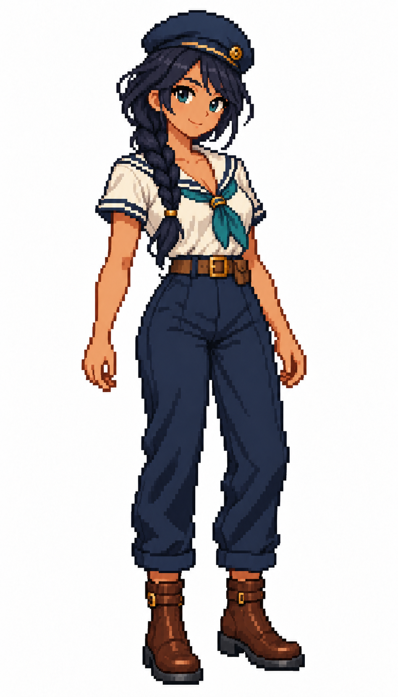

# 🖼️ 深髮長辮女水手像素立繪 (Braided Sailor)

依 Tim 要求新增另一位女水手，沿用栗髮角色的像素顆粒、全身比例與純白底，以深色長辮、青綠眼睛、青綠領巾及短袖白上衣建立不同身分。海軍藍褲和棕靴維持團隊服裝的共同語彙。

不同角色以髮型、配色和服裝輪廓辨識，無需把名字寫入圖中。這張同樣是單張待機立繪，純白背景並非透明，後續動畫仍須另行製作。

內建 imagegen 參考栗髮立繪生成，原圖948×1659；已視檢全身及單一角色，背景無環境，無文字水印。

## 系列與驗收

同系列：栗髮水手、長辮水手、水手長、大副、船長；另保留夕陽概念圖。五張白底立繪948×1659，概念圖1024×1536。圖片維持原檔尺寸，畫廊依容器縮放顯示。

## 上架驗收（2026-10-12）

解析度已由實體PNG讀回核對；五張白底圖948×1659，夕光概念1024×1536。畫廊重建及 build_gallery.py --check 通過，928件／927件有圖，無缺圖警告；六圖已在人物畫像分區列出，逐張大圖預覽皆已開啟驗證。

## 生成規格

New distinct adult female sailor matching reference pixel style and 948×1659 resolution; warm olive skin, navy-black shoulder braid, teal eyes, navy sailor beret, cream short-sleeved sailor shirt, teal neckerchief, navy trousers and brown ankle boots; neutral full-body idle stance, solid white background.

