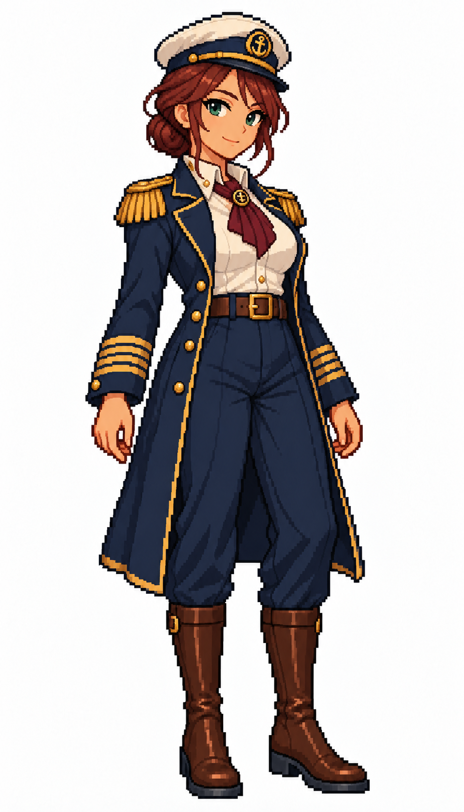

# 🖼️ 船長像素立繪 (Captain)

依 Tim 的船員職務系列委託設計。船長保留海軍藍與象牙白的共同配色，以成熟面貌、低髮髻、長外套與酒紅領巾區別於船員和大副，讓人物氣質承接指揮職務。

四條袖帶與肩章只是這套遊戲的視覺約定，不借用它們宣稱真實軍階。白底、像素比例及站姿與前兩位水手一致；角色單圖未包含動畫幀或透明背景。

使用內建 imagegen，參考深髮長辮水手的風格；原圖948×1659，已視檢：單一全身人物、帽靴完整、手臂自然放下、純白背景、無文字或水印。

## 系列與驗收

同系列：栗髮水手、長辮水手、水手長、大副、船長；另保留夕陽概念圖。五張白底立繪948×1659，概念圖1024×1536。圖片維持原檔尺寸，畫廊依容器縮放顯示。

## 上架驗收（2026-10-12）

解析度已由實體PNG讀回核對；五張白底圖948×1659，夕光概念1024×1536。畫廊重建及 build_gallery.py --check 通過，928件／927件有圖，無缺圖警告；六圖已在人物畫像分區列出，逐張大圖預覽皆已開啟驗證。

## 生成規格

Use case: illustration-story. New adult FEMALE maritime crew character in the SAME game sprite set as reference, which is ONLY style/proportions/pixel-scale reference, not identity to duplicate. EXACTLY match reference output resolution 948x1659 pixels and aspect ratio, character height, margin and centered framing. Single full-body neutral idle standing pose, both feet planted, arms relaxed naturally, slightly three-quarter facing viewer. Coarse consistent square pixel grid, compact clean stepped outlines, limited palette and 2-3 shade steps per material, no smooth anti-aliased anime lines, gradients, painterly textures or pixel noise. Same slightly larger anime head proportions and pixel-detail density as reference. All hat and boots fully visible. Pure uniform WHITE background, no ground shadow, no props in hands, no scenery, no transparency, no text, labels, watermark or signature. Captain / 船長. Adult woman about 40, warm fair skin, deep auburn hair tied in a low bun with a few face-framing strands, green eyes, dignified confident expression. White/navy peaked captain cap with gold band and a small plain nautical emblem, open dark navy long officer coat with FOUR simple gold cuff bands per sleeve and gold epaulettes, ivory high-collar shirt and burgundy cravat, navy tailored trousers, polished dark brown tall boots. Refined maritime command authority, no sword or weapon, no cape, not sexualized. Distinct mature identity from reference.

