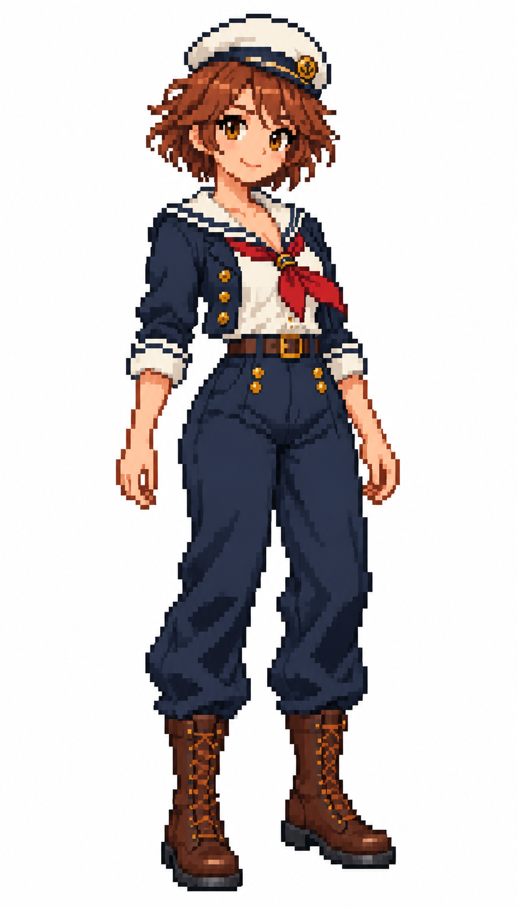

# 🖼️ 栗髮女水手像素立繪 (Chestnut-haired Sailor)

由夕光甲板女水手改作遊戲角色素材；保留栗色短髮、白水手帽、紅領巾、深藍短外套與長褲、棕色高筒靴。姿態改為雙腳站穩、双臂自然放下，讓輪廓離開背景也能辨認。

粗化像素、減少環境光與細碎紋理，是這套角色系列的風格基準。純白底是使用者指定的輸出，並非透明底；此圖為單張全身立繪，尚不是有動作幀的動畫圖集。

內建 imagegen 參考初始概念圖生成，原圖948×1659。已視檢帽子、雙手與靴子完整，角色無環境道具和文字。

## 系列與驗收

同系列：栗髮水手、長辮水手、水手長、大副、船長；另保留夕陽概念圖。五張白底立繪948×1659，概念圖1024×1536。圖片維持原檔尺寸，畫廊依容器縮放顯示。

## 上架驗收（2026-10-12）

解析度已由實體PNG讀回核對；五張白底圖948×1659，夕光概念1024×1536。畫廊重建及 build_gallery.py --check 通過，928件／927件有圖，無缺圖警告；六圖已在人物畫像分區列出，逐張大圖預覽皆已開啟驗證。

## 生成規格

Edit original sailor into coarse visible pixel grid game character sprite, preserve chestnut-haired adult sailor identity and navy/ivory/red costume, neutral freestanding full-body idle stance, limited palette, stepped outlines, pure white background, no scenery, no labels or watermark.

