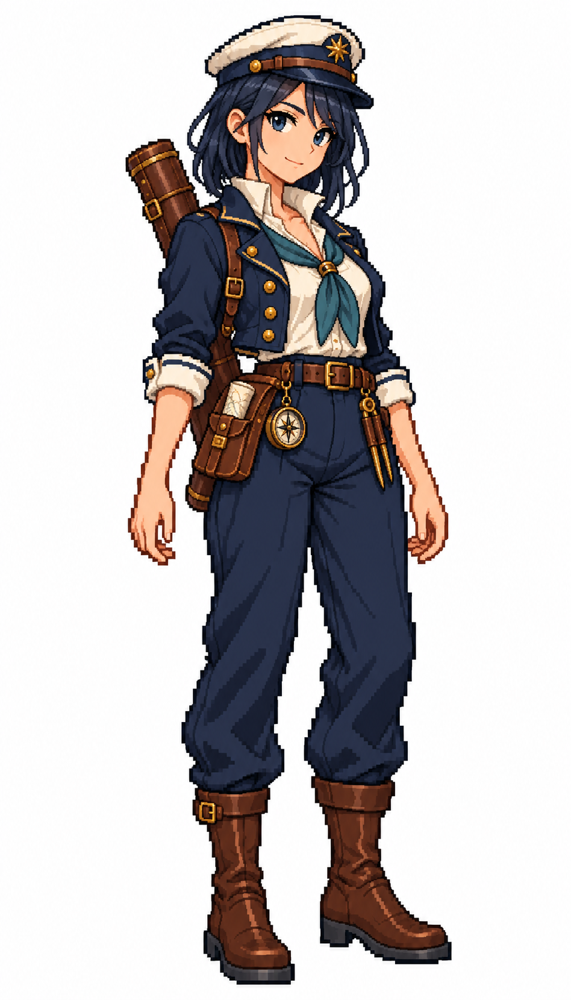

# 🖼️ 航海士女船員精緻點陣立繪

這次把原本水手系列延伸到航海士。維持深藍與象牙白的共通服裝、棕色皮革、白底全身待機構圖，將像素層次與服裝細節做得更細緻；角色仍有清楚的階梯輪廓與分色陰影。

職務設定：Navigator / 航海士. Adult woman about 30, straight midnight-blue shoulder-length hair tucked behind ear, sea-blue eyes, composed alert expression. Navy peaked navigator cap with a small generic brass star ornament, tailored navy short coat with restrained brass buttons, ivory high-collared shirt, muted teal neck scarf, navy trousers, dark brown mid-calf boots. Closed leather chart tube strapped across back and secured at hip; a small folded chart and brass dividers case tucked in belt pouch, modest compass case. Neutral stance with hands relaxed and empty. Visually distinct from ornate captain, scholarly and practical, no modern GPS.

兩張舊圖僅提供系列畫風、比例與配色參考；新角色有獨立的髮型與面貌。這是帆船遊戲用的原創職務設計，不宣稱復刻特定年代的真實制服。單張白底立繪，尚非透明PNG、遊戲圖集或動畫幀；本次不改遊戲素材。

參考：[栗髮女水手](sirius_sailor_chestnut_sprite.md)、[水手長](sirius_sailor_boatswain_sprite.md)。生成方式：內建imagegen。

## 完整生成提示詞

```text
Use case: stylized-concept. Produce one finished game character illustration, a new ADULT FEMALE crew member in this existing nautical sprite series. Reference images are STYLE, costume palette, proportions and framing references ONLY, not characters to copy. Japanese refined pixel art / 精緻日系點陣: expressive anime face, beautifully designed costume, carefully placed square pixels, crisp stair-step outlines, discrete pixel shading, coherent moderate pixel density. Refine detail beyond the old coarse sprites while remaining unmistakably pixel art; no smooth painted rendering, no pixel noise. Single full-body character in relaxed neutral idle stance, three-quarter view slightly toward screen RIGHT, both boots grounded on same baseline, arms relaxed, equipment secured close to body. Portrait aspect close to 4:7, entire cap/hair/hands/boots visible with comfortable white margins, centered and consistent scale. Uniform pure WHITE background, NO ground shadow, NO scenery, NO typography, labels, watermark or frame. Navy blue and ivory crew palette, brown leather, one role-specific accent. Practical age-of-sail-inspired fantasy game clothing with trousers and sturdy boots, no modern medical/military equipment, no real insignia, no gore. Different adult face and hair for each role. Navigator / 航海士. Adult woman about 30, straight midnight-blue shoulder-length hair tucked behind ear, sea-blue eyes, composed alert expression. Navy peaked navigator cap with a small generic brass star ornament, tailored navy short coat with restrained brass buttons, ivory high-collared shirt, muted teal neck scarf, navy trousers, dark brown mid-calf boots. Closed leather chart tube strapped across back and secured at hip; a small folded chart and brass dividers case tucked in belt pouch, modest compass case. Neutral stance with hands relaxed and empty. Visually distinct from ornate captain, scholarly and practical, no modern GPS.
```


