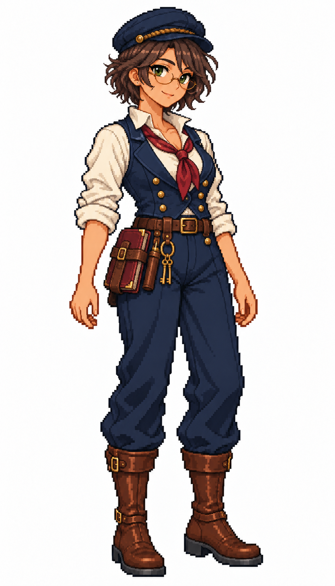

# 🖼️ 軍需官女船員精緻點陣立繪

軍需官照顧的是船上的糧食、物資與庫存。眼鏡、整齊的背心、腰側帳冊和鑰匙，讓她有別於船長與甲板工作者；深藍、象牙白與棕色皮革則延續團隊的共同輪廓。

職務設定：Quartermaster / 軍需官, in charge of shipboard stores and inventory. Adult woman about 36, olive skin, short wavy dark chestnut hair, dark green eyes, clever matter-of-fact smile, thin oval brass spectacles. Simple navy flat cap, ivory stand-collar shirt, muted burgundy necktie, neat navy waistcoat with brass buttons, navy trousers, brown tall boots. Small closed inventory ledger bound in burgundy leather secured at hip in a leather book holster, pencil case and a restrained ring of two brass store-room keys at belt. Empty relaxed hands. Organized provisioning role, not a captain or armed soldier.

兩張舊圖僅作系列畫風、比例與配色參考；新角色採獨立髮型與面貌。原創帆船遊戲職務設計，並非特定海軍制度的史實制服。單張白底全身待機立繪，尚非透明圖集或動畫幀；本次不改遊戲素材。

參考：[栗髮女水手](sirius_sailor_chestnut_sprite.md)、[水手長](sirius_sailor_boatswain_sprite.md)。生成方式：內建imagegen。

## 完整生成提示詞

```text
Use case: stylized-concept. Produce one finished game character illustration, a new ADULT FEMALE crew member in this existing nautical sprite series. Reference images are STYLE, costume palette, proportions and framing references ONLY, not characters to copy. Japanese refined pixel art / 精緻日系點陣: expressive anime face, beautifully designed costume, carefully placed square pixels, crisp stair-step outlines, discrete pixel shading, coherent moderate pixel density. Refine detail beyond the old coarse sprites while remaining unmistakably pixel art; no smooth painted rendering, no pixel noise. Single full-body character in relaxed neutral idle stance, three-quarter view slightly toward screen RIGHT, both boots grounded on same baseline, arms relaxed, equipment secured close to body. Portrait aspect close to 4:7, entire cap/hair/hands/boots visible with comfortable white margins, centered and consistent scale. Uniform pure WHITE background, NO ground shadow, NO scenery, NO typography, labels, watermark or frame. Navy blue and ivory crew palette, brown leather, one role-specific accent. Practical age-of-sail-inspired fantasy game clothing with trousers and sturdy boots, no modern medical/military equipment, no real insignia, no gore. Different adult face and hair for each role. Quartermaster / 軍需官, in charge of shipboard stores and inventory. Adult woman about 36, olive skin, short wavy dark chestnut hair, dark green eyes, clever matter-of-fact smile, thin oval brass spectacles. Simple navy flat cap, ivory stand-collar shirt, muted burgundy necktie, neat navy waistcoat with brass buttons, navy trousers, brown tall boots. Small closed inventory ledger bound in burgundy leather secured at hip in a leather book holster, pencil case and a restrained ring of two brass store-room keys at belt. Empty relaxed hands. Organized provisioning role, not a captain or armed soldier.
```


