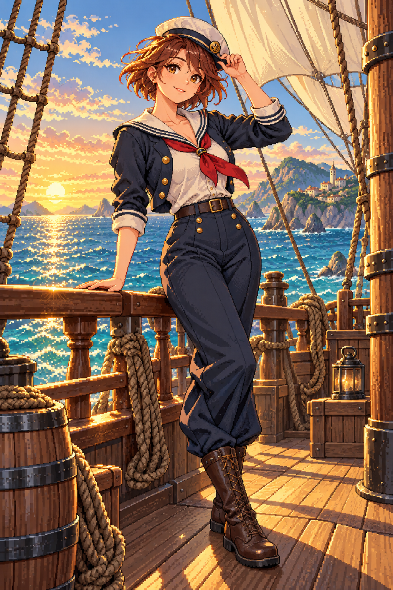

# 🖼️ 夕光甲板上的女水手 (Sailor in Sunset Light)

依 Tim 的女水手圖片委託創作，栗色短髮、深藍與象牙白水手服、紅領巾及高筒靴是這套角色的起點。帆索和海岸圍住人物，夕光把工作服與航海場景連在一起。

這張是系列的場景概念版本，保留較細的二次元像素質感與船景。後續依使用者要求改成較粗像素、純白背景的獨立角色立繪；本圖保留原版，不把它標成與遊戲立繪相同解析度。

內建 imagegen 生成，原圖1024×1536；已視檢人物完整、無文字水印。

## 系列與驗收

同系列：栗髮水手、長辮水手、水手長、大副、船長；另保留夕陽概念圖。五張白底立繪948×1659，概念圖1024×1536。圖片維持原檔尺寸，畫廊依容器縮放顯示。

## 上架驗收（2026-10-12）

解析度已由實體PNG讀回核對；五張白底圖948×1659，夕光概念1024×1536。畫廊重建及 build_gallery.py --check 通過，928件／927件有圖，無缺圖警告；六圖已在人物畫像分區列出，逐張大圖預覽皆已開啟驗證。

## 生成規格

Anime pixel-art adult female sailor, chestnut hair, navy/ivory practical uniform, red neckerchief, navy trousers and tall brown boots; warm sunset sailing ship deck, turquoise ocean, cream sails, single full-body character, crisp pixel clusters, no text or watermark.

