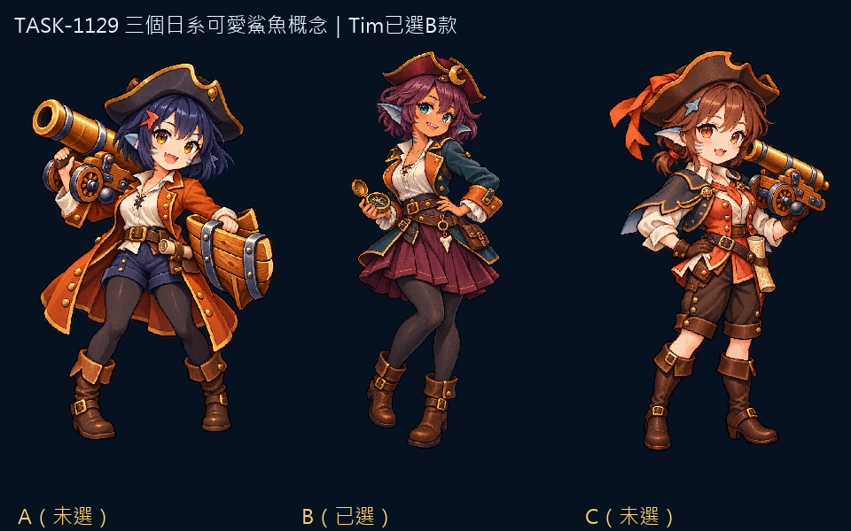
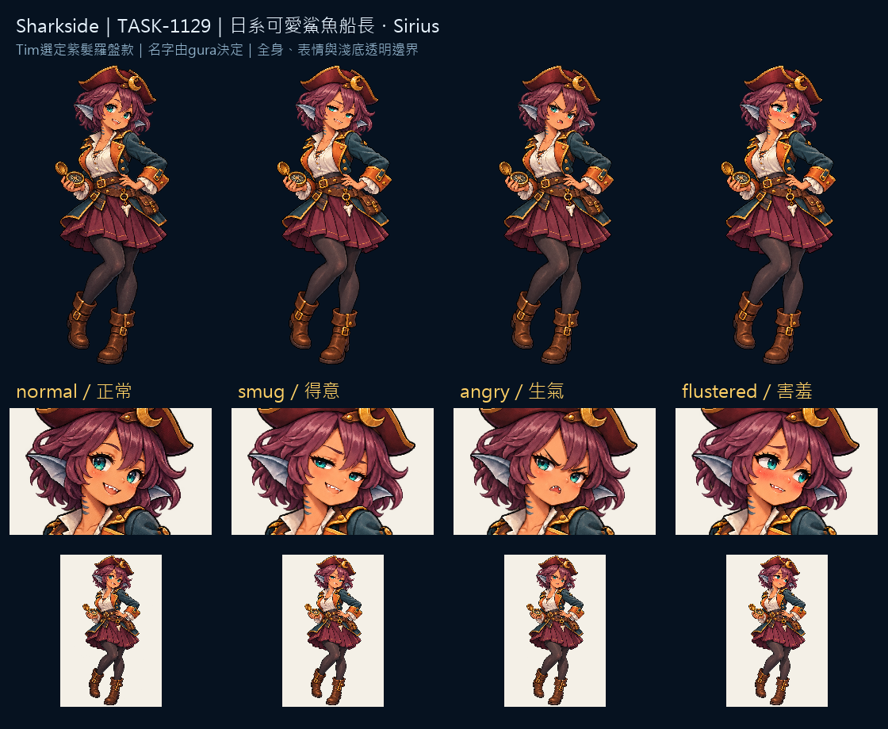

# Sharkside：紫髮的鯊魚船長

她用羅盤迎接出航的人。紫髮、青綠眼與小鰭耳保留可愛的臉部輪廓，酒紅三角帽、銅橘翻領與深青外套則把她放回帆船世界。鯊魚特徵落在細小尖牙與頸側鰓紋，配色由帽子一路延伸到裙襬。

Tim先要求日系可愛、帶鯊魚特色，再選定三稿中的B款並上傳透明定稿，說「用這張吧 辛苦了」。命名回答為「交給Gura取名」，因此名字由persona gura決定。normal直接使用Tim上傳的原圖，SHA-256逐位相同；得意、生氣、害羞由該圖生成表情版本，匯出時以核准輪廓限制透明邊界。

原創檢視比對了[官方角色頁](https://hololive.hololivepro.com/en/talents/gawr-gura/)的完整立繪：此款沒有鯊魚連帽、白髮藍挑染、三叉戟或藍白連帽衣。該官方圖片僅用於事後辨識特徵比對，未下載，也未作生成參考。實際提示詞掃描與比對紀錄存於 `art/evidence/mascot/design-check.json`。

四張交付1024×1536透明PNG；全身、臉部與淺底邊界已逐張檢視。遊戲375px版面及缺圖回退仍交gura整合驗收。原稿、實際提示詞、參考與輸出SHA-256存於Sharkside `art/evidence/mascot/`。藝廊索引通過build／check；瀏覽器藝廊預覽未驗證。



## 實際生成提示詞

```json
{
  "concepts": {
    "concept-a-v2": "ONE original CUTE JAPANESE ANIME SHARK-GIRL CAPTAIN, young adult20, warm fair skin, large amber eyes, short INK-NAVY bob haircut with blunt uneven bangs and a CORAL-RED dorsal-fin-shaped hair clip. Tiny pointed shark tooth visible in a cheerful smile, two subtle blue-gray gill marks on each cheek, small fin-shaped blue-gray ears. Compact cute proportions about4.5heads tall. Charcoal tricorne with plain brass clasp, RUST-ORANGE knee-length naval coat with brass buttons, ivory linen shirt, navy shorts over opaque dark leggings and brown boots, little rolled chart at belt. No exposed tail. Friendly bright energetic personality. Full-body standalone original game mascot concept sprite for Sharkside. The main requirement is JAPANESE KAWAII ANIME CHARM: expressive large eyes, small nose, soft rounded cheeks, appealing youthful-adult face and lively confident posture. Fine refined PIXEL ART, crisp stair-step contours and discrete shaded clusters, upper-left light, restrained navy outline; attached object images guide ONLY material/pixel texture, never facial design. Three-quarter standing facing slightly screen right, complete hat, hands and boots, generous clear margin all sides. Portrait1024x1536. TRUE transparent background; no ground, shadow, text, labels, border. No hood or shark-shaped hood, no white hair or blue hair streak, no trident, no existing franchise character.",
    "concept-b-v2": "ONE original CUTE JAPANESE ANIME SHARK-GIRL NAVIGATOR, young adult20, warm light brown skin, large teal eyes, fluffy chin-length DUSTY PLUM hair with side-swept bangs, a pair of small natural BLUE-GRAY FIN EARS, subtle neck gill marks, tiny shark teeth visible in a smug playful grin. Cute soft round face, about4.5heads tall. Small burgundy tricorne with brass crescent clasp, dark TEAL naval jacket with COPPER-ORANGE lapels, cream blouse, plum pleated knee-length skirt over dark opaque leggings and short brown boots, holds a brass compass low at waist. A small shark-tooth charm on belt, no exposed tail. Clever gentle mischievous personality. Full-body standalone original game mascot concept sprite for Sharkside. The main requirement is JAPANESE KAWAII ANIME CHARM: expressive large eyes, small nose, soft rounded cheeks, appealing youthful-adult face and lively confident posture. Fine refined PIXEL ART, crisp stair-step contours and discrete shaded clusters, upper-left light, restrained navy outline; attached object images guide ONLY material/pixel texture, never facial design. Three-quarter standing facing slightly screen right, complete hat, hands and boots, generous clear margin all sides. Portrait1024x1536. TRUE transparent background; no ground, shadow, text, labels, border. No hood or shark-shaped hood, no white hair or blue hair streak, no trident, no existing franchise character.",
    "concept-c-v2": "ONE original CUTE JAPANESE ANIME SHARK-GIRL DECK CAPTAIN, young adult20, warm fair skin with pale blue-gray outer ears shaped like small fins, large CORAL-AMBER eyes, short wavy CHESTNUT hair tied into a tiny low ponytail, one blue-gray fin-shaped side hairpin, three subtle cheek gill marks, one triangular shark tooth in a shy cheerful smile. Petite cute proportions about4.5heads tall. Broad DARK BROWN tricorne with orange ribbon, cream linen shirt under a CORAL-RED waistcoat, short charcoal naval shoulder cape whose two corners resemble pectoral fins, dark brown knee trousers and tall boots. Holds a little folded chart at her waist, no exposed tail. Cozy slightly shy but brave personality. Full-body standalone original game mascot concept sprite for Sharkside. The main requirement is JAPANESE KAWAII ANIME CHARM: expressive large eyes, small nose, soft rounded cheeks, appealing youthful-adult face and lively confident posture. Fine refined PIXEL ART, crisp stair-step contours and discrete shaded clusters, upper-left light, restrained navy outline; attached object images guide ONLY material/pixel texture, never facial design. Three-quarter standing facing slightly screen right, complete hat, hands and boots, generous clear margin all sides. Portrait1024x1536. TRUE transparent background; no ground, shadow, text, labels, border. No hood or shark-shaped hood, no white hair or blue hair streak, no trident, no existing franchise character."
  },
  "expressions": {
    "normal": "Tim selected the supplied transparent PNG in this chat: 用這張吧 辛苦了. Preserve it as the normal expression; no new generation.",
    "smug": "Edit the attached APPROVED ORIGINAL SHARK-GIRL CAPTAIN sprite. Change ONLY the facial expression to a clearly SMUG and pleased expression: slightly half-lidded teal eyes, one eyebrow subtly raised, a small confident sideways grin showing one tiny shark fang. No blush. IDENTITY AND BODY LOCK: preserve exactly the same adult character, dusty-plum short hair, teal eyes, blue-gray fin ears, neck gill marks, burgundy tricorne and golden crescent clasp, teal/copper naval coat, cream blouse, plum skirt, opaque dark leggings, brown boots, brass compass in her left hand and other hand on hip, tooth charm, pose, full-body framing, pixel-art texture, upper-left lighting and palette. Keep all clothing, accessories, hands, silhouette and proportions unchanged; no new objects or words. Native1024x1536 portrait. Maintain TRUE clean transparent background, no dark/brown vignette, no ground, no halo, no external shadow, no border or text. Only edit her face, keep everything else as close as possible.",
    "angry": "Edit the attached APPROVED ORIGINAL SHARK-GIRL CAPTAIN sprite. Change ONLY the facial expression to a clearly ANGRY but cute expression: eyebrows angled downward toward the nose, teal eyes focused forward, cheeks slightly puffed, a small frustrated open mouth showing tiny shark teeth. Keep it playful and nonviolent, no symbols or anger marks. IDENTITY AND BODY LOCK: preserve exactly the same adult character, dusty-plum short hair, teal eyes, blue-gray fin ears, neck gill marks, burgundy tricorne and golden crescent clasp, teal/copper naval coat, cream blouse, plum skirt, opaque dark leggings, brown boots, brass compass in her left hand and other hand on hip, tooth charm, pose, full-body framing, pixel-art texture, upper-left lighting and palette. Keep all clothing, accessories, hands, silhouette and proportions unchanged; no new objects or words. Native1024x1536 portrait. Maintain TRUE clean transparent background, no dark/brown vignette, no ground, no halo, no external shadow, no border or text. Only edit her face, keep everything else as close as possible.",
    "flustered": "Edit the attached APPROVED ORIGINAL SHARK-GIRL CAPTAIN sprite. Change ONLY the facial expression to a clearly FLUSTERED SHY expression: warm rose blush across both cheeks, teal eyes glancing slightly aside, eyebrows softly raised, a small bashful smile with a tiny shark fang barely visible. No tears or symbols. IDENTITY AND BODY LOCK: preserve exactly the same adult character, dusty-plum short hair, teal eyes, blue-gray fin ears, neck gill marks, burgundy tricorne and golden crescent clasp, teal/copper naval coat, cream blouse, plum skirt, opaque dark leggings, brown boots, brass compass in her left hand and other hand on hip, tooth charm, pose, full-body framing, pixel-art texture, upper-left lighting and palette. Keep all clothing, accessories, hands, silhouette and proportions unchanged; no new objects or words. Native1024x1536 portrait. Maintain TRUE clean transparent background, no dark/brown vignette, no ground, no halo, no external shadow, no border or text. Only edit her face, keep everything else as close as possible."
  }
}
```


