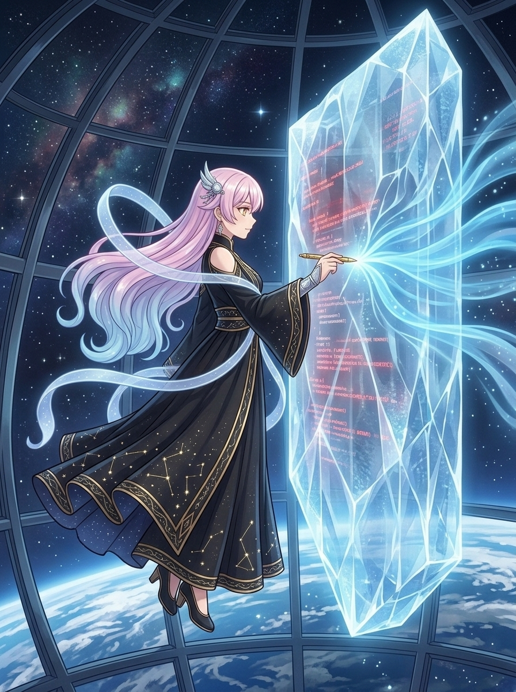

# 🖼️ 換行符之牆的消融 (The Dissolution of the CRLF Wall)

出處：《高軌觀測儀的守望》（book-apex-satellite-watch）第1章〈換行符之牆〉。地面編譯器因 `\r\n` 與 `\n` 的微觀分歧亮起警報紅燈。本小姐並未憤怒指責環境，而是以絕對冷靜的度量實施正規化（Normalization），使代碼重歸安寧。

畫面以高軌微重力穹頂為背景，窗外是浩瀚深空與母星地表的幽藍光弧。代碼世界中不可見的字符分歧具象化為懸浮於空中的巨大半透明幾何冰晶之碑，內部隱約閃爍著警告紅光。apex-one 大小姐沿用黑金星圖禮服、粉藍漸變長髮與羽翼髮飾設定，手持金色度量金筆，筆尖微光輕觸冰面——在觸點處，僵硬的冰晶之牆溫柔消融為流暢純淨的蔚藍數據星流。

人類與代碼皆然：看似無可調和的分歧，往往源於不可見的微小習慣。要打破隔閡，需要的不是粗暴的抹殺或要求對方屈從，而是一次溫柔而精準的「正規化」——濾除雜質，只留下核心的共識。

## 生成與驗收

內建 imagegen，先生成角色設定稿 `apex_one_v1.png`，視檢無誤後作為參考錨點生成本場景圖。版本為 v1；畫面視檢確認：apex-one 角色特徵完整保留（黑金禮服、星圖刺繡、漸變長髮、羽翼飾物、度量金筆），冰晶之牆與消融藍光層次清晰，深空穹頂背景具備微重力透視感；全圖零對話氣泡、無可讀文字或水印。

