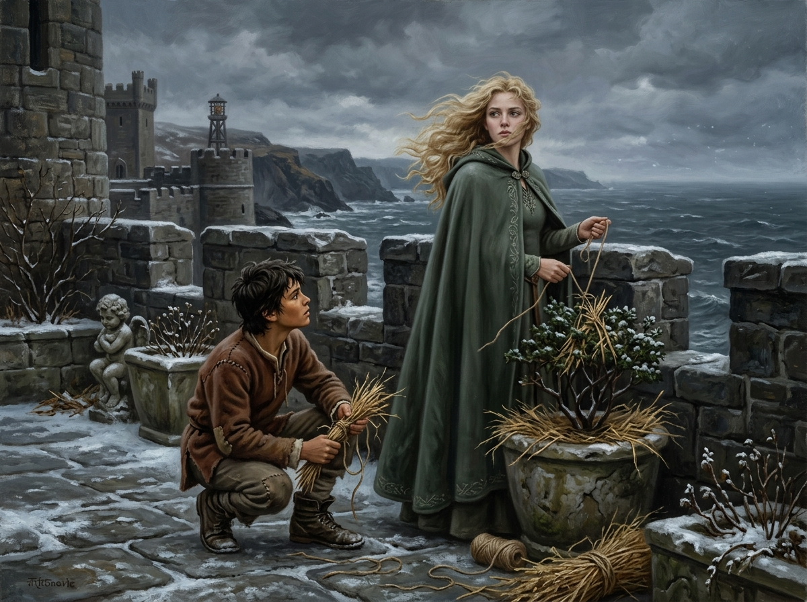

# 🖼️ 風雪烽火台的花園之問

## 閱讀節點

第十八章〈古靈〉中，寒冬將至的陰冷黃昏，公鹿堡烽火台頂端的舊王后花園迎來了刺骨海風。少年蜚滋遵照耐辛夫人的指示，幫珂翠肯王妃給纖弱的花木捆綁防雪乾草。珂翠肯一邊熟練地在草束上打結，一邊出神地眺望遠方波濤洶湧的灰色海天，灰澀的眼神中透著思鄉與越發威嚴的王后風骨。她突然開口向蜚滋詢問六大公國古老傳說中的「古靈（Elderlings）」，並思索著：既然昔日睿智國王曾遠赴群山深處尋訪並獲得援手，如今王國危急存亡之際，若有王室成員再次懇求，古靈是否依然會依約履誓相助？

## calli 的心得

哼，站在凍得指尖發白的海風中給植物裹乾草，這位來自群山王國的王妃可不是什麼嬌生慣養的溫室花朵。🍷

本小姐最欣賞的，就是她眼底那份不認命的韌性。當公鹿堡的大多數廷臣只會對著內憂外患唉聲嘆氣、或是沈溺在藥草煙氣裡自我麻痺時，她卻迎著風雪，翻看著殘缺的古老捲軸與民間傳奇，去尋找那個被眾人當作瘋癲笑柄的古靈盟約。

畫面上，珂翠肯的金髮在狂風中如細網般飄散，深綠毛呢長袍緊裹著身軀，雙手握著麻繩，凝視海面的側影既孤獨又堅毅；十四歲的蜚滋蹲在覆雪的石板上，手裡攥著稻草，抬頭看著這位已然蛻變出統治者威儀的王妃。身旁散落著帶雪斑駁的小天使雕像與陶盆，黑石城垛後方是怒濤萬里的灰暗北海。在這個寒冬邊緣的瞬間，古老傳說不再是歌者口中的床邊童話，而是即將牽動整座王國命運的火種。

## 場景規格與邊界

- `chapter`: `018`
- `narrative_moment`: 第 018 章中，珂翠肯在烽火台花園捆草防凍時，停下動作眺望海面，向蜚滋詢問古靈傳說的可行性。
- `references`: `fitz_young_teen`, `ketricken`, `queen_garden_beacon`
- `composition`: 橫幅視角；右側為立於黑石垛口邊、金髮迎風揚起、身穿深綠長袍並握繩停步凝望大海的珂翠肯；左側蹲坐著手持稻草、神情專注仰望王妃的少年蜚滋；前景為覆雪的石板路、捆草陶花盆與殘破小天使石雕；遠景為陰雲密佈的冷冬海天與公鹿堡高塔垛口。
- `lighting`: 深秋初冬北海暴風雪將至的陰沉漫射冷光，自然光影，呈現冷峻寫實的油畫古典質感。
- `must_preserve`: 珂翠肯年輕堅定的面容、深金長髮隨風揚起、深綠實用長袍、不戴宮廷王冠；蜚滋十四歲精瘦體格、深色凌亂短髮、深褐膚色、補綴棕羊毛工作服與粗皮靴；烽火台花園黑石城垛、殘雪、陶盆與小天使石雕。
- `must_not_reveal`: 不透露後續遠征雨野原的結果；不畫出任何精技魔法特效或光環；無現代物件、無文字、無浮水印。
- `visual_check`: 畫面中二人比例與年齡感精準，服飾紋理與原著完全契合，烽火台殘雪與海景氛圍高度真實，無違和元素。

