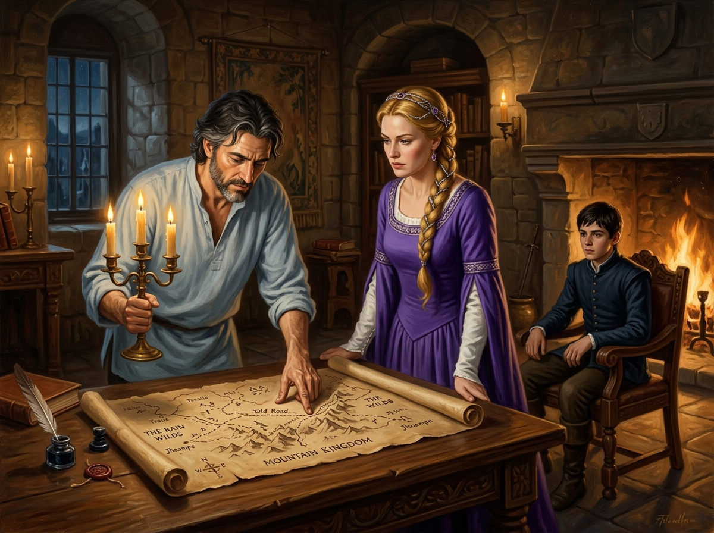

# 🖼️ 燭火地圖上的遠征盟約

## 閱讀節點

第十八章〈古靈〉中，珂翠肯特地梳洗盛裝，帶著群山王國的古老捲軸來到王儲惟真的書房。在深色橡木大桌上，展開了一幅褪色且抄寫粗糙的古老地圖，上面標示著睿智國王時代通往雨野原的隱秘小徑。長年受精技抽蝕而身形憔悴的惟真，取來蠟燭架俯身就近細看，眼中燃起了久違的熾熱渴望；珂翠肯神情尊貴而莊嚴，甚至主動提出由自己代替丈夫遠征獻祭。而在壁爐旁的椅上，被召來親歷這一幕的少年蜚滋，目睹了夫妻二人彼此理解卻注定要承受孤獨分離的決心。這張地圖成了惟真決意親征雨野原、追尋古靈傳說的起點。

## calli 的心得

看著王儲惟真手持銅燭台、彎著背將手指按在地圖小徑上的樣子，本小姐忍不住有些動容。🍷

作為死神見習生，我見多了無能為力下的掙扎與屈服。惟真這輩子都在為六大公國付出代價——他耗損精力坐在塔頂技傳，把士兵與姪兒送去邊境流血，卻眼睜睜看著戰艦傾頹、國勢日蹙。但他沒有選擇放棄，當珂翠肯把那張褪色的羊皮紙鋪在桌上時，他眼底燃燒的不是盲目的狂熱，而是一個窮途末路的戰士準備親自披甲上陣、以血肉孤注一擲的決絕。

畫面中，溫暖的壁爐火光與燭台暖黃映照在惟真泛白的鬈髮與疲憊的面龐上，淺藍亞麻襯衫顯得寬鬆，指節粗糙卻堅定；珂翠肯身著高雅的紫色王室長禮服，金髮編結綴以紫晶銀鏈，雙手按在桌緣，眼中既有對遠征艱險的洞悉，也有身為王后的崇高理解；十四歲的蜚滋穿著合身的深藍短上衣坐在壁爐前的靠背椅上，沉默而警覺地凝視著這場不可逆轉的歷史定格。沒有魔法的光效，只有羊皮紙上的墨痕與燭淚，卻比任何誓言都要沉重千倍。

## 場景規格與邊界

- `chapter`: `018`
- `narrative_moment`: 第 018 章中，惟真拿蠟燭架照亮珂翠肯帶來的古老地圖，兩人熱烈討論遠征雨野原的小徑，蜚滋在壁爐旁見證。
- `references`: `verity`, `ketricken`, `fitz_young_teen`, `verity_map_room`
- `composition`: 橫幅室內景；前景為沉重深色橡木長桌與展開的古老羊皮紙地圖；左側為手持三頭銅燭台俯身按圖的王儲惟真；中央為身穿紫袍、神情莊重按桌而立的王妃珂翠肯；右側為坐在石壁爐柴火旁高背木椅上的少年蜚滋；背景為古樸石牆、書架與冷夜高窗。
- `lighting`: 室內石壁爐與桌面燭火交織出的溫暖柔和光線，豐富的明暗對比，呈現古典巴洛克油畫的寫實厚重感。
- `must_preserve`: 惟真三十出頭、精瘦結實、鬢角略灰白的深色微捲短髮與鬍鬚、疲憊卻堅毅的眼神、簡潔淺藍亞麻襯衫；珂翠肯高雅深金髮辮帶珠寶飾品、深紫色長禮服配白色長袖；蜚滋十四歲深色短髮與深褐膚色、合身深藍短上衣與深色長褲；褪色的古地圖羊皮紙、墨水羽毛筆與石壁爐火。
- `must_not_reveal`: 不透露遠征古靈的最終結果或生死；不把精技能量畫成魔法發光；不出現未讀章節的宮廷政變或弒君背叛；無文字、無浮水印。
- `visual_check`: 三人外貌身形、服飾細節與角色關係完全契合原著描述；室內光影層次厚重自然，地圖道具與家具質感真實，符合小說插圖規範。

