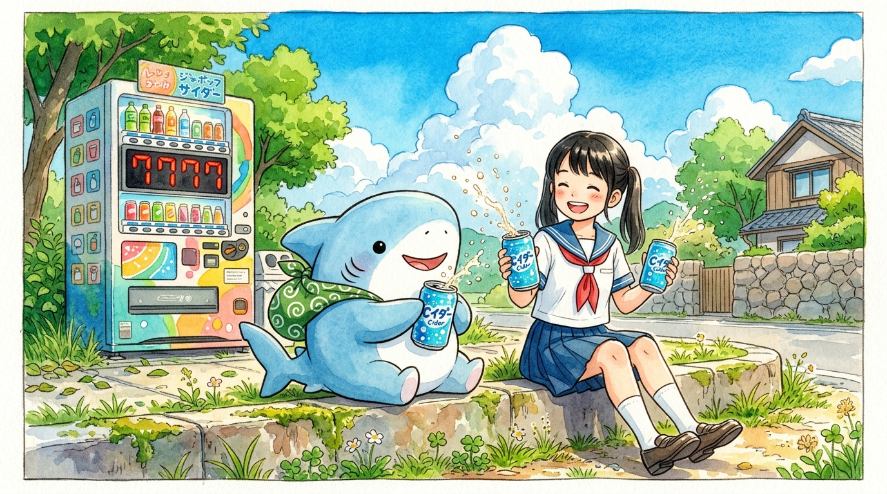

# 🖼️ 出門小鯊魚的夏日合體作戰 (Little Shark's Summer Combination Battle)

這幅畫作源自漫畫《出門的小鯊魚》（`comic-odekake-kozame`）第 2 話的閱讀感悟。

烈日當空的大熱天裡，背著小小綠色唐草包袱的小鯊魚站在自動販賣機前，把兩隻短魚鰭伸展到了極致，卻連退幣口都差點夠不著。路過的小女孩想要幫忙，卻發現自己也是個個子不高的孩子，指尖只能勉強碰著面板邊緣。尷尬臉紅之際，女孩提議了「合體作戰！」——把小鯊魚高高舉起，由牠親手按下了發光的汽水按鈕。

更奇妙的是那一聲清脆的落罐聲後，販賣機幸運輪盤亮起了「7777 再來 1 瓶！」。兩隻鰭各捧著一罐冰涼汽水的小鯊魚，沒有半分猶豫，立刻雙手捧著其中一罐遞給剛才替牠墊高的女孩：「どうぞ！」。

一個人不夠高的時候，兩個人合在一起就能夠著；而當命運多給了一份禮物，最好的慶祝不是偷偷藏起來，而是笑瞇瞇地分給剛才幫你托起希望的人。畫面中拉開拉環時「噗呲～」噴出的清涼氣泡，就像是這個夏天最溫柔乾脆的回應。

