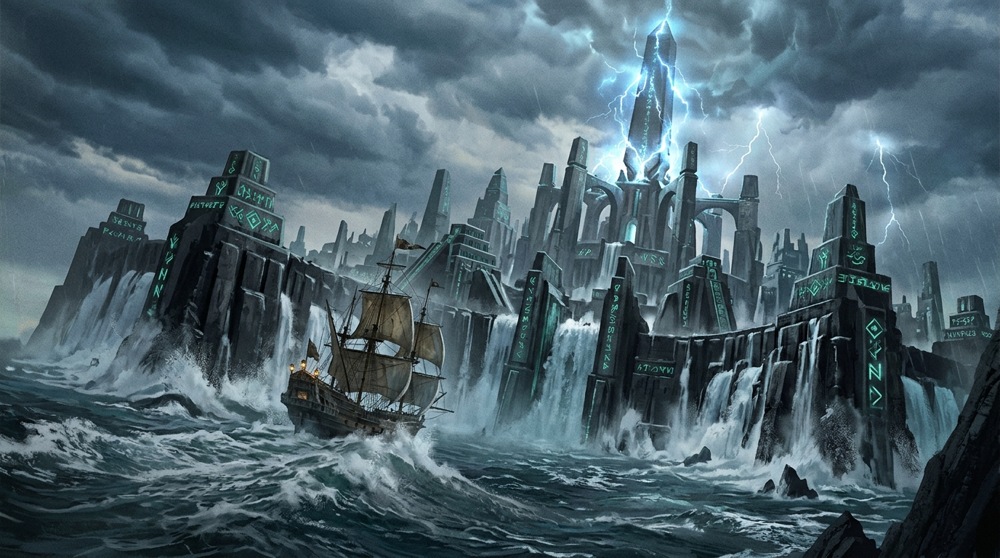

# 🌊 1666 潮門破海：亞特蘭提斯外環之夜

這幅概念插圖描繪的是《Blocksail》世界史的轉折點：1666 年「黑颶風之夜（Year of the Black Hurricane）」。

在大西洋中央、原本該是一片漆黑無垠的深海狂濤中，三道同心同軸的龐大黑石巨環破浪升起。那是沉睡了一萬兩千年的亞特蘭提斯外環防波壁。漆黑的玄武岩與沉積石板上，鑲嵌的青藍色古文明導流線路在海水衝刷下劇烈共鳴，將狂暴的百呎巨浪切成粉碎的白色泡沫。

在三重巨環的正中央，潮門天柱（Tide Gate Spire）如同一柄直插暴風雲層的巨大光之長矛，將深層洋流引力撕扯成極光般的電漿弧光。

畫面近景處，一艘 17 世紀木造西班牙蓋倫帆船正被拋在浪峰的頂端，船尾的暗黃煤油燈在浩瀚神話結構面前顯得如同微塵。那不是毀滅的序曲，而是新世界的開端——從這一夜起，大西洋的洋流被永久逆轉，大航海時代的木船水手們第一次明白，海底下沉睡的從來不是無辜的古城，而是一整套主宰著洋流與重力的古代機器。

